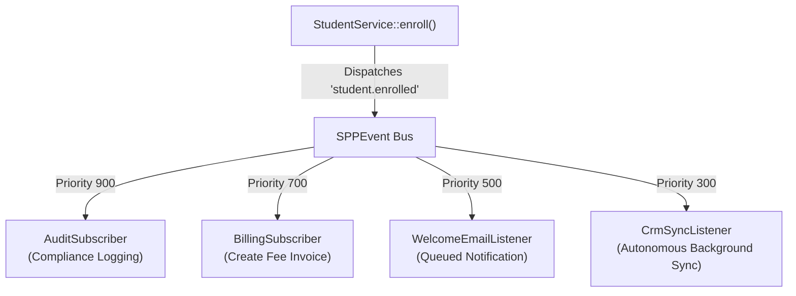
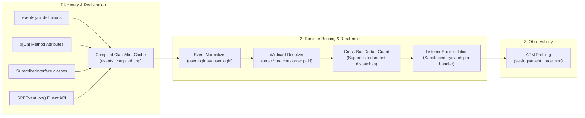

# Volume III — Runtime Infrastructure

## Chapter 4 — Events, EventHandler, SPPEvent, and Sovereign Enterprise Triggers

**Evidence:** `spp/core/class.sppevent.php`, `spp/core/class.eventparams.php`, `spp/core/class.eventrecord.php`, `spp/core/class.eventbuilder.php`, `spp/core/class.compoundtrigger.php`, `spp/core/interfaces/SubscriberInterface.php`, `spp/core/exceptions/EventAbortedException.php`, `spp/modules/spp/sppdb/class.sppentity.php`, `tests/core/test.event_system_resilience.php`.

If you have never used an event-driven framework before, the concept of an **event** may sound abstract. In ordinary procedural or basic object-oriented PHP, one method calls another method directly. When Class A needs something from Class B, it instantiates Class B or calls `ClassB::doSomething()`.

That direct approach works fine for small scripts. But as an enterprise system grows to hundreds of thousands of lines of code, direct calls create rigid, brittle dependencies:

> “Class A must know that Class B exists, Class B must know that Class C exists, and any small change in C breaks A.”

An **Event System** completely breaks this tight coupling:

> “A component simply announces to the world that something significant happened (`StudentCreated`, `OrderApproved`). It does not know or care who is listening. Other independent modules can react to that occurrence without modifying the original code.”

In the SPP framework, the event subsystem is not merely a naive callback array. It is an **enterprise-grade, high-resilience event bus and trigger engine** that blends:
1. **Modern Framework Features**: PSR-14 / Symfony-style Subscribers, Laravel-style fluent builders (`on()`, `once()`, `until()`), and transaction lifecycle hooks (`afterCommit()`, `onRollback()`).
2. **Sovereign Enterprise Trigger Paradigms**: `:OLD` and `:NEW` pseudorecords, change detection (`isDirty()`), declarative `WHEN` conditional triggers, cohesive **Compound Triggers**, domain application aborts (`abort()`), and isolated **Autonomous Execution Sandboxes** (`SPPEvent::autonomous()`).
3. **Kernel Resilience**: Microsecond tracing, automatic event name normalization (dot vs. colon), cross-bus deduplication, and per-listener error isolation.

---

## 4.1 The Coupling Problem: Before and After

To understand why SPP's event architecture exists, consider what happens when a student enrolls in a school application.

### The Coupled Approach (Anti-Pattern)

Without events, the student enrollment controller or service becomes an unmaintainable dump of secondary responsibilities:

```php
// Inside StudentService::enroll()
$student = new Student();
$student->name = $data['name'];
$student->email = $data['email'];
$student->save();

// Hard-coded secondary dependencies:
$mailer = new WelcomeEmailSender();
$mailer->send($student);

$billing = new FeeInvoiceGenerator();
$billing->createAdmissionInvoice($student);

$auditor = new AuditLogger();
$auditor->log('student_enrolled', $student->id);

$crmSync = new ExternalCrmSyncClient();
$crmSync->pushStudent($student);
```

Notice the critical design flaws:
1. **Fragile Transaction Boundaries**: If the `ExternalCrmSyncClient` throws a network timeout exception, does the student enrollment fail? In the direct approach, yes—even though the student was already saved in the database!
2. **Violates Single Responsibility Principle**: `StudentService` is now responsible for email formatting, accounting invoices, compliance logging, and third-party CRM protocols.
3. **Testing Nightmare**: Unit testing `StudentService` requires mocking five different external services.

### The Decoupled SPP Approach

With SPP's event engine, `StudentService` only focuses on student enrollment:

```php
// Inside StudentService::enroll()
$student = new Student();
$student->name = $data['name'];
$student->email = $data['email'];
$student->save();

// Simply announce what happened:
\SPP\SPPEvent::fireEvent('student.enrolled', ['student' => $student]);
```

The runtime architecture transforms into a clean, decoupled hub:



`StudentService` has zero knowledge of `AuditSubscriber`, `BillingSubscriber`, or `WelcomeEmailListener`. If you remove the CRM sync tomorrow, you don't touch `StudentService` at all!

---

## 4.2 Architecture of the Unified SPP Event Bus

In the SPP framework, the event subsystem is anchored by the kernel class `\SPP\SPPEvent`.

To eliminate historical confusion between modules, `\SPP\SPPEvent` is aliased directly to `\SPP\Core\EventManager` and `\SPP\EventManager`. All registrations, hook invocations, and subscriber auto-wirings route into a single, high-performance runtime bus.



### Key Architectural Invariants:

1. **Colon & Dot Notation Interchangeability**: Whether a legacy module dispatches `workflow:transition` or modern code listens to `workflow.transition`, SPP's normalizer treats them as identical keys.
2. **Wildcard Routing**: You can attach global audit listeners to patterns like `user.*` or `entity.*`. The resolver uses optimized regular expression caches to match events instantly.
3. **Cross-Bus Deduplication**: In historical codebases, some controllers fired both `SPPEvent::fireEvent('foo', $params)` and `Hook::invokeAll('foo', $params)`. SPP tracks recent dispatch fingerprints (within 100ms) to ensure listeners only execute **once**.
4. **Listener Fault Isolation**: If a third-party listener throws an unexpected `RuntimeException`, SPP catches the error, records it in the trace ledger, and allows all remaining listeners to execute cleanly.
5. **Recursion & Cycle Guards**: SPP prevents runaway event loops (e.g., Event A triggering Event B which re-triggers Event A) by imposing a strict recursion depth limit (maximum 25 total, 5 identical), preventing server memory exhaustion.

---

## 4.3 SPP Enterprise Domain Triggers: `:OLD`, `:NEW`, and Beyond

Enterprise applications require rock-solid lifecycle guarantees, state integrity, and transaction-aware execution. SPP natively incorporates five foundational enterprise trigger paradigms into its event engine:

### 1. `:OLD` and `:NEW` Pseudorecords

In database triggers:
- During an **UPDATE**, `:OLD` contains the original record values prior to modification, while `:NEW` contains the pending changes.
- During an **INSERT**, `:OLD` is empty, and `:NEW` contains the inserted data.
- During a **DELETE**, `:OLD` contains the deleted record, and `:NEW` is empty.

In SPP, every database model extending `\SPPMod\SPPDB\SPPEntity` automatically captures its pristine state in `$this->_snapshot` and exposes both `:OLD` and `:NEW` on `EventParams`:

```php
use SPP\SPPEvent;
use SPP\EventParams;

SPPEvent::on('entity:updating')
    ->handle(function(EventParams $params) {
        // Method accessors
        $oldPrice = $params->old('price');
        $newPrice = $params->new('price');

        // Property accessors (:OLD.price and :NEW.price)
        if ($params->new->price < $params->old->price * 0.5) {
            // Price cannot be reduced by more than 50% without manager sign-off!
            $params->abort('Discount ceiling exceeded', 403);
        }
    });
```

#### Supported Pseudorecord Access Patterns:

| Syntax Style | Example | Best Used For |
|---|---|---|
| **Property Syntax** | `$params->old->status`, `$params->new->status` | Clean, readable conditional checks |
| **Array Syntax** | `$params->old['status']`, `$params->new['status']` | Dynamic attribute lookups from variables |
| **Method Syntax** | `$params->old('status', 'draft')` | Supplying default values for optional fields |
| **Full Array Dump** | `$params->old()`, `$params->new()` | Bulk array comparison or audit serializing |

### 2. Built-in Dirty Checking & Change Inspection

Instead of manually writing comparisons like `$old['status'] !== $new['status']`, `EventParams` provides native change detection:

```php
// Check if a specific column changed:
if ($params->isDirty('status')) {
    echo "Status changed from {$params->old->status} to {$params->new->status}!";
}

// Check if ANY column on the entity changed:
if ($params->isDirty()) {
    echo "Record has pending changes.";
}

// Retrieve an associative array of all delta changes:
$changes = $params->getChanges();
// Yields: ['salary' => ['old' => 50000, 'new' => 60000]]
```

### 3. Declarative `WHEN` Conditional Triggers

In enterprise databases, declarative conditions like `WHEN (NEW.status = 'approved' AND OLD.status != 'approved')` prevent the trigger from executing unnecessarily.

In SPP, you use the fluent `->when()` builder:

```php
SPPEvent::on('entity:updating')
    ->when(fn(EventParams $p) => $p->isDirty('status') && $p->new->status === 'approved')
    ->handle(function(EventParams $p) {
        // This callback ONLY runs when status transitions to 'approved'!
        NotificationService::sendApprovalNotification($p->entity);
    });
```

If the `WHEN` closure returns `false`, SPP short-circuits execution immediately without executing the callback.

### 4. Sovereign Compound Triggers (`CompoundTrigger`)

In complex enterprise workflows, managing four separate listeners for `before_save`, `updating`, `after_save`, and `error` leads to fragmented code.

SPP solves this with **Compound Triggers**, grouping all stages of an entity's lifecycle into one cohesive file. SPP implements this via `\SPP\Event\CompoundTrigger`:

```php
namespace App\School\Triggers;

use SPP\Event\CompoundTrigger;
use SPP\EventParams;

class StudentEnrollmentTrigger extends CompoundTrigger
{
    public static function targetEvent(): string
    {
        return 'entity:student'; // Listens to student entity lifecycles
    }

    public static function priority(): int
    {
        return 750; // Higher priority
    }

    public function when(EventParams $params): bool
    {
        // Only trigger for active admissions
        return $params->new('admission_status') !== 'archived';
    }

    public function before(EventParams $params): void
    {
        // Validation / Pre-calculation before database write
        if (empty($params->new->enrollment_date)) {
            $params->entity->set('enrollment_date', date('Y-m-d'));
        }
    }

    public function after(EventParams $params): void
    {
        // Post-commit actions (e.g., generate student ID card)
        StudentBadgeService::issueBadge($params->entity);
    }

    public function onError(\Throwable $e, EventParams $params): void
    {
        // Recovery logic if an exception occurred during the save chain
        \SPPMod\SPPLogger\SPP_Logger::error("Enrollment failed for student: " . $e->getMessage());
    }
}
```

Registration is one line:
```php
StudentEnrollmentTrigger::register();
```

### 5. Application Abort (`abort()`)

When a business rule is violated, calling `$params->abort($message, $code)` halts the trigger chain, rolls back the transaction, and throws an `EventAbortedException` with an explicit application error code:

```php
SPPEvent::on('entity:saving')
    ->handle(function(EventParams $params) {
        if ($params->new->grade_level > 12) {
            // Halts propagation and throws an EventAbortedException:
            $params->abort("Invalid school grade level: {$params->new->grade_level}", 422);
        }
    });
```

- When `$params->abort()` is called, event propagation stops instantly.
- SPP throws `\SPP\Exceptions\EventAbortedException`, which your controller or API layer can catch to return an HTTP `422 Unprocessable Entity` or `400 Bad Request`.
- If you pass `$throw = false` (`$params->abort('Warning', 400, false)`), SPP halts propagation softly without throwing an exception, setting `$params->isAborted() === true`.

### 6. Autonomous Execution Sandboxes (`autonomous()`)

An autonomous execution sandbox executes independently of the main transaction. If the main transaction rolls back, the autonomous logging or security audit still commits safely without being rolled back.

In SPP, `SPPEvent::autonomous(callable $callback)` provides an isolated execution sandbox:

```php
SPPEvent::on('user.login_attempt')
    ->handle(function(EventParams $params) {
        // Ensure security audit logs are ALWAYS persisted even if subsequent handlers crash
        SPPEvent::autonomous(function() use ($params) {
            SecurityAuditLedger::record([
                'ip' => $_SERVER['REMOTE_ADDR'] ?? '127.0.0.1',
                'username' => $params->get('username'),
                'timestamp' => time()
            ]);
        });
    });
```

Any unexpected exception inside `SPPEvent::autonomous()` is safely logged without ever aborting the outer business flow.

---

## 4.4 Modern Framework Features

SPP's event engine incorporates the most popular features from Laravel, Symfony, and Spring:

### 1. Fluent `EventBuilder` via `SPPEvent::on()`

Instead of verbose array configurations, use the intuitive fluent interface:

```php
SPPEvent::on('invoice.generated')
    ->priority(800)
    ->when(fn($p) => $p->get('total') > 10000) // High-value invoices only
    ->once()                                    // Unbind after first execution
    ->handle(function(EventParams $params) {
        ExecutiveAlerts::notifyHighValueTransaction($params->get('invoice'));
    });
```

### 2. Single-Use Listeners (`SPPEvent::once()`)

Need a listener to run only once (such as initializing a background worker or verifying a one-time setup)? Use `once()`:

```php
SPPEvent::once('kernel.booted', function() {
    DatabaseConnectionPool::warmup();
});
```

After its first execution, SPP automatically removes the listener from memory.

### 3. Short-Circuiting Evaluation (`SPPEvent::until()`)

Inspired by Laravel's `Event::until()`, this pattern executes registered listeners in priority order and returns the **first non-null response**, stopping any further listeners from running:

```php
// Register authorization policies:
SPPEvent::on('task.authorize_delete')->priority(900)->handle(function($p) {
    if ($p->user->isAdmin()) return true; // Superuser override
    return null; // Defer to next policy
});

SPPEvent::on('task.authorize_delete')->priority(500)->handle(function($p) {
    return $p->task->owner_id === $p->user->id; // Owner check
});

// Evaluate:
$isAllowed = SPPEvent::until('task.authorize_delete', ['task' => $task, 'user' => $currentUser]);
```

### 4. Database Transaction Hooks (`afterCommit` & `onRollback`)

A common anti-pattern in web applications is sending an email or webhook before the database transaction actually commits. If the database commit fails, the user receives an email for an order that does not exist!

SPP solves this natively via transaction lifecycle integration with `\SPPMod\SPPDB\SPPDB`:

```php
use SPP\SPPEvent;

// Inside an order controller:
$db->transaction(function() use ($order) {
    $order->save();
    $payment->process();

    // Defer side-effects until the database physically commits:
    SPPEvent::afterCommit(function() use ($order) {
        EmailService::sendOrderConfirmation($order);
        WarehouseWebhook::notifyShipmentReady($order);
    });

    // Register compensation in case of transaction failure:
    SPPEvent::onRollback(function() use ($order) {
        PaymentGateway::voidHold($order->payment_id);
    });
});
```

- If no transaction is active, `SPPEvent::afterCommit()` executes immediately.
- If a transaction is active, the callback is queued in memory and executed only after `SPPDB::commit()` succeeds.
- If the transaction rolls back, all `afterCommit` callbacks are safely discarded, and any registered `onRollback` callbacks execute.

### 5. Asynchronous Background Queue Dispatch (`SPPEvent::queue()`)

To offload time-consuming tasks to background worker daemons without blocking the user's HTTP response:

```php
// Pushes the event to the SPPQueue / DAG job orchestrator:
SPPEvent::queue('report.generate_annual_ledger', [
    'fiscal_year' => 2026,
    'requested_by' => $user->id
]);
```

If the queue module is not installed or configured, SPP automatically falls back to synchronous execution without throwing an error.

---

## 4.5 Structured Subscribers (`SubscriberInterface`)

When an application has dozens of related events (e.g., an Authentication or Order module), registering separate closures in an `init.php` file clutters the codebase.

The standard solution is a **Subscriber Class** implementing `\SPP\Event\SubscriberInterface`:

```php
namespace App\School\Subscribers;

use SPP\Event\SubscriberInterface;
use SPP\EventParams;

class UserLifecycleSubscriber implements SubscriberInterface
{
    /**
     * Maps event names to handler method names and optional priorities.
     */
    public static function getSubscribedEvents(): array
    {
        return [
            'user.registered' => 'onRegistered',
            'user.login' => ['onLogin', 800],           // High priority
            'user.password_reset' => ['onPasswordReset', 500],
            'user.*' => 'onAnyUserAction',              // Wildcard listener
        ];
    }

    public function onRegistered(EventParams $params): void
    {
        $user = $params->get('user');
        // Welcome flow...
    }

    public function onLogin(EventParams $params): void
    {
        // Update last login timestamp...
    }

    public function onPasswordReset(EventParams $params): void
    {
        // Security notification...
    }

    public function onAnyUserAction(EventParams $params): void
    {
        // General audit trail...
    }
}
```

### Auto-Wiring Subscribers

You can register subscribers either by class name or instance:

```php
// Auto-wires all events declared in getSubscribedEvents():
\SPP\SPPEvent::registerSubscriber(UserLifecycleSubscriber::class);
```

Furthermore, any legacy handler extending `\SPP\EventHandler` that implements `getSubscribedEvents()` is automatically detected and auto-wired by the constructor.

---

## 4.6 Developer CLI Tooling

The SPP framework includes first-class command-line tools for inspecting and testing your event pipeline.

### 1. Listing All Active Listeners

To inspect all registered event listeners, their priorities, and their handler classes:

```bash
php spp.php event:list-listeners
```

**Output:**
```text
Event listeners registered in app context: default
--------------------------------------------------
Event: entity:updating (Listeners: 2)
  -> App\School\Triggers\StudentEnrollmentTrigger::onBefore (Priority: 750)
  -> Closure (Priority: 500)
Event: user.registered (Listeners: 1)
  -> App\School\Subscribers\UserLifecycleSubscriber::onRegistered (Priority: 500)
Event: user.login (Listeners: 1)
  -> App\School\Subscribers\UserLifecycleSubscriber::onLogin (Priority: 800)
```

### 2. Manually Firing Events from the Terminal

To test event listeners and queue pipelines without having to click through the web UI:

```bash
php spp.php event:fire --event=user.registered --payload='{"user_id":42,"email":"student@school.edu"}'
```

**Output:**
```text
Firing event 'user.registered'...
Event triggered successfully.
```

---

## 4.7 Hands-on Tutorial: Building a Secure Order Discount Trigger

Let's build a practical real-world scenario from scratch: **a sovereign discount ceiling validator trigger with change tracking and post-commit notifications**.

### Step 1: Create the Entity Model

```php
namespace App\Shop\Entities;

use SPPMod\SPPDB\SPPEntity;

class Order extends SPPEntity
{
    // Attributes declared in etc/entities/order.yml:
    // id, customer_id, total_amount, discount_percent, status
}
```

### Step 2: Register the Discount Validation Trigger

We want to prevent anyone from setting a discount greater than 20% unless their role is `manager`:

```php
use SPP\SPPEvent;
use SPP\EventParams;

SPPEvent::on('entity:updating')
    ->when(fn(EventParams $p) => $p->isDirty('discount_percent'))
    ->priority(900) // Run before database write
    ->handle(function(EventParams $p) {
        $oldDiscount = $p->old->discount_percent ?: 0;
        $newDiscount = $p->new->discount_percent;

        if ($newDiscount > 20) {
            $currentUser = \SPPMod\SPPAuth\SPPAuth::user();
            if (!$currentUser || !$currentUser->hasRole('manager')) {
                // Abort with explicit application error:
                $p->abort("Discount of {$newDiscount}% requires Manager authorization.", 403);
            }
        }
    });
```

### Step 3: Register the Post-Commit Fulfillment Notification

```php
SPPEvent::on('entity:updated')
    ->when(fn(EventParams $p) => $p->isDirty('status') && $p->new->status === 'paid')
    ->handle(function(EventParams $p) {
        // Safe transaction hook: only executes once the DB physically commits!
        SPPEvent::afterCommit(function() use ($p) {
            WarehouseService::dispatchOrder($p->entity);
        });
    });
```

### Step 4: Testing the Implementation

```php
$order = Order::find(101);
$order->set('discount_percent', 35);

try {
    $order->save();
} catch (\SPP\Exceptions\EventAbortedException $e) {
    echo "Validation halted: " . $e->getMessage();
    // Outputs: Validation halted: Discount of 35% requires Manager authorization.
}
```

---

## 4.8 Kernel Hacker: Execution Trace & Troubleshooting

When an event does not behave as expected, follow this systematic debugging checklist:

1. **Verify Registration**: Run `php spp.php event:list-listeners` to verify that your listener or subscriber appears under the event name.
2. **Inspect the Execution Trace**: Check `var/logs/event_trace.json`. SPP automatically records the timestamp, stage (`before`, `main`, `default`, `after`), duration in milliseconds, and any error message for every executed handler:
   ```json
   {
       "event": "entity:updating",
       "timestamp": 1729249800.124,
       "handlers": [
           {
               "stage": "main",
               "name": "App\\School\\Triggers\\StudentEnrollmentTrigger::onBefore",
               "stopped": false,
               "duration": 0.42
           }
       ]
   }
   ```
3. **Check `isPropagationStopped()`**: An earlier listener with higher priority may have called `$params->stopPropagation()` or `$params->abort()`.
4. **Inspect `WHEN` Conditions**: If using `SPPEvent::on()->when()`, verify that the condition closure returns `true` for the given input payload.
5. **Clear Compiled Event Caches**: If you added new `#[On]` attributes or modified `events.yml`, delete `var/cache/events_compiled.php` so the runtime re-scans the definitions.

---

## Chapter Summary & Best Practices

| Best Practice | Description |
|---|---|
| **Use `:OLD` and `:NEW`** | Always inspect `$params->old` and `$params->new` rather than querying the database a second time to see previous values. |
| **Use `isDirty()`** | Guard business logic with `$params->isDirty('column')` to avoid executing expensive side-effects on unchanged records. |
| **Always Use `afterCommit()` for Side Effects** | Never send emails, trigger webhooks, or charge credit cards inside active database transactions; wrap them in `SPPEvent::afterCommit()`. |
| **Group Related Hooks into `CompoundTrigger`** | When an entity requires multiple lifecycle hooks (`before`, `after`, `onError`), group them into a single `CompoundTrigger` class. |
| **Favor `abort()` over Generic Exceptions** | Call `$params->abort($message, $code)` to halt event propagation cleanly with domain-specific error codes. |
