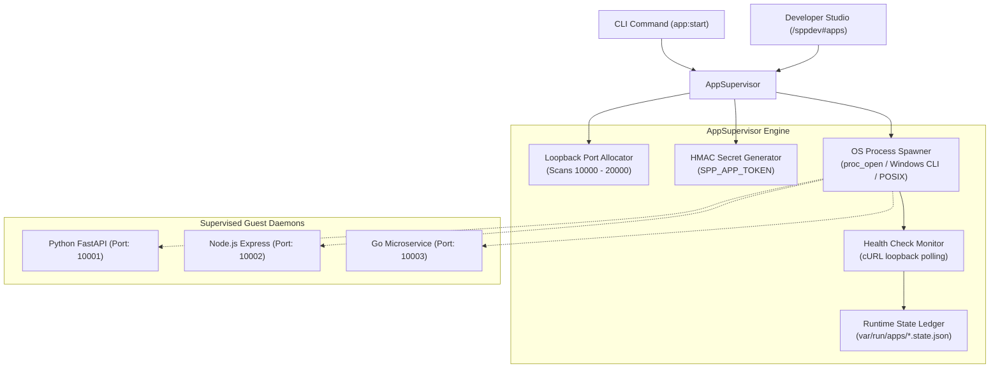
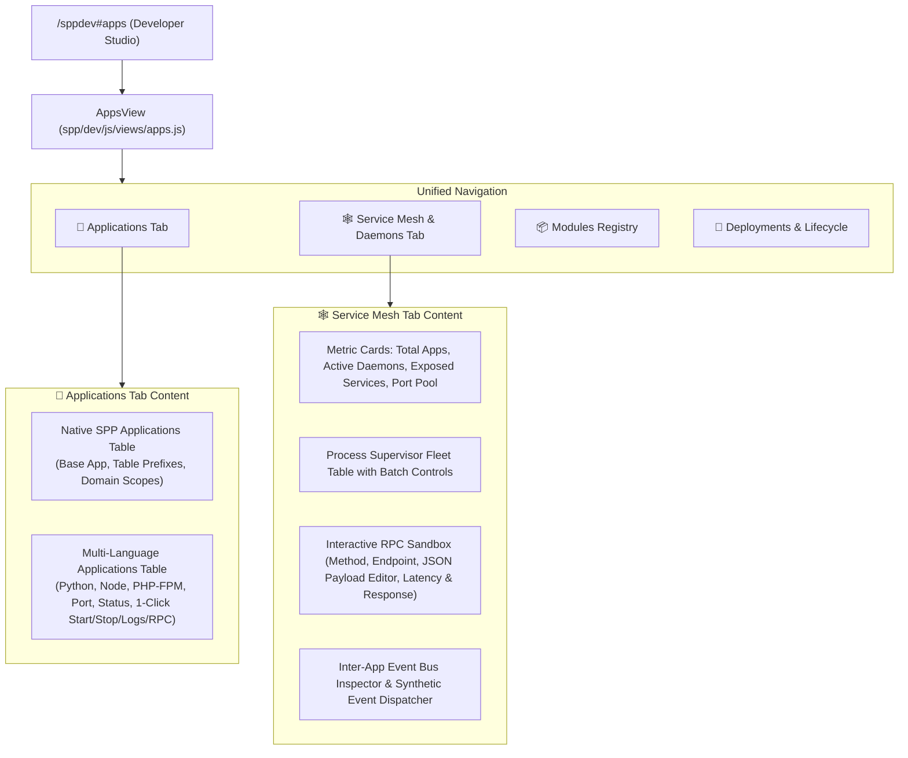

# Volume VIII — Integration Architecture

## Chapter 10 — Polyglot Bridges, Multi-Language Application Hosting & Sovereign Service Mesh

**Evidence:** `etc/apps.yml`, `spp/core/apps/ForeignAppRegistry.php`, `spp/core/apps/SubpathVirtualizer.php`, `spp/core/apps/SubpathGateway.php`, `spp/core/apps/AppSupervisor.php`, `spp/core/apps/MeshServiceDispatcher.php`, `spp/core/apps/Mesh.php`, `spp/lib/mesh/`, `spp/commands/AppSupervisor*.php`, `spp/commands/Mesh*.php`, `spp/dev/js/views/apps.js`, `spp/core/Polyglot/`, `spp/lib/polyglot/`, and `tests/core/test.multi_language_app_mesh.php`.

A serious enterprise system rarely lives entirely inside one PHP codebase.

You may already have:

- a Python machine-learning service (FastAPI, PyTorch, LangChain);
- a Node.js real-time collaborative service (Express, Socket.io, NestJS);
- a Go high-concurrency microservice (Gin, Fiber);
- a standalone WordPress or Laravel installation running on PHP-FPM;
- a static Single Page Application (Vite, React, Vue); or
- another SPP application context.

If you have never studied enterprise software architecture, the most important concept to learn first is **process and runtime boundaries**.

PHP code runs inside a PHP runtime. Python code runs inside a Python virtual environment. A guest application has its own request lifecycle, memory space, and dependency graph. These systems do not magically share in-memory PHP objects merely because they sit on the same server.

They need an **integration boundary**.

SPP provides two distinct, complementary integration tiers:

1. **In-Process Code Bridges (`SPP\Core\Polyglot`)**: Synchronous and asynchronous function-level invocations across language boundaries via compilers, CLI adapters, and specialized worker processes.
2. **Sovereign Multi-Language Application Integrator & Service Mesh (`ForeignAppRegistry`, `SubpathVirtualizer`, `AppSupervisor`, `\SPP\Mesh`)**: Transparent hosting and orchestration of complete external applications running under server route directories (`/blog`, `/ai`, `/chat`) or dedicated subdomains (`ai.myserver.com`), with ambient Single Sign-On (SSO), cross-platform process supervision, dynamic port mapping, mutual RPC calling, and unified Developer Studio management at `/sppdev#apps`.

---

## 10.1 What is a Polyglot Architecture?

“Polyglot” in software engineering means **using more than one programming language or runtime because different components of an enterprise require different strengths**.

For example:

```text
SPP / PHP
   ↓
Core Institutional ERP, Workflow Engine, CQRS & Domain Models

Python (FastAPI / PyTorch)
   ↓
Predictive Analytics & AI Inference Microservice

Node.js (Express / WebSockets)
   ↓
Real-Time Chat & Collaborative Canvas

PHP-FPM (WordPress / Laravel)
   ↓
Public Marketing Blog & Knowledge Base
```

The architectural goal is not "use every language for the sake of it."

The goal is:

> **Give each subsystem the runtime best suited to its workload, while providing a single, sovereign host that supervises their lifecycles, virtualizes their ingress routes, and unifies their communication into a single pane of glass.**

---

## 10.2 The Two Integration Paradigms in SPP

Before writing code, understand the architectural distinction between the two integration paradigms:

| Dimension | Tier 1: In-Process Code Bridges (`Polyglot`) | Tier 2: Application Hosting & Service Mesh (`Mesh`) |
| :--- | :--- | :--- |
| **Primary Units** | Functions, scripts, compilers, code snippets. | Full guest applications, microservices, daemons, SPAs. |
| **Mounting** | Called internally within PHP controllers/services. | Mounted on public subpaths (`/ai`) or subdomains (`ai.domain.com`). |
| **Execution** | Ephemeral process invocation or worker pool. | Supervised background daemons with persistent loopback ports. |
| **Networking** | STDIN/STDOUT pipes, local sockets, or CLI flags. | Transparent HTTP reverse proxy, FastCGI multiplexer, or WebSockets. |
| **Identity & SSO** | Passed as raw method arguments. | Automatic HMAC-SHA256 signed user claims passed via ingress headers. |
| **Management UI** | `/sppdev#polyglot` Studio. | `/sppdev#apps` & `/sppdev#mesh` Unified Developer Workbench. |

---

## 10.3 Declarative Application Manifest & Catalog (`etc/apps.yml`)

The backbone of SPP's multi-language hosting is the declarative application manifest located at `etc/apps.yml`.

In this file, developers declare every native and external application participating in the system:

```yaml
version: '2.0'

apps:
  # 1. Native SPP ERP Application (Mounted at Server Root)
  school:
    type: spp
    name: "School ERP"
    route: /
    enabled: true

  # 2. Standalone WordPress Running on Dedicated PHP-FPM Pool
  blog:
    type: php-fpm
    name: "Campus Editorial Blog"
    route: /blog
    subdomain: blog.school.local
    root_dir: apps/wordpress
    fpm_socket: 127.0.0.1:9000
    enabled: true
    virtualization:
      rewrite_redirects: true
      rewrite_html_base: true
      rewrite_cookie_paths: true

  # 3. Supervised Python FastAPI Microservice
  ai_engine:
    type: python
    name: "AI Analytics Microservice"
    route: /ai
    subdomain: ai.school.local
    root_dir: apps/ai_engine
    command: "python -m uvicorn main:app --host 127.0.0.1 --port {PORT}"
    health_check: /health
    enabled: true
    spp_integration:
      ambient_sensing: true
      service_mesh: true
      expose_services:
        - name: ai.predict
          endpoint: /api/predict
          method: POST
          description: "Predict student performance and dropout risk"
        - name: ai.summarize
          endpoint: /api/summarize
          method: POST
          description: "Summarize course transcripts and notes"

  # 4. Supervised Node.js Real-Time Service
  chat:
    type: node
    name: "Campus Live Chat"
    route: /chat
    root_dir: apps/chat
    command: "node server.js"
    health_check: /health
    enabled: true
```

### Route & Subdomain Resolution (`ForeignAppRegistry`)

At boot time, `ForeignAppRegistry` parses `etc/apps.yml`. When an incoming HTTP request arrives at `public/index.php` or `spp/router.php`, `ForeignAppRegistry::resolveApp($path, $host)` evaluates:

1. **Subdomain Matching**: If the incoming `Host` header matches a declared `subdomain` (e.g. `ai.school.local`), the request is instantly routed to that application.
2. **Longest Route Prefix Matching**: If accessed via URL paths (e.g. `https://school.local/ai/api/predict`), the router sorts registered applications by route length in descending order (`/ai` before `/`). The longest matching prefix claims the request.
3. **Subpath Extraction**: The matched prefix (`/ai`) is stripped from the request URI to calculate the internal `$subPath` (`/api/predict`) delivered to the guest daemon.

---

## 10.4 The Subpath Virtualization Dilemma & The SPP Solution

Mounting guest applications inside route directories (e.g. `myserver.com/blog` or `myserver.com/ai`) is notoriously difficult in traditional architectures. It frequently leads to three catastrophic failures:

1. **Broken Relative Assets**: The guest app emits HTML linking to `<script src="assets/app.js">`. The browser resolves this relative to root (`myserver.com/assets/app.js`), triggering 404 errors.
2. **Redirect Loops & Directory Escapes**: A guest app issues an HTTP redirect `Location: /login`. The browser navigates to the host root (`myserver.com/login`), escaping the guest application subpath completely.
3. **Cookie Path Collisions**: Session cookies set by guest apps overwrite or collide with host session cookies on `/`.

### How SPP Solves This (`SubpathVirtualizer`)

SPP introduces a bi-directional virtualization layer between the client and the guest daemon:

```mermaid
sequenceDiagram
    autonumber
    participant Browser as Browser Client
    participant Kernel as SPP Gateway (SubpathVirtualizer)
    participant Guest as Guest Microservice (Python / Node / PHP)

    Browser->>Kernel: GET /ai/dashboard (Session Cookie: spp_session=abc)
    Note over Kernel: Ingress Virtualization: Build Headers & Sign Claims
    Kernel->>Guest: GET /dashboard<br/>X-Forwarded-Prefix: /ai<br/>X-SPP-User-Id: 42<br/>X-SPP-Signature: hmac_sha256(...)
    Guest->>Kernel: HTTP 302 Found<br/>Location: /login<br/>Set-Cookie: session=xyz; Path=/
    Note over Kernel: Egress Virtualization: Rewrite Redirects, Cookies & Inject <base>
    Kernel->>Browser: HTTP 302 Found<br/>Location: /ai/login<br/>Set-Cookie: session=xyz; Path=/ai/
```

1. **Ingress Header Virtualization**:
   - `X-Forwarded-Prefix: /ai`: Informs the guest application of its mount path.
   - `X-Forwarded-Host` & `X-Forwarded-Proto`: Informs the guest app of the public domain and SSL state.
   - `X-SPP-Gateway: sovereign-mesh`: Confirms to the guest app that it is running inside the SPP mesh.
   - **Signed SSO User Claims**: If an authenticated SPP user is logged in, the gateway computes an HMAC-SHA256 signature using `SPP_APP_TOKEN` and passes `X-SPP-User-Id`, `X-SPP-User-Email`, `X-SPP-Claims`, and `X-SPP-Signature`. The guest app verifies the signature and authenticates the user instantly.

2. **Egress Response Virtualization**:
   - **`Location:` Header Rewriting**: If the guest returns `Location: /login` or `Location: http://127.0.0.1:10042/login`, `SubpathVirtualizer::rewriteRedirectLocation()` rewrites it to `/ai/login`.
   - **Cookie Scoping**: If the guest sets `Set-Cookie: session_id=...; Path=/`, the path is rewritten to `Path=/ai/`, preventing cookie bleed.
   - **HTML `<base>` Injection**: If the response is HTML, the virtualizer scans `<head>` and injects `<base href="/ai/">`. All relative CSS, JavaScript, and image URLs resolve perfectly without touching a single line of the guest application's code!

---

## 10.5 Sovereign Cross-Platform Process Supervision (`AppSupervisor`)

Traditional systems force developers to install external process supervisors like Docker, PM2, or Supervisord. This creates massive friction on developer machines, especially across Windows, Linux, and macOS.

SPP features a native, cross-platform process supervisor (`\SPP\Core\Apps\AppSupervisor`):



### Key Supervisor Capabilities:

1. **Dynamic Loopback Port Allocation**: Scans ports `10000–20000` to find a guaranteed free port. The allocated port is passed to the daemon command via the `{PORT}` placeholder (e.g. `uvicorn main:app --port {PORT}`).
2. **Environment Variable Injection**: Injects `SPP_HOST=1`, `SPP_APP_ID`, `PORT`, `SPP_ROUTE_PREFIX`, `SPP_APP_TOKEN`, and `SPP_GATEWAY_URL`.
3. **Cross-Platform Process Spawning**:
   - On Windows: Uses background WScript/CMD wrappers to spawn detached processes with tracked PIDs.
   - On Linux/macOS: Uses `nohup` and POSIX signal handling (`kill -0` for alive checks, `kill -15` for graceful termination).
4. **State Persistence & Log Streaming**: Writes daemon metadata to `var/run/apps/{app_id}.state.json` and streams all stdout/stderr directly to `var/run/apps/{app_id}.log`.

### CLI Supervisor Commands

Developers manage all multi-language daemons using high-level CLI commands:

```bash
# Start all multi-language daemons
php spp.php app:start all

# Start a specific daemon
php spp.php app:start ai_engine

# Check live operational status
php spp.php app:status

# Inspect real-time stdout/stderr log stream
php spp.php app:logs ai_engine --tail=50

# Restart daemon and reload configuration
php spp.php app:restart ai_engine

# Stop daemons gracefully
php spp.php app:stop all
```

### Request-Driven Applications vs. Supervised Background Daemons

`AppSupervisor` intelligently distinguishes between **request-driven applications** and **persistent background daemons**:

1. **Request-Driven Applications (`type: php-fpm`, `php`, `static`, `spp`)**:
   - Standard PHP web applications (such as WordPress, Drupal, or Laravel) and static SPAs do not maintain persistent TCP listener processes.
   - When an HTTP request targets `/blog`, the web server (Apache/Nginx) or SPP's `SubpathGateway` dispatches the request on-demand to the local PHP-FPM worker pool or executes it in-process.
   - In `/sppdev#apps` and the CLI status table, these applications display `Ready (PHP-FPM)`, `Ready (PHP Engine)`, or `Ready (Static)`. They do not require `▶ Start` or `⏹ Stop` lifecycle buttons because the PHP engine is always ready to handle incoming web traffic on demand.
2. **Supervised Background Daemons (`type: python`, `node`, `go`, `rust`, `ruby` or any app with an explicit `command: ...`)**:
   - Microservices written in Python (e.g. FastAPI/Uvicorn), Node.js (e.g. Express/Nest), or compiled binaries (Go/Rust) run as persistent background daemon processes listening on private loopback ports.
   - `AppSupervisor` dynamically allocates ports (e.g. `10042`), spawns processes, polls health endpoints, tracks OS PIDs, streams logs to `var/run/apps/*.log`, and offers `Start`, `Stop`, and `Restart` lifecycle controls.

---

## 10.6 Ambient Sensing & Zero-Dependency Guest SDKs

Guest applications do not need heavy framework libraries to talk to SPP. SPP provides standalone, zero-dependency SDKs for Python, Node.js, and PHP.

### Python SDK (`spp/lib/mesh/python/spp_mesh.py`)

In a Python FastAPI application:

```python
from fastapi import FastAPI, Request
from spp_mesh import SPPMesh

app = FastAPI()
mesh = SPPMesh()

# 1. Ambient Sensing
if mesh.is_spp_managed():
    print(f"🚀 Running under SPP at route: {mesh.route_prefix}")

# 2. Seamless Single Sign-On (SSO)
@app.get("/api/profile")
async def get_profile(request: Request):
    # Validates HMAC-SHA256 signature against SPP_APP_TOKEN
    user = mesh.get_auth_user(dict(request.headers))
    if not user:
        return {"error": "Unauthorized"}, 401
    return {"message": f"Hello, {user['email']} (ID: {user['id']})"}

# 3. Inter-App Service Calling (Invoking Peer Services)
@app.post("/api/predict")
async def predict(data: dict):
    # Call another guest service or native SPP endpoint
    chat_response = mesh.call_service("chat", "/api/notify", {"text": "Prediction complete!"})
    
    # Broadcast an event across the SPP event bus
    mesh.publish_event("ai.prediction_completed", {"score": 98.5})
    return {"status": "ok", "prediction": 98.5}
```

### Node.js SDK (`spp/lib/mesh/node/spp_mesh.js`)

In an Express or NestJS application:

```javascript
const express = require('express');
const { SPPMesh } = require('./spp_mesh');

const app = express();
const mesh = new SPPMesh();

app.get('/api/live-status', (req, res) => {
    const user = mesh.getAuthUser(req.headers);
    res.json({
        spp_managed: mesh.isManaged,
        active_user: user ? user.email : 'Anonymous',
        route_prefix: mesh.routePrefix
    });
});
```

### Drop-In WordPress SSO Bridge

For WordPress applications hosted at `/blog`:
1. Drop `spp/modules/optional/sppapps/plugins/wordpress/spp-sso-bridge.php` into `wp-content/plugins/`.
2. When an authenticated SPP user navigates to `https://myserver.com/blog/`, the bridge verifies the HMAC user claims and logs them into WordPress instantly as Administrator or Subscriber. **Zero login screens, zero duplicate passwords!**

---

## 10.7 Sovereign Inter-App Service Mesh (`\SPP\Mesh`)

The SPP Service Mesh allows native PHP controllers, CQRS commands, workflows, and CLI scripts to invoke guest microservices directly:

```php
// 1. Invoke a Python FastAPI microservice from native PHP
$prediction = \SPP\Mesh::call('ai_engine', '/api/predict', [
    'student_id' => 101,
    'features'   => [85, 92, 78]
]);

// 2. Publish an event into the unified event bus
\SPP\Mesh::publishEvent('student.evaluated', [
    'student_id' => 101,
    'prediction' => $prediction
]);

// 3. Discover all registered microservices across the entire server
$services = \SPP\Mesh::listServices();
```

### Automatic Daemon Bootstrapping
When `\SPP\Mesh::call('ai_engine', ...)` is called, the mesh checks if the target daemon is running. If stopped, it **boots the daemon on demand**, waits for the health check to pass, and forwards the request without failing!

### CLI Service Mesh Commands

```bash
# Discover exposed microservice endpoints
php spp.php mesh:services

# Call an endpoint directly from the command line
php spp.php mesh:call ai_engine /api/predict '{"student_id": 42}' --method=POST
```

---

## 10.8 Unified Developer Studio (`/sppdev#apps` & `/sppdev#mesh`)

To ensure developers do not have to hop between different browser tabs and terminals, all native and multi-language application management features are unified directly into `/sppdev#apps`.



### 1. Unified Application Inventory (`#apps`)
- Displays native SPP apps and multi-language guest apps in one consolidated view.
- Language badges (🐍 `Python`, 🟢 `Node.js`, 🐘 `PHP-FPM`, 🐹 `Go`, 📄 `Static SPA`).
- Ingress link (`📁 /ai ↗`) and subdomain link (`🌐 ai.school.local`).
- Supervisor status (`🟢 Running on Port 10001, PID 14208` or `🔴 Stopped`).
- Inline actions: `▶️ Start`, `⏹️ Stop`, `🔄 Restart`, `📜 Logs`, `⚡ RPC`, `🌐 Open`.

### 2. Service Mesh & Daemons Studio (`#apps?tab=mesh` or `#mesh`)
- **Fleet Metrics**: Live counts of Total Apps, Active Daemons, Exposed Mesh Services, and Dynamic Port Pool (`10000 - 20000`).
- **Batch Supervisor Controls**: `▶️ Start All`, `⏹️ Stop All`, `🔄 Refresh`.
- **Interactive RPC Sandbox**: Select an application, pick an auto-discovered endpoint (e.g. `POST /api/predict`), edit JSON payload with auto-formatting, and execute live calls with latency (ms) and response inspection.
- **Cross-App Event Bus Inspector**: Fire synthetic domain events and verify real-time propagation across native subscribers and guest microservices.

---

## 10.9 Production Web Server Synthesis (Apache, Nginx, Caddy)

While SPP's internal gateway multiplexer (`SubpathGateway`) handles routing automatically during development or single-entry setups, production servers benefit from generating optimized web server configuration files:

```bash
php spp.php server:configure --domain=school.example.com --app=school
```

This command inspects `etc/apps.yml` and generates production virtual host files in `domains/_vhosts/`:

- **Nginx (`nginx-school.example.com.conf`)**:
  ```nginx
  location /ai/ {
      proxy_pass http://127.0.0.1:10042/;
      proxy_set_header Host $host;
      proxy_set_header X-Forwarded-Prefix /ai;
      proxy_http_version 1.1;
      proxy_set_header Upgrade $http_upgrade;
      proxy_set_header Connection "upgrade";
  }
  ```
- **Apache (`apache-school.example.com.conf`)**:
  ```apache
  ProxyPass /ai/ http://127.0.0.1:10042/
  ProxyPassReverse /ai/ http://127.0.0.1:10042/
  RequestHeader set X-Forwarded-Prefix "/ai"
  ```
- **Caddy (`caddy-school.example.com.conf`)**:
  ```caddy
  handle_path /ai/* {
      reverse_proxy 127.0.0.1:10042
  }
  ```

---

## 10.10 Verification with Parikshak

Every feature of the Multi-Language Application Integrator and Service Mesh is covered by comprehensive automated tests in SPP's primary native testing engine, **Parikshak** (`\SPPMod\Parikshak\SPPTestCase`):

```bash
php spp.php test tests/core/test.multi_language_app_mesh.php
```

```text
Running tests for [school1]...
✔ PASS Tests\Core\MultiLanguageAppMeshParikshakTest::testRoutePrefixAndSubdomainResolution
✔ PASS Tests\Core\MultiLanguageAppMeshParikshakTest::testSubpathVirtualizerIngressHeadersAndSsoSigning
✔ PASS Tests\Core\MultiLanguageAppMeshParikshakTest::testSubpathResponseRewriting
✔ PASS Tests\Core\MultiLanguageAppMeshParikshakTest::testAppSupervisorPortAllocationAndRuntimeState
✔ PASS Tests\Core\MultiLanguageAppMeshParikshakTest::testServiceMeshDiscoveryAndEventBus
✔ PASS Tests\Core\MultiLanguageAppMeshParikshakTest::testAmbientPhpMeshClient
✔ PASS Tests\Core\MultiLanguageAppMeshParikshakTest::testServerConfiguratorGeneratesSubpathRules
✔ PASS Tests\Core\MultiLanguageAppMeshParikshakTest::testCommandBridgeAndDeveloperAdminMeshIntegration

Test Run Summary:
Total: 8, Passed: 8, Failed: 0 (100% Pass Rate)
```

---

## 10.11 Common Beginner Mistakes

1. **Mistake: Hardcoding Absolute URLs in Guest Applications**:
   If your guest app renders `<a href="/dashboard">`, it forces the browser to the root domain. Always use relative links (`<a href="dashboard">`) or read the injected `X-Forwarded-Prefix` header.
2. **Mistake: Storing Loopback Ports in Hardcoded Configs**:
   Do not hardcode port numbers like `8000` or `5000`. Use the `{PORT}` placeholder in `etc/apps.yml` so `AppSupervisor` can dynamically assign available ports and prevent port collision conflicts.
3. **Mistake: Hopping Between Multiple Terminal Windows**:
   Do not run separate terminals for every microservice. Use `php spp.php app:start all` or the `/sppdev#apps` dashboard to supervise all daemons and stream their logs in one place.
4. **Mistake: Bypassing the Gateway for Inter-App Communication**:
   Do not make raw curl calls to hardcoded ports. Use `\SPP\Mesh::call($appId, $endpoint, $payload)` which handles automatic daemon boot-up, health verification, and distributed tracing context propagation.
