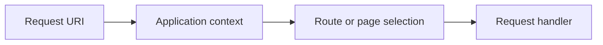
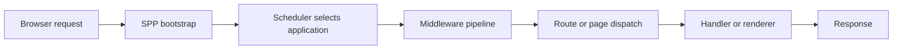
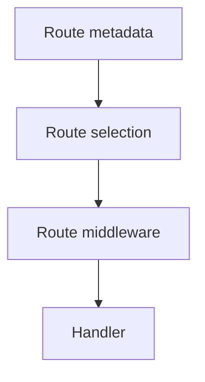
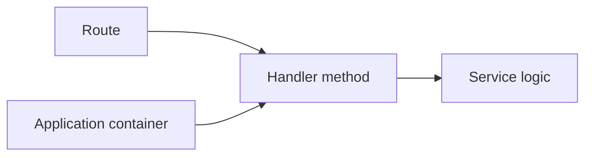
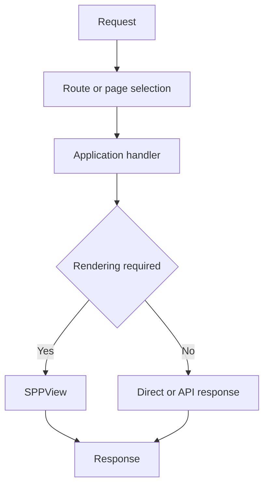
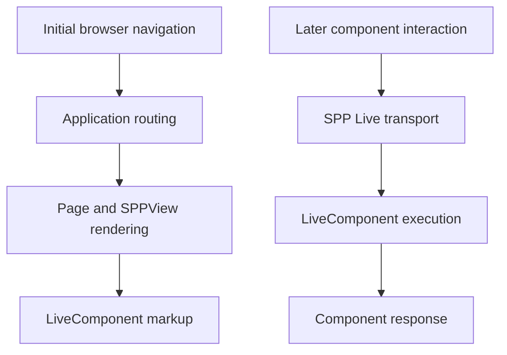
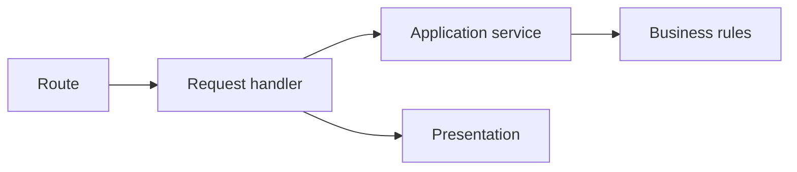
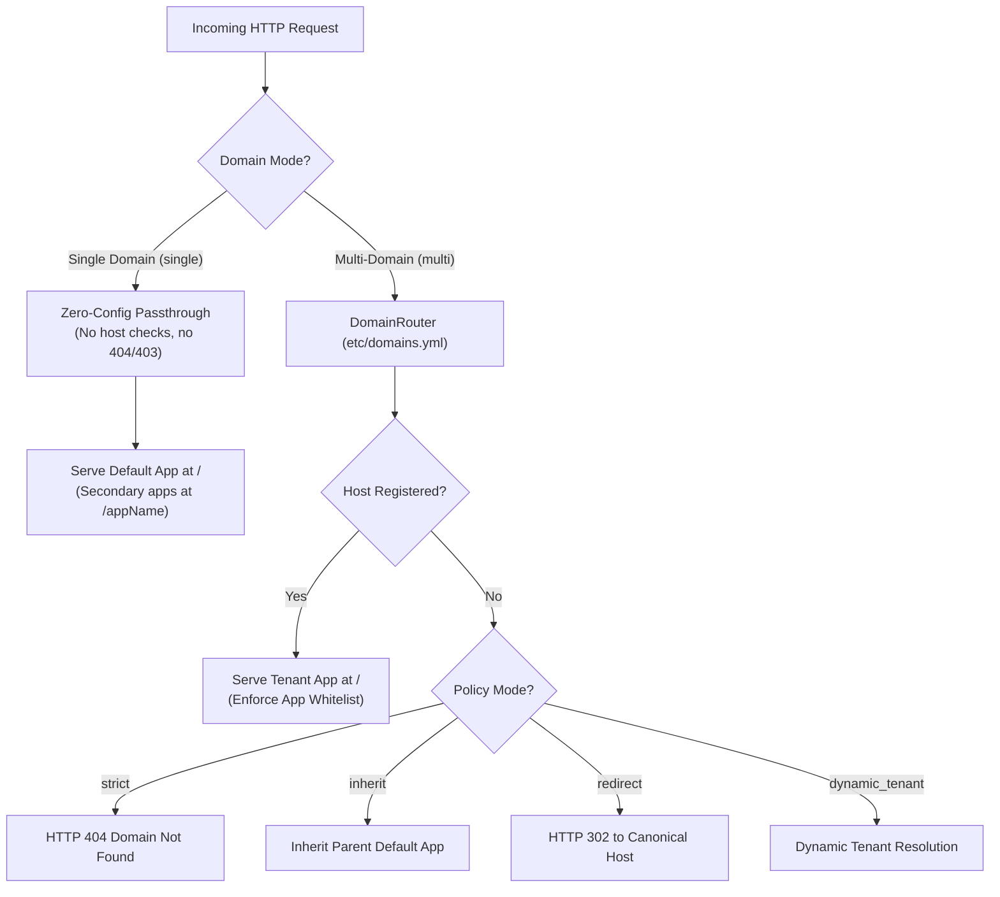
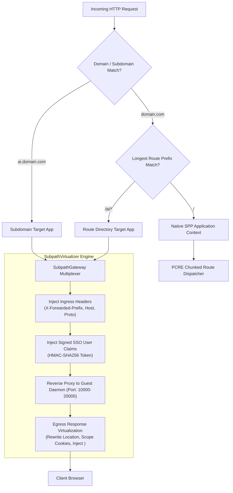

# Volume IX — Building Applications

## Chapter 15 — Routing and Request Dispatch

**Evidence:** `documentation/framework/booting-and-app-loading.md`, `documentation/framework/application-development.md`, `documentation/framework/middleware.md`, SPPView route/view-router classes and route attributes in the source tree.

If you have never used a framework, **routing** is simply the mechanism that answers this question:

> **A web request has reached the correct application. Which piece of application code should handle it?**

That sounds simple, but SPP separates the problem into several layers. Understanding those layers is essential in a multi-application framework.

---

## 15.1 First learn the difference between application selection and routing

Suppose the browser requests:

```text
/myapp/admin/users
```

Before SPP can decide which endpoint handles `/admin/users`, it needs to know which application owns `/myapp`.

So there are at least two decisions:

1. **Application selection** — choose the SPP application context.
2. **Route selection** — choose the endpoint/page/handler inside that application.

The relationship is:



This is one of the most important differences between SPP's Scheduler and ordinary routing terminology.

---

## 15.2 What is a route?

A route is a mapping between an incoming request and application behavior.

A conceptual route might say:

```text
GET /admin/users
        ↓
UsersController::index()
```

The browser does not call `UsersController::index()` directly. It calls a URL.

The routing infrastructure turns that URL into an executable destination.

---

## 15.3 Why the framework needs routing

Without a routing system, every public PHP file would need to understand its own URL and manually decide what to do.

A router centralizes that mapping.

As the application grows, you get relationships such as:

```text
/admin/users       → user management
/admin/reports     → report management
/api/students      → API handler
/dashboard         → dashboard page
```

Routing turns those URLs into application behavior in a predictable way.

---

## 15.4 SPP does not have to use one universal route file

This is an important SPP-specific documentation rule.

The repository contains different application and rendering mechanisms. Depending on the enabled modules and application architecture, request dispatch can involve:

- route attributes;
- page definitions;
- view routing;
- API routing;
- controller methods;
- service handlers; or
- LiveComponent paths.

Therefore this handbook does **not** invent one universal `routes.php` format and claim that every SPP application uses it.

The actual route mechanism must be learned from the active routing/view module and its source.

---

## 15.5 Attribute-based routes

The SPP middleware documentation shows route declarations using the SPP View attribute system.

A simple example is:

```php
use SPPMod\SPPView\Attributes\Route;

class UsersController
{
    #[Route('/admin/users')]
    public function index()
    {
        // ...
    }
}
```

The route attribute tells the framework that the method participates in route discovery.

The exact constructor/options supported by `Route` are defined by the current attribute implementation.

Do not copy a route attribute signature from Laravel or Symfony and assume it is valid in SPP.

---

## 15.6 Application URL versus route URL

Beginners often confuse these two:

| Concept | Example | Question answered |
|---|---|---|
| Application `base_url` | `/myapp` | Which application is active? |
| Route | `/admin/users` | Which endpoint inside the application handles the request? |

So the complete public path can conceptually be:

```text
/myapp + /admin/users
```

The Scheduler is concerned with the first decision. The routing layer is concerned with the second.

---

## 15.7 Where routing sits in the request pipeline

Routing happens after earlier framework stages have prepared the application/runtime.

A useful learning model is:



Middleware can reject the request before routing completes, which is why a route that “looks correct” may still never execute.

---

## 15.8 Route-level middleware

SPP's route metadata can also carry middleware.

For example, the framework documentation shows a route-specific declaration such as:

```php
#[Route('/api/data', middleware: [RateLimiterMiddleware::class])]
public function getData()
{
    // ...
}
```

The important composition is:



This lets a route declare additional request-processing requirements without making those requirements global to every URL.

---

## 15.9 Controllers are common, but they are not the whole model

A controller is simply a class containing request-facing methods.

SPP applications can use controllers, but request dispatch may also target other kinds of application behavior depending on the active architecture.

Possible destinations include:

- controller methods;
- page definitions;
- API handlers;
- service methods;
- rendering pages; and
- LiveComponent-related paths.

The framework is therefore more general than “every route must instantiate a controller”.

---

## 15.10 Routing and dependency injection work together

Routing answers:

> **Which handler should run?**

Dependency injection answers:

> **How should that handler receive its dependencies?**

For example:

```php
class HomeController
{
    public function index(SiteService $site): string
    {
        return $site->title();
    }
}
```

The route selects `HomeController::index()`.

The application container can supply the `SiteService` dependency when the method is invoked through the app's `call()` mechanism.

This is a useful architecture boundary:



The router does not need to know how the `SiteService` object is constructed.

---

## 15.11 What if no route matches?

The exact fallback/error behavior depends on the routing/page subsystem in use.

For debugging, first separate two different failures:

### Case A — Correct application, wrong route

The Scheduler selected the expected application, but that application does not expose the requested endpoint.

### Case B — Wrong application, correct route

The route exists, but the Scheduler selected a different application context.

Those are very different problems.

For Case A, investigate route/page discovery.

For Case B, investigate:

```php
\SPP\Scheduler::getContext();
```

and the application's `base_url` configuration.

---

## 15.12 Routing and SPPView

SPPView contains view location/routing/page infrastructure as well as rendering components.

But routing and rendering are still different responsibilities.

A request may route to something that returns an API response and never renders HTML.

Or it may route to a page that renders through SPPView.

A useful model is:



This distinction becomes especially useful when an application contains both browser pages and APIs.

---

## 15.13 Routing and LiveComponent

A LiveComponent can participate in a page without being the same thing as the page's route.

### Initial navigation

The browser may request a normal application URL, which goes through ordinary application routing/page rendering.

### Later interaction

The browser can then send a live action through SPP Live to update the component.

So there are two related flows:



The later live request is not necessarily the same route dispatch that produced the original page.

---

## 15.14 API routing

The SPP middleware documentation identifies API routing infrastructure such as `SPPAPI` and `AutoApiRouter` as possible destinations after middleware processing.

That means one SPP application can support multiple request styles:

```text
Browser HTML requests
API requests
LiveComponent interactions
```

The framework can route each into its appropriate subsystem without requiring separate framework installations.

---

## 15.15 Enterprise route ownership

Large applications become easier to maintain when routes have a clear owner.

A useful ownership model is:

| Concern | Owner |
|---|---|
| Application URL prefix | Application configuration |
| Feature route | Module/application feature |
| Authentication | Middleware/auth subsystem |
| Resource authorization | Application/domain policy |
| Business behavior | Service/domain layer |
| HTML rendering | SPPView |
| Server-reactive interaction | LiveComponent + SPP Live |
| Browser-local reactivity | SPPUX |

This avoids the common anti-pattern where a giant central route file contains business decisions for the entire application.

---

## 15.16 A route should not become a business workflow

A route should identify the entry point.

A controller/handler should coordinate request-specific work.

A service should contain reusable business behavior.

A view/component should present the result.

For example:



This separation makes the same business service reusable from a web page, API, scheduled task, or other application entry point.

---

## 15.17 Debugging route problems systematically

When a URL fails, use this order.

### Step 1 — Confirm the application context

```php
\SPP\Scheduler::getContext();
```

### Step 2 — Check middleware

Could global or route-level middleware be rejecting the request before the handler?

### Step 3 — Check route/page discovery

Does the selected application actually define this endpoint?

### Step 4 — Check handler resolution

Does the handler exist, and can the application container resolve its dependencies?

### Step 5 — Check rendering

If the handler executes but HTML is wrong, move your investigation to SPPView.

### Step 6 — Check Live/UX transport separately

If the initial page works but later component interaction fails, investigate SPP Live or SPPUX rather than continuing to debug the original route.

---

## 15.18 Coming from other frameworks

### Laravel

The mapping to `routes → controller → middleware → Blade` is useful, but SPP adds an explicit Scheduler/application-context stage before ordinary route handling.

### Symfony

Think of SPP routing as a routing/dispatch concern layered inside an application context, with SPP's own route attributes and view integration.

### Django

Think URL pattern → view, but distinguish application-context selection from URL endpoint selection.

### React/Vue

Client-side routing and SPP server routing are different problems. SPPUX can manage browser-side UI behavior, but PHP routing remains a server-side application concern.

---

## 15.19 Common beginner mistakes

### Mistake 1 — Confusing `base_url` with route path

`base_url` helps select the application. A route selects an endpoint inside that application.

### Mistake 2 — Assuming middleware runs after routing

Global middleware can prevent the request from ever reaching the route destination.

### Mistake 3 — Assuming every endpoint must be a controller

SPP supports broader request/dispatch patterns.

### Mistake 4 — Putting business rules into route definitions

Keep business logic in application/domain services.

### Mistake 5 — Debugging Live interactions as normal routing failures

Initial navigation and later LiveComponent interactions can use different runtime paths.

---

## 15.21 Domain Operational Modes: Single Domain vs. Multi-Domain

The SPP framework can be deployed either as a standard single-domain application platform or as a high-density, multi-tenant virtual host engine.



### 1. Single Domain Mode (`mode: single`)
* **Zero Configuration ("Just a copy paste will do")**: Domain routing is completely optional, not required, and not enforced. Simply copying and pasting an SPP installation onto any web server, shared hosting account (e.g. cPanel `public_html`), standard Apache/Nginx DocumentRoot, or server IP address serves immediately.
* **No Host Header Rejection**: No HTTP 404 "Domain not configured" errors and no HTTP 403 "Application disabled on domain" errors. Any incoming host or IP address is accepted transparently.
* **Transparent Default App Serving**: Serves the configured default application directly at root (`/`), while all secondary registered apps remain accessible via their base URLs (e.g. `/sppadmin`, `/api`).
* **Automatic Graceful Fallback**: If `etc/domains.yml` is absent or contains no registered domains, SPP automatically defaults to Single Domain Mode without requiring any configuration files.

### 2. Multi-Domain Mode (`mode: multi`)
* **Virtual Host Multi-Tenancy**: Incoming `Host` headers are actively matched against registered patterns in `etc/domains.yml`.
* **Domain Scoping & Isolation**: Enforces tenant-specific applications (`domains/<domain>/src/<app>`), per-domain permissions, canonical host aliases (e.g. `www.` to root domain), and SSL enforcement.
* **Policy Modes**: Unmapped hosts or subdomains enforce strict isolation policies (`strict`, `inherit`, `redirect`, `dynamic_tenant`, `permissive`).

### Switching Between Modes

You can inspect and toggle modes instantly via the SPP CLI or through the SPPAdmin and SPPDev web consoles:

#### CLI Commands
```bash
# View active architecture mode and policy
php spp.php domain:mode

# Switch to Single Domain Mode (Copy-paste ready for any host/IP)
php spp.php domain:mode single

# Switch to Multi-Domain Mode with strict virtual host isolation
php spp.php domain:mode multi strict
```

#### SPPAdmin & SPPDev Visual Console
Both **SPPAdmin** (`/sppadmin/#domains`) and **SPPDev** (`/sppdev/#domains`) include a dedicated **Domain Architecture Mode Switcher**:
* **Real-Time Mode Indicator**: Displays a color-coded status badge (`🟢 Single Domain Mode (Active - Routing Not Required)` vs `🌐 Multi-Domain Mode (Active - Virtual Hosts Enforced)`).
* **1-Click Mode Toggling**: Instantly flip between Single Domain Mode and Multi-Domain Mode with a single button click. The change is atomically persisted to `etc/domains.yml` via `DomainAdminService::setDomainMode()`.
* **Integrated Virtual Host Policy Selector**: In Multi-Domain mode, configure the unmapped subdomain/host policy directly from the dropdown (`Strict 404`, `Inherit Parent`, `302 Redirect`, `Dynamic Tenant`, or `Permissive`).
* **App Domain Scoping Controls**: In the App Studio Console (`#apps`), developers can configure application scope (`🌍 Global` vs `🔒 Domain-Only`), restricting specific apps to authorized domains with immediate visual validation badges.

---

## 15.22 Multi-Tenant Domain-Driven Routing (`DomainRouter`)

In production environments, a single SPP framework instance frequently powers multiple domains, brands, or institutional portals (e.g. `portal.school1.edu`, `alumni.school1.edu`, `admissions.school1.edu`).

SPP's **DomainRouter** (`\SPP\Core\Router\DomainRouter`) evaluates incoming `Host` headers before route matching occurs. It resolves the active domain configuration from `etc/domains.yml`:

```yaml
domains:
  portal.school1.edu:
    canonical_host: "portal.school1.edu"
    default_app: "student_portal"
    apps:
      - "student_portal"
      - "library"
    vhost_policy: "strict"
    ssl:
      enabled: true
      force_https: true

  alumni.school1.edu:
    canonical_host: "alumni.school1.edu"
    default_app: "alumni_network"
    apps:
      - "alumni_network"
```

### Domain Routing Mechanics:
1. **Host Normalization**: Strips port numbers (`:8080`), normalizes casing, and resolves against canonical domain names or aliases.
2. **5-Tier Host Resolution Algorithm**:
   - **Tier 1 (Exact Match)**: Direct lookup in `domains.yml` patterns (`example.com`, `docs.localhost`).
   - **Tier 2 (Wildcard Match)**: Pattern matching using `fnmatch` (e.g. `*.example.com`, `*.docs.localhost`).
   - **Tier 3 (Declared Aliases)**: Evaluation against declared primary or wildcard aliases (with optional 301 canonical redirects).
   - **Tier 4 (Candidate App Subdomain Auto-Detection)**: If an incoming virtual host starts with `<app>.<domain>` (e.g. `app.example.com`) and `<app>` corresponds to an installed SPP application, DomainRouter dynamically synthesizes a virtual host mapping to serve that application at root (`/`), respecting parent domain access restrictions.
   - **Tier 5 (Mode-Aware Fallback)**:
     - In **Single Domain Mode** (`mode: single`): Unmapped hosts bypass virtual host checks and serve the default application (`base_app`) immediately with zero 404 blocking ("just a copy paste will do").
     - In **Multi-Domain Mode** (`mode: multi`): Unmapped subdomains trigger the configured policy (`strict` 404, `inherit` parent default app, `redirect` 302, or `dynamic_tenant` hook).
3. **Canonical Redirection**: If an incoming request hits an alias (e.g. `www.school1.edu`), DomainRouter automatically issues a 301 Permanent Redirect to `school1.edu` with full query string preservation.
4. **Application Context Resolution**: Determines the `default_app` for the domain, allowing the application to be served directly from root (`/`) without requiring prefix URLs like `/student_portal`.
5. **App Access Whitelisting**: Verifies that the requested application is explicitly allowed on the active domain.
6. **Central Web Server / cPanel Configuration**: For centralized front-controller architectures like SPP, subdomains and virtual hosts (e.g. `app.example.com`) must point their web server `DocumentRoot` to the framework root directory (`public_html`) containing `index.php` and `.htaccess`, ensuring all traffic flows through SPP's `Scheduler`.

---

## 15.23 Domain Scoping & Application Access Control (`domain:app:scope`)

Security policies often dictate that high-privilege applications (such as administrative tools, financial accounting, or developer portals) must never be accessible across public tenant domains.

SPP enforces this via **Domain Application Scoping**:

```bash
# Lock the finance application so it is ONLY accessible on accounting.school1.internal
php spp.php domain:app:scope finance --domain-only --allow=accounting.school1.internal

# Allow an application across multiple approved domains
php spp.php domain:app:scope lms --allow=school1.edu,elearning.school1.edu

# Reopen an application globally across all domains
php spp.php domain:app:scope marketing --global
```

When an unauthorized domain attempts to invoke a domain-restricted application, SPP's router immediately terminates the pipeline with an **HTTP 403 Forbidden** security response, preventing reconnaissance and multi-tenant data leaks.

---

## 15.24 Domain-Specific Isolated Applications (`domains/<domain>/src/<AppName>`)

Beyond logical routing rules, enterprise tenants often require **physical code isolation**. SPP supports physical domain-isolated applications stored under:

```text
domains/
  portal.school1.edu/
    src/
      custom_plugin/
        Controllers/
        Models/
```

### Key Architectural Invariants:
- **Physical Boundary**: Code in `domains/<domain>/src/<app>` is physically segregated from other domains.
- **Strict Accessibility**: Requests hitting other domains cannot load or invoke this code under any circumstances.
- **Scaffolding Tooling**: Scaffolded via `php spp.php domain:app:install <domain> <appName> [--make-default]`.

---

## 15.25 Virtual Host Policy Modes (Strict, Addon, Parked, Subdomains)

SPP supports four declarative virtual host policy modes defined in `etc/domains.yml`:

| Mode | Behavior | Use Case |
|---|---|---|
| `strict` | Requests must match configured routes or return 404/403. | High-security corporate & ERP systems. |
| `addon` | Functions as an independent website with isolated docroot and applications. | Multi-tenant agency hosting & school branches. |
| `parked` | Aliases that mirror the primary domain with 301 canonical redirects. | Secondary TLDs (`.net`, `.org`) and `www` prefixes. |
| `subdomain` | Automatically inherits parent domain configurations or routes dynamically. | Dynamic student portals (`user.school1.edu`). |

Manage modes via CLI:
```bash
# Set virtual host mode
php spp.php domain:mode portal.school1.edu --mode=addon

# Create an addon domain linked to an application
php spp.php domain:addon sub.school1.edu --app=lms --root=/var/www/sub
```

---

## 15.26 Server Provisioning, Host Autodiscovery, and Reverse Proxy Guidance

SPP is completely generic and does **not** assume hardcoded domains or fixed installation paths. The universal server configuration gateway discovers network interfaces, server IP addresses, hostnames, and web server software automatically:

```bash
# Run server audit and virtual host generator
php spp.php domain:server:configure --mode=setup --domain=portal.school1.edu
```

### Supported Web Server Configurations:
1. **Apache VirtualHost**: Generates clean directives with `mod_rewrite`, `.htaccess` fallbacks, and optional `X-Sendfile` acceleration.
2. **Nginx Server Block**: Generates high-performance `try_files` directives, fastcgi socket configurations, and `X-Accel-Redirect` locations.
3. **Microsoft IIS**: Generates `web.config` XML URL Rewrite rules for Windows Server.
4. **Caddy & FrankenPHP**: Generates clean Caddyfile server blocks with automatic TLS.

### User Home Hosting (`/home/<user>/...`):
For cPanel, DirectAdmin, and multi-user Linux hosting, SPP provides automated directory traversal guidance (`chmod +x /home/<user>`) and web server group access (`usermod -aG <user> www-data`) to prevent `403 Forbidden` file permission errors.

---

## 15.27 Application Decommissioning, Standalone Backups, and Restoration Engine

In dynamic enterprise environments, applications must be decommissioned, migrated, or restored with zero downtime and complete data integrity.

### 1. Uninstallation Modes (`AppUninstaller`)
```bash
# Config-Only Mode: Unregisters domain bindings and routing, cleans caches, preserves src/
php spp.php app:uninstall legacy_app --config-only

# Full Purge Mode with Pre-Removal Safety Backup
php spp.php app:uninstall old_crm --full --backup
```

### 2. Standalone Portable Backups (`var/backups/apps/`)
When `--backup` is specified, SPP bundles the application source code (`src/<app>`), configurations (`etc/apps/<app>`), resources, SQLite database, and domain bindings into a single portable `.zip` archive containing a structured `manifest.json`.

### 3. Application Restoration Engine
```bash
# Reconstruct code, configurations, SQLite database, and domain bindings from archive
php spp.php app:restore old_crm_20261025_001106.zip --force
```

### 4. Storage Reclamation
```bash
# List all backups and disk usage
php spp.php app:backup --list

# Delete an obsolete archive to free disk space
php spp.php app:backup --delete=old_crm_20261025_001106.zip

# Purge all historical archives for a specific app
php spp.php app:backup --purge=old_crm
```

---

## 15.27 Multi-Language Application Ingress & Subpath Virtualization

Beyond native SPP PHP applications, SPP's routing infrastructure natively supports hosting **multi-language applications** (Python FastAPI/Flask, Node.js Express/Nest, Go Gin/Fiber, standalone PHP-FPM WordPress/Laravel, and static SPAs) inside route directories (e.g. `/ai`, `/chat`, `/blog`) and dedicated subdomains (e.g. `ai.domain.com`).



### 1. Ingress Header & Claims Injection
Before forwarding the request to the loopback port (`10000–20000`) of the supervised daemon, `SubpathVirtualizer` injects:
- `X-Forwarded-Prefix: /ai`
- `X-Forwarded-Host` & `X-Forwarded-Proto`
- `X-SPP-Gateway: sovereign-mesh`
- HMAC-SHA256 signed user claims (`X-SPP-User-Id`, `X-SPP-User-Email`, `X-SPP-Signature`) for automatic Single Sign-On (SSO).

### 2. Egress Response Virtualization
When the guest daemon replies, `SubpathVirtualizer` automatically virtualizes the response:
- **`Location:` Header Rewriting**: Rewrites redirects (e.g. `Location: /login` becomes `Location: /ai/login`), preventing directory escapes.
- **Cookie Path Scoping**: Rewrites `Path=/` to `Path=/ai/`, preventing session bleed across subpaths.
- **HTML `<base>` Injection**: Scans `<head>` and injects `<base href="/ai/">`, ensuring relative links and asset paths resolve out-of-the-box without modifying guest code.

---

## 15.28 Kernel Hacker: multiple selectors

The most useful expert mental model is that SPP request handling contains **multiple selectors**.

1. **Domain Selection**: `DomainRouter` identifies the active tenant domain, virtual host policy, and domain-isolated application directory.
2. **Multi-Language App & Subpath Gateway**: `ForeignAppRegistry` checks if the request matches a non-SPP guest application route directory (`/ai`, `/chat`, `/blog`) or dedicated subdomain, delegating to `SubpathGateway` and `SubpathVirtualizer`.
3. **Application Selection**: For native SPP applications, `Scheduler` selects the application context based on domain default or base URL prefix.
4. **Access Guarding**: Domain Scoping checks whether the application is permitted on the active host (blocking with 403 on violations).
5. **Middleware Pipeline**: Global and route middleware verify authentication, rate limits, and security headers.
6. **Route Selection**: PCRE `(*MARK:mX)` chunked router selects the endpoint destination.
7. **Handler Resolution & Response**: The destination executes and streams presentation markup or data.

### Source map

- `spp/core/apps/ForeignAppRegistry.php`
- `spp/core/apps/SubpathVirtualizer.php`
- `spp/core/apps/SubpathGateway.php`
- `spp/core/apps/AppSupervisor.php`
- `spp/core/routing/providers/ForeignAppRouteServiceProvider.php`
- `etc/apps.yml`
- `spp/core/router/class.domainrouter.php`
- `spp/core/class.appuninstaller.php`
- `spp/bin/spp-domain-installer.php`
- `spp/commands/DomainAppScopeCommand.php`
- `spp/commands/DomainAddonCommand.php`
- `spp/commands/DomainModeCommand.php`
- `spp/commands/AppUninstallCommand.php`
- `spp/commands/AppRestoreCommand.php`
- `spp/commands/AppBackupCommand.php`
- `spp/core/class.scheduler.php`
- `spp/core/class.middlewarekernel.php`
- `spp/core/class.pipeline.php`
