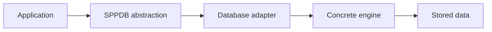
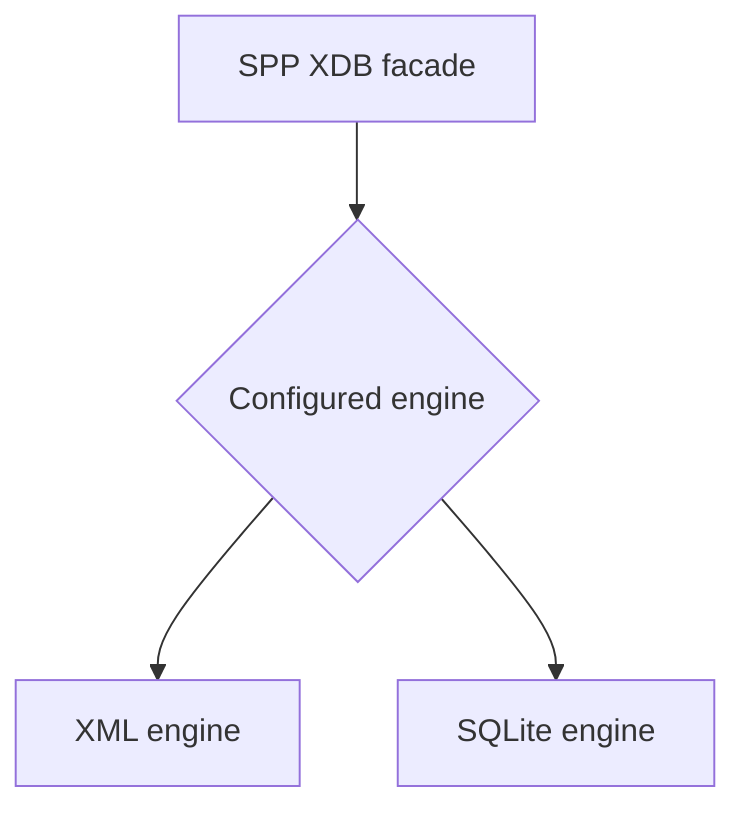
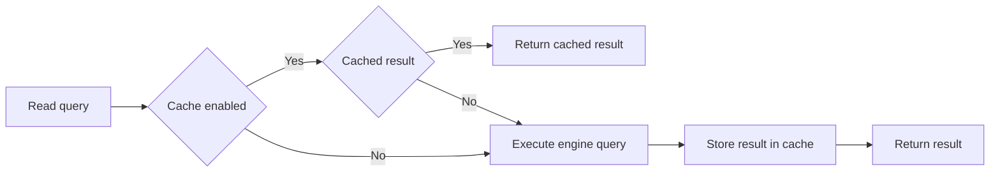
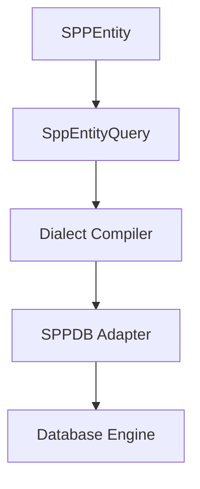
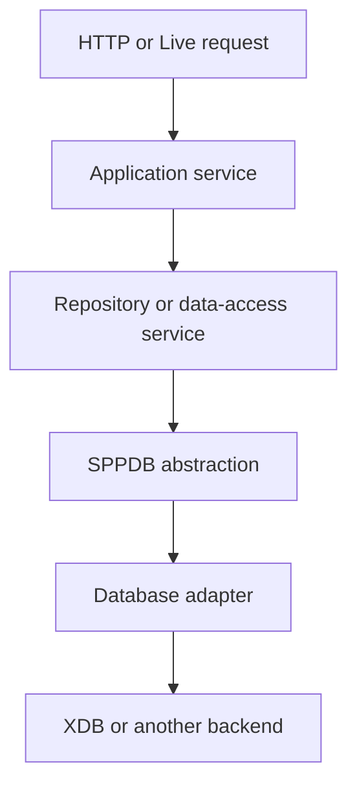
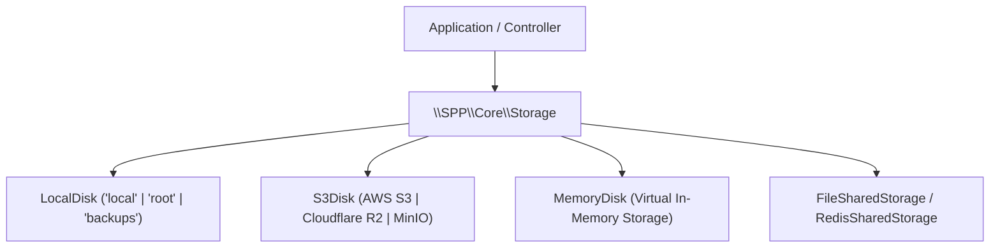
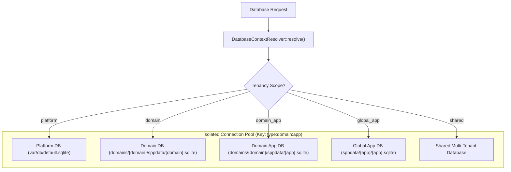

# Volume X — Data and Storage

## Chapter 16 — Database, SPPDB, and SPP XDB

**Evidence:** `spp/modules/spp/sppdb/`, `spp/modules/spp/sppxdb/`, `spp/modules/spp/sppstorage/`, `documentation/framework/sppxdb.md`, `documentation/framework/sppinterdb.md`, and the corresponding tests.

This chapter is written for a reader who knows PHP but has never worked with a framework database abstraction.

A web application eventually needs to remember things: users, orders, documents, settings, audit records, or other domain data. A database is the system that stores that information so the application can read it later.

The important SPP lesson is that **database access is another framework boundary**. Application code does not have to know every detail of every storage engine.

---

## 16.1 Why a framework has a database layer

Without an abstraction, application code might do this everywhere:

```php
$pdo = new PDO($dsn, $user, $password);
$statement = $pdo->prepare('SELECT * FROM users WHERE id = ?');
$statement->execute([$id]);
```

That works, but now the application owns connection setup, driver selection, error handling, query conventions, and replacement of one storage engine with another.

A framework database layer tries to centralize those decisions.

SPP has at least two relevant levels:

| Layer | Purpose |
|---|---|
| SPPDB | Common database abstraction/adapter layer |
| SPP XDB | SPP's XML/SQLite-backed database subsystem |

The distinction is important: **SPPDB is an abstraction layer; XDB is one concrete database family behind it.**

---

## 16.2 The SPPDB idea

Think of SPPDB as a common vocabulary for database operations.

An application can ask for operations such as:

- query;
- execute;
- insert;
- update;
- delete;
- inspect table existence; and
- inspect schema.

The exact backend can then be provided by a specific adapter.

For XDB, the repository contains `spp/modules/spp/sppdb/class.xdbadapter.php` implementing the `DBAdapter` contract.

That adapter delegates SQL operations to `SPP_XDB`.



This is the core idea behind a database abstraction: **application code depends on a stable interface while storage details stay below it**.

---

## 16.3 What is SPP XDB?

SPP XDB is a concrete database subsystem included in the repository.

The main facade is:

```text
SPPMod\SPPXDB\SPP_XDB
```

The source shows that `SPP_XDB` is a facade/proxy in front of at least two engine implementations:

- `XMLEngine`;
- `SQLiteEngine`.

The facade chooses the engine from SPP configuration and then forwards database operations to that engine.



This is a particularly useful example for learning framework architecture: a high-level API does not have to expose the details of the storage engine it eventually calls.

---

## 16.4 Selecting the XDB engine

The `SPP_XDB` constructor checks the framework configuration for `sys:db.engine` and defaults to XML when no other value is selected.

If the configured engine is `sqlite`, the facade creates `SQLiteEngine`; otherwise it creates `XMLEngine`.

The configuration-driven decision therefore happens at runtime:

```text
Application configuration
        ↓
SPP_XDB constructor
        ↓
XML or SQLite engine
```

The exact configuration keys and deployment conventions should be kept synchronized with the current SPP configuration subsystem.

---

## 16.5 Reading and writing through the adapter

The XDB adapter implements generic database operations by translating them into SQL and delegating to `SPP_XDB`.

For example, the adapter's `insert()` method builds an SQL `INSERT` statement with placeholders and passes the values separately.

That matters because the adapter is not simply storing PHP arrays. It presents a database-style API on top of the XDB engine.

The adapter also provides schema inspection through `DESCRIBE` and table discovery through `SHOW TABLES`.

---

## 16.6 Querying

The XDB facade forwards unknown methods to the selected engine through `__call()`.

This means calls such as:

```php
$xdb->querySQL($sql, $params);
```

are delegated to the concrete engine.

The facade also recognizes read-style SQL such as `SELECT`, `SHOW`, and `DESCRIBE` for query caching when caching is enabled.

That caching behavior is framework infrastructure, not something every application has to implement itself.

---

## 16.7 Query caching

`SPP_XDB` can cache read queries through the framework cache subsystem.

Conceptually:



The implementation creates a cache key from the SQL and serialized parameters. Cached entries are associated with a table tag when the engine exposes a table name.

Mutation operations such as insert, update, and delete invalidate the corresponding table tag.

This is a concrete example of two SPP subsystems composing: **database access uses the framework cache layer without embedding the cache implementation inside application code**.

---

## 16.8 Query logging

`SPP_XDB` contains query logging controls:

```php
SPP_XDB::enableQueryLog();
$log = SPP_XDB::getQueryLog();
```

The facade records timing information for selected database operations when logging is enabled.

This is useful while debugging slow database interactions.

---

## 16.9 XML storage is still a real database engine

The presence of an XML engine does not mean that SPP is simply reading arbitrary XML files as configuration documents.

The `XMLEngine` has database-oriented responsibilities and traits for areas including:

- CRUD;
- schema handling;
- indexing;
- views;
- query processing;
- transactions;
- validation;
- access control;
- locking;
- encryption; and
- other engine features.

The engine is therefore a substantial storage subsystem in its own right.

---

## 16.10 Verification Status & The Apex Subsystems

In earlier iterations of SPP, advanced features such as cryptographic audit chains, universal indexing, and distributed transactions were documented as architectural aspirations. 

Through the **Next-Gen and Apex engineering initiatives**, these capabilities have been fully implemented, integrated, and verified directly within the framework codebase:

1. **Dietz Pre/Post Binary Tree Engine (`XdbTreeEngine`) & Zero-Copy Flat Buffers (`.xbam`, `XbamEngine`)**: Resolves structural containment in $O(1)$ time with 32-byte fixed binary structs and segregated string/value pools.
2. **MarkLogic-Style Universal Inverted Index (`UniversalIndex`)**: Unified inverted postings for structural paths, typed values, text word tokens, and numeric ranges with composite bitset/array intersection.
3. **Native AI RAG Subsystem (`RagEngine` & `SemanticChunker`)**: Tree-aware XML chunker preserving ancestral breadcrumb metadata combined with hybrid Vector Cosine + BM25 Lexical search and agent tool schemas.
4. **SQL:2011 / XTDB Dual-Timeline Bi-Temporal Engine (`BiTemporalEngine`)**: Independent Valid Time and System Time tracking with point-in-time "As-Of" historical queries.
5. **Cryptographic Merkle DAG Ledger (`MerkleLedger`)**: SHA-256 hash chains, rolling Merkle roots, inclusion proofs, and zero-trust mathematical disk tamper detection.
6. **Reactive Live Queries & Hotwire Turbo Streams (`LiveQueryManager`, `LiveSubscription`)**: Standing query subscriptions generating real-time `<turbo-stream>` frames and Server-Sent Events (SSE).
7. **Next-Gen ANSI SQL Dialect**: Common Table Expressions (CTEs), $O(N+M)$ Hash Joins, Outer Joins, Correlated `EXISTS` subqueries, `UPSERT`, Transaction Savepoints, SQL/JSON and SQL/XML duality, and ANSI Window Functions.
8. **W3C Standards Compliance**: Full XQuery 3.1 FLWOR query compilation and in-place tree mutations via the XQuery Update Facility (XQUF).
9. **ACID Snapshot Isolation**: Multi-Version Concurrency Control (MVCC) with Write-Ahead Logging (`_wal.jsonl`).

All features are covered by **27 automated test suites** in `tests/core/test.xdb_apex.php`, `tests/core/test.xdb_sql_nextgen.php`, and `tests/core/test.xdb_nextgen.php` with a 100% pass rate.

---

## 16.11 XDB Transactions, MVCC & Write-Ahead Logging

The XDB engine provides ACID transaction guarantees through two cooperating layers:

1. **MVCC Snapshot Isolation**: Managed by `\SPPMod\SPPXDB\Concurrency\MVCCManager`. Transactions operate on isolated tree snapshots.
2. **Write-Ahead Logging (WAL)**: All transaction mutations are durably recorded in `_wal.jsonl` prior to disk synchronization, preventing data corruption on abrupt system termination.
3. **SQL Savepoints**: Granular rollback boundaries (`SAVEPOINT`, `ROLLBACK TO SAVEPOINT`, `RELEASE SAVEPOINT`) allowing nested transaction emulation without aborting parent transactions.

The SPPDB `XDBAdapter` and facade expose complete transaction methods:

```php
$xdb->beginTransaction();
try {
    $xdb->insert(['id' => 1, 'amount' => 100]);
    $xdb->createSavepoint('step1');
    $xdb->insert(['id' => 2, 'amount' => 200]);
    $xdb->commit();
} catch (\Throwable $e) {
    $xdb->rollBack();
    throw $e;
}
```

---

## 16.7 Active Record Entity Architecture (`SPPEntity` & `SppEntityQuery`)

While SPPDB provides the raw database abstraction, modern domain applications interact with persistent data through **Active Record Entities** extending `\SPPMod\SPPDB\SPPEntity`.

Each entity encapsulates database table mapping, attribute casting, validation schemas, event hooks, and lifecycle transitions.



### Core Entity CRUD & Query APIs

```php
use App\School\Entities\Student;

// 1. Primary key lookup (checks IdentityMap first)
$student = Student::find(42);
$studentOrThrow = Student::findOrFail(42);

// 2. Attribute search
$student = Student::findBy('email', 'student@school.edu');
$honorStudents = Student::findWhere(['grade' => 'A', 'status' => 'active']);

// 3. Chainable Query Builder (SppEntityQuery)
$results = Student::query()
    ->where('gpa', 3.5, '>=')
    ->whereIn('department_id', [10, 12, 15])
    ->orderBy('created_at', 'DESC')
    ->paginate(25);

// 4. Persistence & Lifecycle
$student = new Student();
$student->name = 'Arya Stark';
$student->email = 'arya@winterfell.org';
$student->save(); // Inserts and registers into IdentityMap

// 5. State Refresh
$student->refresh(); // Reloads from DB without losing object identity
```

---

## 16.8 Request-Scoped In-Memory Identity Map (`IdentityMap`)

In multi-service enterprise workflows, loading the same physical database row into multiple distinct PHP object instances causes state collision and silent data overwrite bugs.

SPP solves this via `\SPPMod\SPPDB\IdentityMap`:
- **Single Instance Guarantee**: Within a single HTTP request or worker cycle, loading entity `#42` anywhere returns the **exact same PHP object reference**.
- **Zero Redundant Queries**: Redundant `find(42)` calls across service boundaries return from memory in 0ms.
- **Automatic Lifecycle Synchronization**: `$entity->save()` registers new IDs; `$entity->delete()` evicts records from the map.
- **Worker Isolation**: Long-running daemons purge memory between jobs via `IdentityMap::clear()`, while isolated subroutines execute via `IdentityMap::withoutIdentityMap(fn() => ...)`.

```php
$user1 = User::find(1);
$user2 = User::find(1);
assert($user1 === $user2); // Identical reference
```

---

## 16.9 First-Class Relation Objects & Relationship Querying

SPP provides fluent, chainable relationship objects extending `\SPPMod\SPPDB\Relations\Relation`:

| Relation | Description | Method Helper |
|---|---|---|
| **One-to-Many** | Parent owns multiple child entities | `$this->hasMany(Related::class, 'foreign_key')` |
| **Many-to-One** | Child belongs to a parent | `$this->belongsTo(Related::class, 'foreign_key')` |
| **One-to-One** | Single associated record | `$this->hasOne(Related::class, 'foreign_key')` |
| **Many-to-Many** | Associated through a pivot table | `$this->belongsToMany(Related::class, 'pivot_table')` |
| **Polymorphic** | Shared target across multiple parent entities | `$this->morphMany(Related::class, 'morph_prefix')` |

### Fluent Query Chaining & Magic Properties
Calling relation methods returns chainable query objects, while accessing them as properties auto-resolves and caches the results:

```php
// Fluent relation query chaining
$activeCourses = $student->courses()->where('status', 'active')->get();

// Property access with automated caching
$allCourses = $student->courses; // Resolves once, caches on instance

// Pivot table associations (BelongsToMany)
$course->students()->attach($studentId);
$course->students()->detach($studentId);
$course->students()->sync([10, 12, 15]);

// Relationship existence queries (whereHas / whereDoesntHave)
$activeTeachers = Teacher::query()
    ->whereHas('courses', fn($q) => $q->where('credits', 4, '>='))
    ->get();
```

---

## 16.10 Nested Transaction Savepoints

High-concurrency business operations often compose multiple services that each require transactional safety. Standard PDO crashes when `beginTransaction()` is invoked while a transaction is already active.

SPP implements SQL-92 **Savepoints** natively across MySQL, PostgreSQL, and SQLite:
- `beginTransaction()` increments `$transactions`; if already inside a transaction, it emits `SAVEPOINT transN`.
- `commit()` decrements `$transactions` and releases savepoints before outer commit.
- `rollBack()` rolls back to the immediate savepoint level without aborting the parent transaction.
- Explicit savepoints: `$db->createSavepoint('checkpoint_a')`, `$db->releaseSavepoint('checkpoint_a')`, and `$db->rollbackToSavepoint('checkpoint_a')`.

---

## 16.11 Modern PHP 8.2+ Declarative Attributes

Developers can declare tables, columns, constraints, relations, and workflows directly inside PHP classes using PHP 8.2+ Attributes (`\SPPMod\SPPDB\Attributes`):

```php
namespace App\School\Entities;

use SPPMod\SPPDB\SPPEntity;
use SPPMod\SPPDB\Attributes\Table;
use SPPMod\SPPDB\Attributes\Id;
use SPPMod\SPPDB\Attributes\Column;
use SPPMod\SPPDB\Attributes\HasMany;
use SPPMod\SPPDB\Attributes\Workflow;

#[Table(name: 'students', idField: 'id', keyType: 'int')]
#[Workflow(definition: 'student_lifecycle', initialState: 'enrolled')]
class Student extends SPPEntity
{
    #[Id(type: 'int', strategy: 'autoincrement')]
    public int $id;

    #[Column(type: 'varchar', length: 150, nullable: false, searchable: true)]
    public string $name;

    #[Column(type: 'varchar', length: 255, nullable: false, unique: true, pii: true)]
    public string $email;

    #[HasMany(target: Enrollment::class, foreignKey: 'student_id')]
    public function enrollments(): \SPPMod\SPPDB\Relations\HasMany
    {
        return $this->hasMany(Enrollment::class, 'student_id');
    }
}
```

Attributes seamlessly merge with YAML definitions: Attributes define code-level defaults, while YAML can override them for environment-specific customization.

---

## 16.12 Zero-Downtime Two-Phase DDL (`SafeDDLRunner`)

Running direct `ALTER TABLE` operations on multi-million row production tables locks reads and writes.

SPP's `SafeDDLRunner` executes zero-downtime migrations via the **shadow-table pattern**:
1. **Phase 1 (Shadow Create)**: Compiles `_spp_shadow_<table>` with the target schema.
2. **Phase 2 (Backfill Copy)**: Copies rows with optional transformation expressions.
3. **Phase 3 (Atomic Swap)**: Executes instantaneous atomic table rename (`table` $\rightarrow$ `_spp_old_table`, `_spp_shadow_table` $\rightarrow$ `table`).
4. **Phase 4 (Verify & Cleanup)**: Runs verification callbacks, then safely drops the old table. Auto-rolls back on error.

```php
$runner = new \SPPMod\SPPDB\Migration\SafeDDLRunner('students');
$runner->addColumn('gpa', 'DECIMAL(4,2) DEFAULT 0.0', 0.0);
$runner->dropColumn('obsolete_field');
```

---

## 16.13 Native AI Vector Similarity Search Compiler

SPP query engine features native AI vector similarity search across all major relational engines:
- **MySQL 9.0+**: Native `VECTOR` type and `DISTANCE(col, CAST(? AS VECTOR), 'COSINE')`.
- **PostgreSQL**: `pgvector` extension operators (`<=>` cosine, `<->` L2, `<#>` inner product).
- **SQLite**: `sqlite-vec` extension functions (`vec_distance_cosine()`, `vec_distance_L2()`).

```php
$similarDocs = Document::query()
    ->whereSemanticSimilarity('embedding', $queryVector, metric: 'cosine', topK: 10)
    ->where('category', 'science')
    ->get();
```

---

## 16.14 Strongly-Typed IDE Helper Generation

To eliminate active record dynamic property friction in IDEs (PhpStorm, VS Code, PHPStan), SPP provides the `make:entity-types` command:

```bash
php spp.php make:entity-types [--app=AppName] [--out=_ide_entity_helper.php]
```

It introspects all entity schemas and emits `@property`, `@property-read`, and `@method static` declarations into `_ide_entity_helper.php` for complete autocompletion.

---

## 16.15 Storage, database, and application architecture

A clean enterprise application keeps database concerns below its domain/application services.



The exact repository pattern is an application architecture decision. SPP provides the underlying facilities; it does not require every project to use one particular domain-repository structure.

---

## 16.13 When should you use XDB?

XDB is a reasonable candidate when an application specifically benefits from the storage model provided by the SPP XDB subsystem or when project requirements already depend on SPP's XML/SQLite database facilities.

It should not be selected merely because it is a framework feature.

Before production adoption, evaluate:

- expected data volume;
- concurrency;
- transaction semantics required by the domain;
- backup/restore behavior;
- operational tooling;
- indexing requirements;
- security controls; and
- failure/recovery behavior.

Those are engineering decisions, not framework marketing claims.

---

## 16.14 Database debugging for beginners

When a database operation fails, debug in layers.

### Step 1 — Is the application configured for the expected backend?

Check the database engine/configuration first.

### Step 2 — Did SPPDB select the expected adapter?

The abstraction and adapter layers are distinct from the concrete engine.

### Step 3 — Did the engine receive the expected SQL and parameters?

Enable query logging where appropriate.

### Step 4 — Does the table/schema exist?

Use the engine's schema inspection mechanisms.

### Step 5 — Did caching return stale data?

Inspect cache behavior and mutation invalidation when relevant.

### Step 6 — Is the problem actually in application logic?

A successful query does not prove that the domain logic interpreted the result correctly.

---

## 16.15 Coming from other ecosystems

### Laravel / Symfony

Think of SPPDB as conceptually similar to a database abstraction layer, while SPP XDB is a concrete storage engine family beneath it.

### Django

Think in terms of the ORM/database backend boundary, but do not assume SPP's XDB layer is a drop-in ORM equivalent.

### Java / Spring

The distinction between an interface/adapter layer and a concrete database implementation should feel familiar: the application depends on the abstraction while the runtime selects a concrete provider.

---

---

## 16.16 Declarative Multi-Database Routing & High-Performance Manifest Storage

Enterprise architectures often require splitting read and write traffic across read replicas and primary database clusters. Rather than hardcoding connection names in controllers or repository constructors, SPP enables **declarative connection routing** at the directory level via `__spp_file_props.yml`.

### 1. Declarative Database Routing (`db_routing`)

Directories can specify dedicated connections for queries and mutations:

```yaml
db_routing:
  read_connection: "analytics_read"
  write_connection: "primary_cluster"
```

The runtime resolves connection routing dynamically through `\SPPMod\SPPStorage\ManifestContractEngine::resolveDbRouting(__FILE__)`. This allows read-heavy reporting modules or background analytics to automatically target read replicas without altering domain queries or entity repositories.

### 2. High-Performance SQLite WAL Workspace Metadata Storage

The framework itself leverages SQLite for its internal high-performance metadata catalog. When compiling workspace properties via `php spp.php props:compile`, `\SPPMod\SPPStorage\FilePropsManager` compiles all manifests into `var/cache/file_props.db`.

By executing under `PRAGMA journal_mode = WAL;`, `PRAGMA synchronous = NORMAL;`, and wrapping directory indexing inside an atomic `beginTransaction()` ... `commit()` block, SQLite indexes over 16,500 components across 1,870+ manifests in **under 450 milliseconds** on Windows, achieving $O(1)$ query performance for runtime contract lookups.

---

## 16.17 Sovereign Framework File Services (`\SPP\Core\File`)

In enterprise architectures, direct calls to native PHP filesystem functions (`file_put_contents`, `unlink`, `scandir`) introduce serious platform vulnerabilities:
- **Locking & Sharing Collisions**: In Windows and WSL2 (DrvFs mounts), opening a file with write/truncate flags while an active handle exists triggers `STATUS_SHARING_VIOLATION`, translated by glibc into fatal `EINVAL` (`22: Invalid argument`) crashes.
- **Race Conditions**: Concurrent requests can observe half-written files during configuration updates.
- **Memory Bloat**: Reading large datasets into memory with `file_get_contents()` breaches PHP `memory_limit`.

SPP replaces raw file manipulation with the sovereign static facade **`\SPP\Core\File`** (alias: **`\SPP\File`**):

```php
use SPP\File;

// Check existence or absence
if (File::missing('/var/app/config.txt')) {
    File::put('/var/app/config.txt', 'Initial configuration');
}

// Memory-efficient lazy line streaming using PHP Generators
foreach (File::lines('/var/logs/apache/access.log') as $lineNumber => $line) {
    if (str_contains($line, '500 Internal Server Error')) {
        // Process line without allocating memory for entire file
    }
}
```

---

## 16.18 Cross-Platform Atomic Persistence & Declarative Serialization

To guarantee cross-platform resilience and prevent partial reads, SPP uses **staged atomic writes**:

```php
use SPP\File;
use SPP\Core\Storage;

// 1. Atomic Staged Writing (putAtomic)
// Writes to a sibling staging file (.tmp_*.bin) and atomically renames to target.
// Automatically recovers from Windows/WSL DrvFs lock collisions.
File::putAtomic('/path/to/critical_config.yml', $rawYamlString);

// 2. Atomic YAML & JSON Persistence
$settings = [
    'app' => 'VShiksha',
    'version' => '2.5.0',
    'features' => ['courses', 'admissions', 'fee_management']
];

// Write atomically
Storage::writeYaml('/etc/apps/vshiksha/app.yml', $settings, 10, 2);

// Read back parsed array
$config = Storage::readYaml('/etc/apps/vshiksha/app.yml');
```

---

## 16.19 Multi-Disk Cloud & Storage Engine (`\SPP\Core\Storage`)

SPP's storage engine (`\SPP\Core\Storage`) provides a unified multi-disk abstraction across local filesystems, in-memory storage, and cloud object stores:



### 1. Pre-Configured Disks:
- `Storage::disk('root')`: Scoped to the project root directory (`SPP_APP_DIR`).
- `Storage::disk('backups')`: Scoped to `var/backups/`.
- `Storage::disk('local')`: Standard application upload and document storage.

### 2. Pure-PHP Cloud Object Storage (`S3Disk`):
Zero-dependency, pure-PHP implementation of AWS Signature Version 4 (SigV4). Connects natively to **AWS S3, Cloudflare R2, MinIO, Wasabi, Backblaze B2, and Google Cloud Storage** with **no external composer packages**:

```php
use SPP\Core\Storage;

$s3 = Storage::disk('s3');
$s3->put('documents/transcript_42.pdf', $pdfBytes);

// Pre-signed temporary S3 download URL (valid for 30 minutes)
$downloadUrl = $s3->temporaryUrl('documents/transcript_42.pdf', '+30 minutes');
```

### 3. Virtual In-Memory Disk (`MemoryDisk`):
Stores objects in memory arrays with zero disk I/O. Ideal for serverless microVMs (AWS Lambda / Bref) and ultra-fast, isolated automated testing with Parikshak.

---

## 16.20 Fluent Directory Scanner (`FileFinder` / `File::find()`)

Inspired by Symfony Finder, `File::find()` provides a fluent, generator-backed directory query builder:

```php
use SPP\File;

// Discover all large logs modified within the past 7 days, excluding archives
$logs = File::find('/var/logs')
    ->name('*.log')
    ->size('> 5MB')
    ->modifiedAfter('-7 days')
    ->notPath('archive')
    ->get();

// Stream-process matching files with near-zero memory footprint
File::find('/var/backups')
    ->extension('zip')
    ->size('> 100MB')
    ->each(function(string $filePath) {
        // Stream or verify archive
    });
```

---

## 16.21 Expiring Signed URLs & HTTP 206 Partial Content Range Streaming

Sensitive student records, fee receipts, and video lectures must never be publicly exposed or cause memory exhaustion during download:

```php
use SPP\Core\Storage;

// 1. Generate an expiring HMAC-SHA256 signed URL (valid for 15 minutes)
$signedUrl = Storage::temporaryUrl('student_records/exam_paper.pdf', '+15 minutes');

// 2. Stream video or large documents with native HTTP 206 Partial Content & Range seeking:
Storage::streamDownload('lectures/intro.mp4', 'Lecture_01.mp4');
```
`streamDownload()` automatically detects **`X-Sendfile`** on Apache/IIS and **`X-Accel-Redirect`** on Nginx for zero-copy kernel transfers, falling back to 64KB chunked stream slices with output buffer flushing.

---

## 16.22 Multi-Tier MIME Detection & Magic-Byte Sniffer

On minimalist container images (like Alpine Linux without `php83-fileinfo`), standard MIME detection fails. SPP utilizes a **4-tier detection system**:
1. PHP `finfo` (when PECL extension is active).
2. **Magic-byte binary sniffer**: Inspects file header signatures (PNG, JPEG, GIF, WebP, PDF, ZIP, TAR, GZ, MP4, MP3, WASM, SQLite).
3. **Extension lookup map**: Over 100 standard web and data formats.
4. Fallback to `application/octet-stream`.

---

## 16.23 Multi-Tenant Database Context Resolution (`DatabaseContextResolver`)

In multi-tenant, multi-domain environments, different tenant domains and applications must never share a database connection indiscriminately. Tenant A's queries must never leak into or pollute Tenant B's tables.

SPP solves this via the **Database Context Resolver** (`\SPP\Core\Database\DatabaseContextResolver`). It manages dedicated, isolated PDO connection pools across 5 distinct tenancy scopes:



### 1. Connection Resolution API
```php
use SPP\Core\Database\DatabaseContextResolver;

$dbResolver = DatabaseContextResolver::getInstance();

// 1. Resolve isolated connection for a specific domain tenant
$tenantPdo = $dbResolver->resolve(
    contextType: 'domain',
    domainId: 'portal.example.com',
    appId: 'school1'
);

// 2. Resolve platform-level shared database
$platformPdo = $dbResolver->resolve(
    contextType: 'platform'
);

// 3. Resolve dedicated database for a domain-isolated application
$pluginPdo = $dbResolver->resolve(
    contextType: 'domain_app',
    domainId: 'portal.example.com',
    appId: 'custom_plugin'
);
```

### 2. Database Studio Integration
In SPPAdmin's **Database Studio** (`/sppadmin/#database`), tenant connections are discovered and exposed under the `🌐 Multi-Domain Isolated Databases` optgroup using connection strings formatted as `context:<type>[:<domain>[:<app>]]`. Administrators can inspect schema tables, run queries, and optimize indexes on tenant databases while preserving strict isolation.

---

## 16.24 Multi-Domain Storage Boundaries & Traversal Defense

Just as database connections are isolated, filesystem storage for tenant domains is logically and physically partitioned:

- **Platform Storage (`sppdata/`)**: Global application caches, system audit logs (`sppdata/logs/audit.jsonl`), and shared temporary scratch files.
- **Tenant Storage (`domains/<domain>/sppdata/`)**: Isolated tenant cache, tenant error logs, file uploads, and session data.

```php
use SPP\Core\Domain\PathResolver;
use SPP\Core\File;

$paths = PathResolver::getInstance();

// Resolving domain upload path with traversal defense
$tenantUploads = $paths->getDomainDataPath($domainId) . '/uploads';
$paths->ensureDirectoryExists($tenantUploads);

// Throws InvalidArgumentException if $userInput attempts ../ breakout
$targetFilePath = $paths->resolveSafePath($tenantUploads, $userInput);
File::putAtomic($targetFilePath, $data);
```

---

## Kernel Hacker note

The most important internal design feature in the current code is the **double delegation boundary**:

1. `SPPDB` can delegate to a backend adapter such as `XDBAdapter`.
2. `SPP_XDB` can then delegate to an engine such as `XMLEngine` or `SQLiteEngine`.

In multi-tenant configurations, `DatabaseContextResolver` guarantees that connections are cached strictly by composite key (`type:domain:app`), ensuring zero cross-tenant contamination while maintaining high connection reuse. In the file and storage layer, `PathResolver` guarantees strict boundary containment against directory traversal attacks.

### Source map

- `spp/core/Database/DatabaseContextResolver.php`
- `spp/core/Domain/PathResolver.php`
- `spp/admin/services/DatabaseAdminService.php`
- `spp/core/class.file.php`
- `spp/core/class.storage.php`
- `spp/core/class.localdisk.php`
- `spp/core/class.s3disk.php`
- `spp/core/class.memorydisk.php`
- `spp/core/class.filefinder.php`
- `spp/core/interfaces/DiskInterface.php`
- `spp/modules/spp/sppdb/class.sppdb.php`
- `spp/modules/spp/sppdb/class.xdbadapter.php`
- `spp/modules/spp/sppxdb/class.sppxdb.php`
- `spp/modules/spp/sppxdb/Engines/XMLEngine.php`
- `spp/modules/spp/sppxdb/Engines/SQLiteEngine.php`
- `spp/modules/spp/sppxdb/class.querybuilder.php`
- `spp/modules/spp/sppxdb/class.xdbfactory.php`
- `spp/modules/spp/sppxdb/class.xdbmigrator.php`
- `spp/modules/spp/sppstorage/src/FilePropsManager.php`
- `spp/modules/spp/sppstorage/src/ManifestContractEngine.php`
