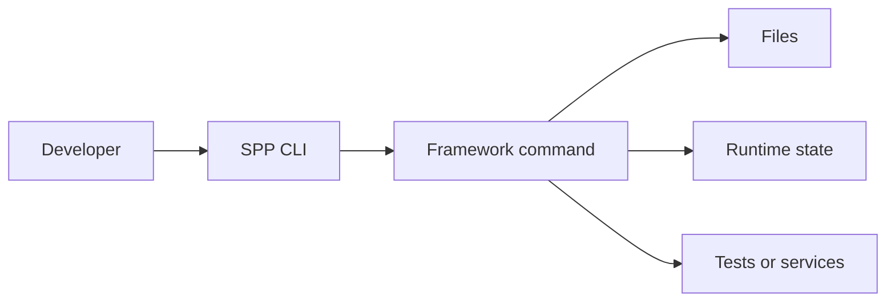
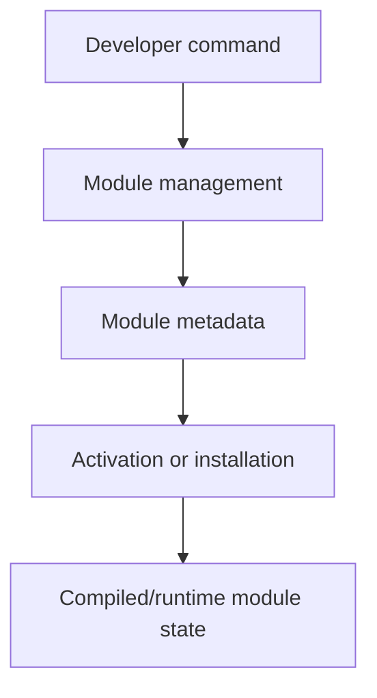
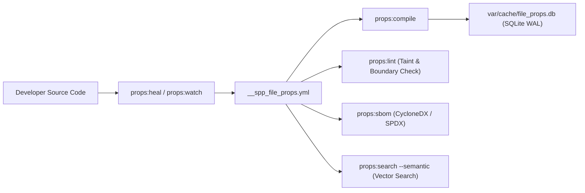
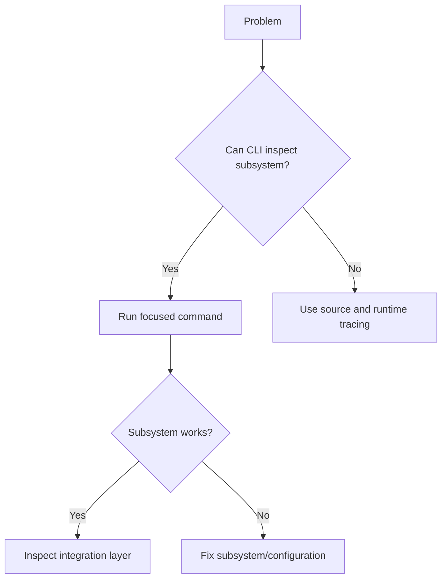

# Volume XIII — Developer Tooling

## Chapter 19 — The SPP CLI and Development Workflow

**Evidence:** `docs/spp-cli-manual.md`, `spp/commands/`, command stubs, and the command implementations referenced by the repository.

A framework becomes much easier to work with when you stop treating its command-line tools as magic commands and understand what they are doing for you.

SPP has a large CLI surface. It includes commands for application creation, modules, middleware, events, views, LiveComponents, SPPUX components, database work, testing, documentation, cache management, deployment, and polyglot services.

This chapter teaches how to think about that CLI rather than simply memorizing hundreds of commands.

---

## 19.1 What is a CLI?

CLI means **Command-Line Interface**.

Instead of opening a browser and clicking a button, you type a command into a terminal.

For example:

```bash
php spp.php make:app myapp
```

A CLI command is just another interface to the framework. It can create files, inspect runtime state, compile metadata, run tests, or start services.

The important relationship is:



---

## 19.2 Why use generators?

Suppose an SPP application needs a middleware class.

You could manually create the file and remember its namespace, directory, and framework conventions.

A generator can create the starting structure for you.

The repository provides generators such as:

```text
make:app
make:controller
make:service
make:middleware
make:event
make:eventhand
make:module
make:entity
make:form
make:live-component
make:ux-component
make:view
make:blade
make:command
```

The exact command list is maintained in `docs/spp-cli-manual.md` and the corresponding command implementations.

---

## 19.3 Generators do not replace understanding

A beginner mistake is:

> “The generator created the files, therefore I know what the files do.”

That is backwards.

The generator should be thought of as a **scaffolding tool**.

It creates a conventional starting point. The application developer still needs to understand:

- where the generated file lives;
- which namespace it uses;
- what SPP discovers automatically;
- what configuration is required; and
- which lifecycle invokes it.

That is why the handbook explains the underlying architecture before relying heavily on generators.

---

## 19.4 Application creation

The repository includes `make:app` and a `MakeAppCommand` implementation.

The first-application tutorial uses the manually understandable application structure before treating the generator as a convenience.

That gives two valid approaches:

| Approach | Best for |
|---|---|
| Manual structure | Learning and understanding the architecture |
| `make:app` | Quickly starting a real project |

A good developer should be able to do both.

---

## 19.5 Module commands

The CLI includes module operations such as:

```text
module:list
module:enable
module:disable
module:install
module:uninstall
module:update
module:setting:list
module:setting:update
```

These commands operate on the framework's module architecture described in Chapter 5.

The useful mental model is:



The command is therefore another entry point into the module lifecycle.

---

## 19.6 Event commands

The repository includes commands such as:

```text
event:fire
event:dispatch
event:list-listeners
```

These are useful when debugging or exercising the event system without requiring a full browser request.

A practical technique is to use the CLI to isolate whether the event layer works before debugging the much larger HTTP stack.

---

## 19.7 Middleware commands

The CLI includes:

```text
make:middleware
middleware:list
```

This reflects two distinct jobs:

1. generate a new middleware implementation;
2. inspect the middleware currently known to the runtime.

That distinction is useful when debugging because a source file existing on disk does not necessarily prove that the framework loaded it into the active middleware stack.

---

## 19.8 Live and reactive development

The CLI also contains development commands for live and UI features, including:

```text
make:live-component
make:ux-component
make:stream
live:status
live:trigger
frontend:debug
```

These commands belong to the LiveComponent/SPP Live/SPPUX development surface.

The architectural principle remains the same: the command creates or manipulates resources; the runtime still owns execution.

---

## 19.9 Database and storage commands

The documented CLI includes commands for database and storage administration, such as:

```text
db:sync
db:verify
migrate
migrate:make
xdb-related administration commands
storage:clean
storage:link
storage:sync
```

The exact syntax and options belong to the current CLI implementation. The handbook should link to the command-specific reference rather than duplicating every flag in every architecture chapter.

---

## 19.10 Testing commands

SPP's CLI includes a substantial testing surface, including:

```text
test
test:run
test:module
test:routes
test:dry-run
test:blueprint
test:monkey
test:module
```

The important beginner concept is that a test command is simply another executable entry point into application behavior.

It allows the same runtime components to be exercised without a browser.

---

## 19.11 Deployment commands

The command manual exposes deployment-related commands such as:

```text
deploy:init
deploy:build
deploy:plan
deploy:run
deploy:rollback
deploy:backups
deploy:history
deploy:maintenance
deploy:env
```

A production deployment should not be built around ad-hoc shell commands when the repository already provides controlled deployment operations.

However, the existence of a command does not by itself prove that a command is safe for every production environment. Each deployment command should be reviewed against its current implementation and the deployment topology.

---

## 19.12 Documentation commands

SPP also exposes commands for building or inspecting documentation:

```text
docs:api
docs:build
docs:man
docs:openapi
docs:phpdoc
```

This illustrates a useful framework property: the framework is documenting and inspecting itself through the same command infrastructure used for application development.

---

## 19.13 Environment and configuration commands

The CLI includes environment/configuration operations such as:

```text
env:get
env:set
env:list
env:status
env:mode
config:export
config:import
config:sync
```

Keep an important production rule in mind:

> Do not place secrets into source-controlled configuration merely because a CLI command makes configuration easy to edit.

Use the repository's deployment/environment facilities and your deployment secret-management policy appropriately.

---

## 19.14 Manifest OS and File Properties Tooling

The SPP Manifest OS (`__spp_file_props.yml`) is backed by a comprehensive CLI command suite for continuous compilation, security auditing, and self-healing:



### Core Manifest Commands

- **`props:compile [--force] [--db]`**: Compiles all workspace manifests into an optimized SQLite WAL database (`var/cache/file_props.db`) and PHP opcode cache (`file_props.cache.php`) in <450ms across 16,500+ files.
- **`props:sbom [--format=spdx|cyclonedx] [--out=path]`**: Emits a cryptographic Software Bill of Materials with SLSA Level 3 build provenance and capability sandbox metrics.
- **`props:heal [path] [--dry-run]`**: AST-powered reconciler that parses source files, detects classes, inheritance, and entities, and auto-repairs manifests to eliminate drift.
- **`props:watch [--heal]`**: Background filesystem watcher that recompiles manifests and auto-heals code changes in real time.
- **`props:search <query> [--semantic]`**: Hybrid keyword and 64-dimensional semantic vector search across workspace components.
- **`props:lint [path] [--strict]`**: Statically traces data flow taint from untrusted sources to dangerous sinks and enforces layer boundaries.
- **`props:verify [path] [--strict]`**: Verifies cryptographic SHA-256 digests to detect unauthorized file tampering.
- **`props:impact <path> [--depth=N]`**: Computes transitive semantic blast radius and risk scores before refactoring.

---

## 19.15 A useful CLI debugging workflow

When an SPP feature fails, do not immediately begin changing source code.

First ask whether the CLI can isolate the subsystem.

For example:



This approach reduces the debugging search space.

---

## 19.16 Coming from other frameworks

### Laravel / Symfony

The SPP CLI plays a role similar to Artisan or Symfony Console commands, but the command surface is tightly integrated with SPP's particular module, application, rendering, live, and polyglot subsystems.

### Django

Think of management commands: the framework exposes developer and administration operations through the terminal.

### Spring Boot

Think of the CLI as development/operations tooling around the application runtime rather than a substitute for the runtime itself.

---

## 19.17 Why the CLI belongs in the architecture handbook

It may seem strange to document commands in an architecture book, but commands are important because they exercise and modify the same runtime architecture described throughout this handbook.

For example:

```text
make:module
    ↓
module manifest/files
    ↓
module discovery
    ↓
compiled module registry
    ↓
runtime activation
```

That is architecture, not merely command syntax.

---

## 19.18 SPPAdmin & SPPDev Visual Operations and Development Workstations

The SPP framework pairs its terminal CLI tooling with two companion browser workstations:
1. **SPPAdmin** (`/sppadmin`): Production and hosting platform command center for virtual host management, service monitoring, multi-tenant accounts, automated deployments, and lifecycle operations.
2. **SPPDev** (`/sppdev`): High-velocity local development console for live component prototyping, database schemas, code scaffolding, and routing diagnostics.

Both workstations share a canonical backend service layer (`spp/admin/services/`) and a synchronized command bridge (`CommandBridge.php`) that maps GUI actions directly to underlying CLI commands and framework APIs.

### 1. Domain Architecture & Virtual Host Management (`#domains`)

The Domains & Virtual Hosts console provides full visual control over routing modes:
* **Architecture Mode Banner**: Prominently displays the active mode (`🟢 Single Domain Mode` vs `🌐 Multi-Domain Mode`).
* **1-Click Mode Toggle**: Enables developers to instantly switch between zero-config single domain operation (where domain routing is bypassed and any host/IP is accepted) and enforced virtual host multi-tenancy.
* **Virtual Host Policy Dropdown**: Easily select between `Strict (404)`, `Inherit Parent`, `302 Redirect`, `Dynamic Tenant`, and `Permissive` modes.
* **SSL Inspector & DNS Diagnostics**: Inspect SSL certificates, trace DNS records, manage BIND DNS zones, and simulate routing for any hostname in real time.

### 2. Universal Infrastructure & OS Workstation (`#server`)

Powered by the universal abstraction engine `\SPP\Core\Infra`, the server console provides complete operational visibility across any operating system or hosting topology:
* **Operating System & Distro Detection**: Normalizes and displays OS family (`windows`, `linux`, `darwin`, `bsd`), distribution name (`Microsoft Windows 11`, `Ubuntu 24.04 (WSL)`, `Alpine Linux`, `RHEL / Rocky`), and C runtime (`glibc`, `musl`, `msvcrt`).
* **Hosting Topology Classification**: Automatically categorizes the runtime environment into `Standard FHS (/var/www)`, `User-Home cPanel Style (/home/*)`, `Windows (IIS / Apache)`, `Container (Docker / Podman / K8s)`, or `Serverless (AWS Lambda / Cloud Run)`.
* **Normalized Paths**: Inspects cross-platform storage locations including guaranteed writable scratch roots (`writablePath()`) and temporary storage directories (`tempDir()`).
* **Detected Services & Daemons**: Inspects active host daemons and services discovered in `etc/detected-services.yml`.

### 3. App Studio & Application Lifecycle Management (`#apps`)

The App Studio Console unifies application registration, domain restrictions, and decommissioning:
* **Visual Domain Scoping**: Configure an application's exposure across domains with the `🌐 Scope` button. Choose between **Global** (accessible across all domains) and **Domain-Only** (restricted to specific virtual host domains with whitelist enforcement).
* **Application Uninstaller & Decommissioning Modal**: Click `🗑️ Uninstall` to safely decommission any non-protected application with granular controls:
  * **Config-Only Removal**: Unbinds virtual hosts from `etc/domains.yml`, removes registration from `global-settings.yml`, and purges routing caches while preserving application source code in `src/{appName}`.
  * **Full Removal**: Completely purges application source code, configuration directories (`etc/apps/{appName}`), caches, and database files.
  * **Automated Safety Backup**: Checkbox to generate a standalone compressed zip archive in `var/backups/apps/` before uninstallation, guaranteeing zero accidental data loss.
  * **Database Purge**: Optional purge of the application SQLite database (`var/db/{appName}.sqlite`).
* **Dedicated Backups & Restoration Tab**:
  * Lists all standalone backup archives in `var/backups/apps/` with file count, size, timestamp, and database status.
  * **1-Click Restore**: Instantly reconstructs application code, configuration in `etc/apps/`, and virtual host domain bindings.
  * **Permanent Disk Reclamation**: Delete unneeded backups with 1 click to free server disk space.
  * **Manual Backup Generator**: Create full standalone backup archives of any registered application at any time.

### 4. Multi-Language Application Fleet & Process Supervision (`#apps`)
The App Studio Console unifies native SPP applications and multi-language guest applications (Python, Node.js, Go, PHP-FPM, Static SPAs) into a single operational interface:
* **Combined Application Inventory**: Displays native SPP apps alongside external microservices declared in `etc/apps.yml`.
* **Runtime Stack Badges**: Highlights the guest application environment (🐍 Python, 🟢 Node.js, 🐘 PHP-FPM, 🐹 Go, 📄 Static SPA).
* **Ingress Route & Virtual Subdomain Links**: Clickable links (`📁 /ai ↗`, `🌐 ai.school.local`) that open the application directly in a new browser tab.
* **Operational Supervisor Controls**:
  * 1-Click Process Management: `▶️ Start`, `⏹️ Stop`, and `🔄 Restart` guest daemons on the fly.
  * Live Log Stream Modal: `📜 Logs` opens a real-time dark terminal modal streaming `var/run/apps/{app_id}.log`.
  * In-Context RPC: `⚡ RPC` opens the interactive RPC Sandbox pre-filled for the target microservice.

### 5. Service Mesh Studio & Inter-App RPC Sandbox (`#apps?tab=mesh` or `#mesh`)
Selecting the **🕸️ Service Mesh & Daemons** tab reveals the deep-dive integration workspace:
* **Fleet Metric Overview**: Real-time summary cards displaying Total Registered Applications, Active Supervised Daemons, Exposed Mesh Services, and Dynamic Port Pool range (`10000 - 20000`).
* **Batch Supervisor Fleet**: Global batch controls (`▶️ Start All`, `⏹️ Stop All`, `🔄 Refresh`) with live process table tracking PIDs, loopback ports, and uptime.
* **Interactive Inter-App RPC Sandbox**:
  * Target Microservice & Endpoint Selectors: Auto-populates exposed endpoints from `etc/apps.yml`.
  * HTTP Method Picker: `POST`, `GET`, `PUT`, `DELETE`.
  * JSON Payload Editor: Built-in syntax checking and 1-click JSON formatting.
  * Live Execution Inspector: Displays execution latency in milliseconds, HTTP response status (e.g. `200 OK`), and formatted JSON response.
* **Cross-App Event Bus Inspector**:
  * Displays registered listeners across native SPP modules and foreign guest applications.
  * Synthetic Event Dispatcher: Enter an event name (e.g. `user.created`, `workflow.after_transition`) and JSON payload to test cross-runtime event broadcasting in real time.

### 6. CLI Application Supervisor & Service Mesh Commands
Complementing the visual studio, developers manage guest applications and inter-app RPC via high-level CLI commands:
```bash
# Daemon Process Management
php spp.php app:start [<app_id>|all]     # Boot supervised multi-language daemons
php spp.php app:stop [<app_id>|all]      # Gracefully terminate running daemons
php spp.php app:restart <app_id>         # Restart daemon and reload runtime config
php spp.php app:status [--json]          # Live dashboard of PIDs, ports, routes, and statuses
php spp.php app:logs <app_id> [--tail=N] # Stream real-time stdout and stderr log outputs

# Inter-App Service Mesh
php spp.php mesh:services [--json]       # Discover all capabilities exposed across apps
php spp.php mesh:call <app> <ep> [json]  # Dispatch inter-app RPC requests directly
```

---

## 19.19 Multi-Domain Administration & The Domain Activation Matrix

In enterprise multi-tenant deployments, managing dozens or hundreds of tenant domains cannot be done through manual file editing. SPPAdmin and SPP CLI provide synchronized, visual and terminal interfaces for multi-domain orchestration:

### 1. Persistent Domain Context & Header Scope Chip
- **Sidebar Domain Selector (`#domain-selector-container`)**: Administrators can select the active tenant domain from an interactive dropdown.
- **Top Navigation Scope Chip (`#header-domain-scope-chip`)**: Clearly displays the current operational boundary (`Platform Scope` vs `Domain: <domain_name>`).
- **Context Injection**: All background AJAX and REST requests via `CommandBridge.php` automatically pass `domain: <selectedDomain>`, ensuring operations strictly bind to the active tenant.

### 2. Domain Activation Matrix (`/sppadmin/#apps?tab=matrix`)
The Applications workstation includes the **Domain Activation Matrix** tab:
* **Interactive Grid**: Maps every installed global application (`apps/` or `src/`) against every registered tenant domain.
* **1-Click Pill Toggles**: Toggle an application's activation state on any domain with one click (`✔ Enabled` / `✖ Disabled`). Calls `apps_set_activation` without restarting services.
* **Domain Configuration Overrides (`⚙ Config`)**:
  * Inspect application defaults side-by-side with domain-specific YAML overrides.
  * Live Diff Viewer: Highlights which settings differ from base defaults.
  * 1-Click Reset: Restore domain settings to base defaults via `apps_config_reset`.

### 3. Automated Single-to-Multi-Domain Migration Tool (`domain:migrate`)
To migrate legacy or single-domain environments to the canonical multi-domain filesystem layout:
```bash
# 1. Preflight dry run (inspect proposed changes with zero filesystem writes)
php spp.php domain:migrate --dry-run

# 2. Live migration with canonical directory scaffolding
php spp.php domain:migrate

# 3. Migrate and register custom domains simultaneously
php spp.php domain:migrate --domains="portal.example.com,store.example.org"
```

### 4. Multi-Domain CLI Commands Summary
| Command | Usage | Purpose |
|---|---|---|
| `domain:migrate` | `php spp.php domain:migrate [--dry-run] [--force]` | Scaffolds `apps/`, `domains/`, `etc/domains.yml` and generates the Activation Matrix. |
| `domain:mode` | `php spp.php domain:mode [single\|multi\|policy]` | Toggles between Single Domain (copy-paste ready) and Multi-Domain (virtual host enforced). |
| `domain:list` | `php spp.php domain:list [--json]` | Tabulates all registered domains, statuses, root paths, and default applications. |
| `domain:app:install` | `php spp.php domain:app:install <domain> <app>` | Scaffolds an application strictly isolated to a domain's private `apps/` directory. |
| `domain:app:scope` | `php spp.php domain:app:scope <app> [--domain-only]` | Restricts an application to approved domain whitelists. |
| `domain:test` | `php spp.php domain:test <hostname>` | Simulates how the framework resolves a given hostname. |

---

## Kernel Hacker note

The SPP CLI is effectively another set of framework entry points. Some commands construct application/runtime state directly, some modify configuration or source files, and others launch long-running services.

That means a production-safe CLI design should be reviewed with the same source-first discipline as HTTP entry points: identify the command class, determine what runtime it initializes, trace side effects, and understand whether it operates synchronously or launches persistent workers.

### Source map

- `docs/spp-cli-manual.md`
- `docs/commands/domain-migrate.md`
- `spp/commands/DomainMigrateCommand.php`
- `spp/commands/DomainListCommand.php`
- `spp/commands/DomainModeCommand.php`
- `spp/commands/DomainAppScopeCommand.php`
- `spp/commands/AppSupervisor*.php`
- `spp/commands/Mesh*.php`
- `spp/core/apps/AppSupervisor.php`
- `spp/core/apps/Mesh.php`
- `spp/core/Domain/DomainRegistry.php`
- `spp/core/Domain/PathResolver.php`
- `spp/core/App/ApplicationRegistryService.php`
- `spp/admin/services/CommandBridge.php`
- `spp/dev/js/views/apps.js`
- `spp/admin/js/views/apps.js`
- `spp/commands/stubs/`
- `spp/commands/MakeAppCommand.php`
- command-specific implementations for module/live/polyglot/database/deployment/testing operations
