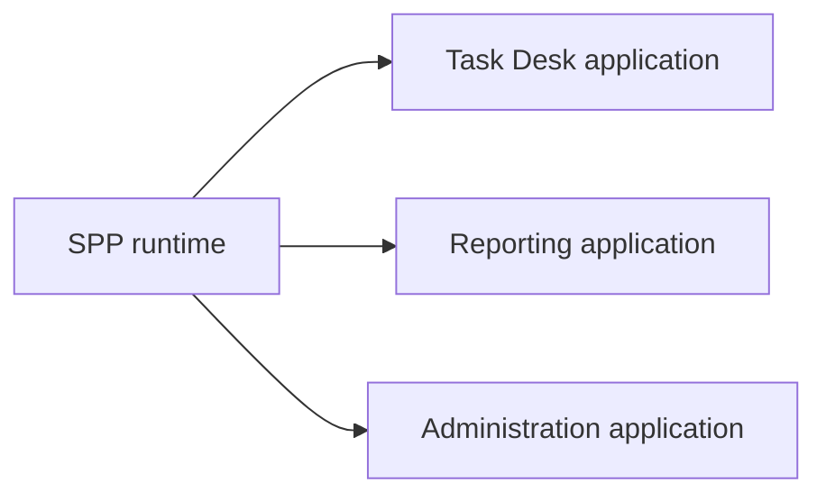
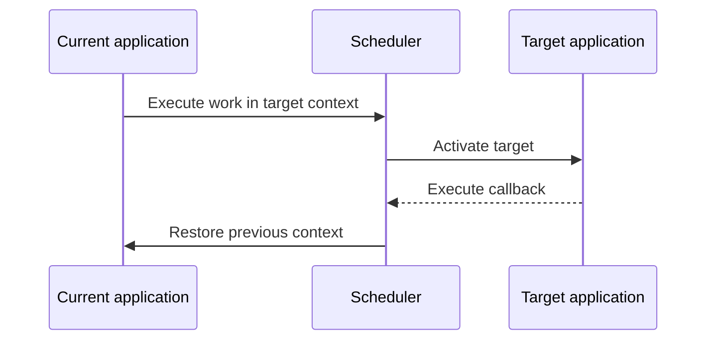
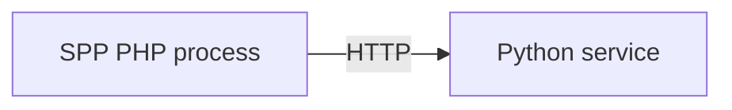
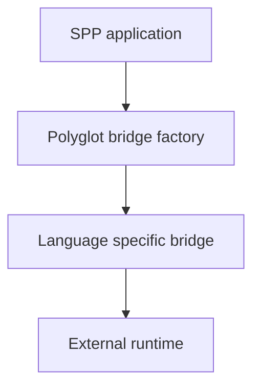
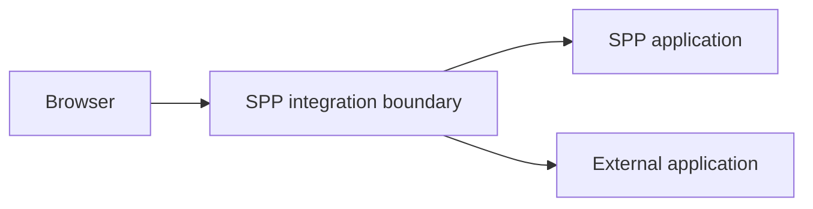
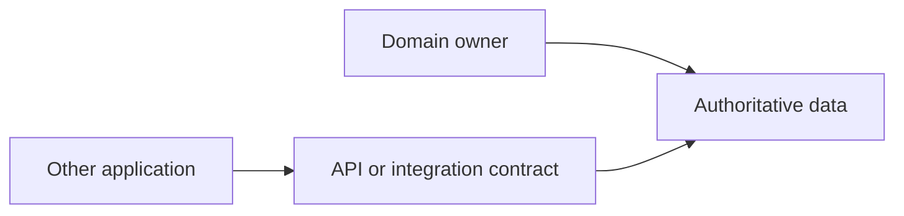
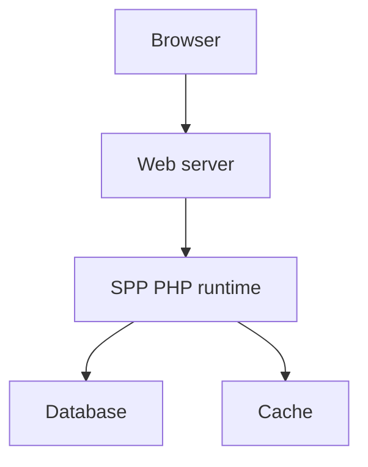
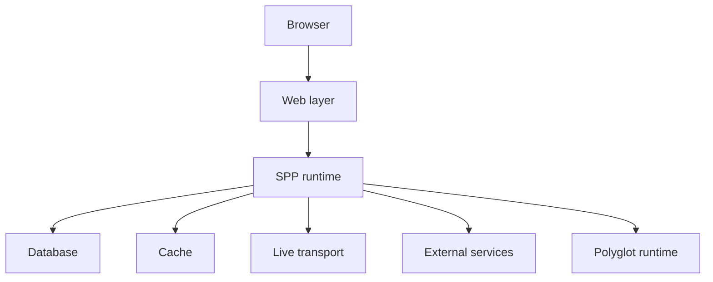
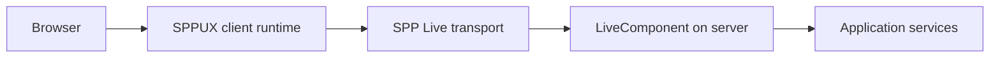
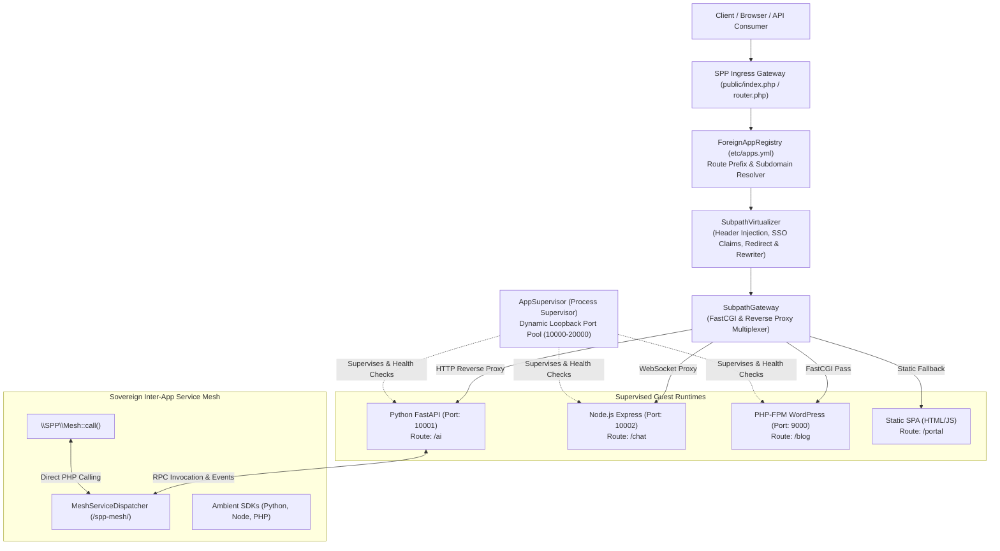

# Volume XV — Enterprise Architecture

## Chapter 21 — Multi-Application, Polyglot, IPC, and Deployment Architecture

**Evidence:** Scheduler/application source, Polyglot bridge classes, external-application integration material, SPP Live/Drishyam runtime, and deployment-related tooling in the repository.

Enterprise architecture is not a synonym for “add more servers”. It means deciding where responsibilities live, which boundaries are real, and what happens when a dependency is unavailable.

This chapter assumes the reader already understands the basic SPP application model from the previous chapters.

---

## 21.1 When one application is enough

Start with one application when one team can own the domain, one configuration boundary is sufficient, and separate deployment or failure isolation is not yet justified.

SPP does not require every feature to become a separate application or service.

A modular application is often the simplest place to begin.

---

## 21.2 When multiple SPP applications become useful

A larger system may contain applications such as:



The Scheduler can register multiple `App` objects and maintain one active application context.

This gives an **in-process application boundary**.

It does not provide operating-system process isolation.

That distinction must remain explicit:

| Boundary | What it provides |
|---|---|
| SPP application context | Application/runtime separation inside the SPP runtime |
| OS process | Separate memory/process failure boundary |
| Network service | Independent runtime reached through a protocol |

---

## 21.3 Why split applications?

Good reasons include:

- different domain ownership;
- substantially different module sets;
- separate URL spaces and application configuration;
- independent operational lifecycle; or
- coexistence with a legacy or externally owned application.

Bad reasons include:

- “microservices are fashionable”;
- two directories happen to exist; or
- one class has become large.

Use modules and normal application boundaries before introducing additional network/process complexity.

---

## 21.4 In-process context switching

`Scheduler::withContext()` is useful when one SPP runtime needs to execute code using another registered application's context and then return to the previous context.

Conceptually:



The expert rule is simple:

> Context switching is not the same thing as process isolation.

Do not use it as a substitute for a real process/network boundary when fault or security isolation is required.

---

## 21.5 What is IPC?

**Inter-process communication (IPC)** simply means one process communicating with another.

IPC is a category, not one specific protocol.

A deployment could use:

- HTTP;
- WebSocket;
- a local socket;
- a queue;
- Redis-backed coordination; or
- a language-specific bridge.

Therefore the architecture should say **which protocol is used**, not merely “IPC”.

For example:



is far more precise than:

```text
SPP → IPC → Python
```

---

## 21.6 Polyglot architecture

SPP contains a polyglot bridge abstraction and language-specific bridge classes. The purpose is to give PHP application code a common integration boundary while the actual external runtime may differ.



The repository contains bridge/runtime assets for several languages. The exact protocol, serialization, worker model, and failure behavior must be taken from each concrete bridge implementation.

Do not infer those details merely from the bridge class name.

---

## 21.7 External non-SPP applications

An external application does not have to be converted into an SPP module.

This matters when integrating an existing platform such as a legacy CMS or another independently maintained system.

The boundary can look like:



The external application remains the owner of its own runtime and business rules.

An adapter can provide SPP-specific routing, service, or protocol integration without pretending the external system is native SPP code.

---

## 21.8 Choosing the right boundary

| Situation | Prefer first |
|---|---|
| Reusable SPP feature | Module |
| Separate SPP domain/application | Application context |
| Different language | Polyglot/service boundary |
| Legacy external platform | Integration adapter |
| Interactive server-side PHP UI | LiveComponent + SPP Live |
| Browser-local state | SPPUX |

This is architectural guidance, not a claim that SPP automatically creates every listed integration.

---

## 21.9 Cross-boundary contracts

Every external boundary needs an explicit contract.

| Contract | Question |
|---|---|
| Input schema | What is allowed to cross the boundary? |
| Output schema | What comes back? |
| Authentication | Who may call it? |
| Authorization | What may the caller do? |
| Timeout | How long may the caller wait? |
| Retry | Which failures are safe to repeat? |
| Idempotency | Can the same operation safely execute twice? |
| Error representation | How are failures communicated? |
| Observability | How can one request be traced across the boundary? |

These contracts belong to the integration implementation, not to the word “polyglot” itself.

---

## 21.10 Data ownership

A common enterprise anti-pattern is allowing multiple applications to write the same domain tables without agreeing on ownership.

Prefer one clear owner:



The consuming application uses the owning domain's contract rather than bypassing business rules through direct database writes.

This is recommended architecture, not a hard SPP rule.

---

## 21.11 Deployment topology

A simple deployment can look like:



A larger deployment can add live transport and external runtimes:



These are topology examples, not a mandatory SPP deployment diagram.

---

## 21.12 Failure isolation

Every added boundary introduces new failure modes.

For example:

```text
Browser → SPP → external service
```

Now the external service can be slow, unavailable, or return invalid data.

For each dependency, decide what happens when it fails:

- immediate failure;
- cached/degraded response;
- queued retry;
- fallback implementation; or
- maintenance response.

A reliable enterprise design makes that decision intentionally.

---

## 21.13 Security boundaries

Cross-process and cross-runtime communication should be treated as a trust boundary even when all components run inside the same company network.

The receiving side should validate according to the actual transport, including where appropriate:

- authentication;
- authorization;
- input/schema validation;
- replay protection;
- rate limiting; and
- audit/observability.

The security chapter explains the distinction between framework mechanisms and general enterprise security guidance.

---

## 21.14 Live architecture in an enterprise system

LiveComponent and SPPUX solve different problems.



A deployment can use normal server-rendered pages for most of the application and use reactive runtimes only where interaction benefits from them.

That is usually simpler than making every page live.

---

## 21.15 Observability across boundaries

A distributed operation should be diagnosable from the originating request to the final dependency.

A practical enterprise design uses a correlation/request identifier and propagates it when the actual protocol permits this.

The handbook does **not** claim a universal built-in SPP correlation protocol unless the source proves one. Where no framework-specific mechanism is established, treat this as deployment guidance.

---

## 21.16 Coming from other architectures

### Monolith

Start with one SPP application and introduce modules for feature boundaries.

### Modular monolith

This maps naturally to SPP modules plus application context boundaries where required.

### Microservices

SPP does not require every feature to become a network service. Introduce network/process boundaries only when ownership, scaling, language, or fault isolation justifies them.

### Service-oriented architecture

Use explicit protocol contracts and adapters at service boundaries. Polyglot support is an implementation tool, not an architecture by itself.

---

## 21.17 Universal OS & Infrastructure Engine (`\SPP\Core\Infra` / `\SPP\Infra`)

An enterprise framework cannot assume that it will only run on Ubuntu with `/var/www/html`. Real-world enterprise environments span:
- Bare-metal Linux servers and BSD appliances.
- User-home shared hosting environments (cPanel, DirectAdmin, Plesk).
- Windows Server environments (IIS, Apache for Windows).
- Developer workstations across Windows, macOS, and WSL2.
- Containerized microservices (Docker, Podman, Kubernetes).
- Ephemeral serverless platforms (AWS Lambda / Bref, Google Cloud Run).

SPP normalizes these disparate platforms through **`\SPP\Core\Infra`** (alias: **`\SPP\Infra`**):

```php
use SPP\Infra;

// 1. Operating System & Distribution
$os = Infra::os();                 // 'windows' | 'linux' | 'darwin' | 'bsd'
$distro = Infra::distro();         // 'debian_like' | 'rhel_like' | 'alpine' | 'arch' | 'suse' | 'windows' | 'darwin'
$distroName = Infra::distroName(); // e.g. "Ubuntu 24.04 LTS (WSL2)", "Alpine Linux 3.19"
$pkgMgr = Infra::packageManager(); // 'apt' | 'dnf' | 'apk' | 'pacman' | 'zypper' | 'brew' | 'choco'

// 2. Web Process Ownership
$webUser = Infra::defaultWebUser(); // 'www-data', 'apache', 'nobody', 'http', 'wwwrun', '_www', 'IIS_IUSRS'

// 3. Execution Context
$isContainer = Infra::isContainer();   // Docker, Podman, Kubernetes
$isServerless = Infra::isServerless(); // AWS Lambda, Cloud Run
$isCli = Infra::isCli();               // PHP_SAPI === 'cli'
```

---

## 21.18 Hosting Topologies & Deployment Environments

| Environment | Typical Path | Web User | SPP Adaptation |
|---|---|---|---|
| **Standard Linux FHS** | `/var/www/html` | `www-data` / `apache` | Direct virtual host or root application dispatch. |
| **User Home (cPanel/DirectAdmin)** | `/home/<user>/public_html` | `<user>` | Automatic traversal permission guidance (`chmod +x /home/<user>`) and addon domain presets. |
| **Windows IIS / Apache** | `C:\inetpub\wwwroot` | `IIS_IUSRS` / `Users` | Windows NTFS ACL handling (`icacls`), `web.config` URL Rewrite rules, and `putAtomic()` lock protection. |
| **macOS Darwin** | `/Users/<user>/Sites` | `_www` | Homebrew HTTPD/Nginx integration and BSD toolchain support. |
| **FreeBSD / OpenBSD** | `/usr/local/www/...` | `www` | BSD `pkg` integration and `/usr/local/etc` hierarchy. |
| **Docker / Kubernetes** | `/app` | `root` or non-root UID 1000 | Container env detection (`/.dockerenv`), zero-boot events, and 12-factor env configuration. |
| **Serverless (AWS Lambda/Bref)** | `/var/task` | `sbx_user1051` | Read-only root detection, in-memory disk (`MemoryDisk`), and `/tmp` scratch redirection. |

---

## 21.19 Cross-Platform Permissions & Read-Only Root Rerouting

### 1. Cross-Platform Permission Setter (`Infra::fixPermissions`)
Calling POSIX `chmod()` or `chown()` on Windows produces PHP warnings or only toggles the read-only flag. `Infra::fixPermissions($path, $mode, $user)` applies the correct mechanism transparently:
- On Linux/macOS/BSD: Executes POSIX `chmod` and `chown`.
- On Windows: Uses safe chmod and `icacls` to grant proper permissions to `IIS_IUSRS` or `Users`.

### 2. Read-Only Root Filesystem Resilience (`Infra::writablePath`)
In security-hardened Docker containers or serverless environments (AWS Lambda / Google Cloud Run), the root application directory (`/` or `/var/task`) is strictly **read-only**.

`Infra::isReadOnlyRoot()` detects this condition. When code requests a writable path via `Infra::writablePath('logs/app.log')` or `Infra::tempDir()`, SPP automatically redirects writable assets to an isolated writable scratch directory (`/tmp/spp/...`), preventing runtime write crashes.

---

## 21.20 Deployment Operating Paradigms: Single Domain Copy-Paste vs. Multi-Domain Multi-Tenancy

Enterprise applications fall into two primary operational patterns, both natively accommodated by SPP:

### 1. Single Domain Copy-Paste Paradigm (`mode: single`)
* **Zero Configuration**: Developers and operations engineers can copy-paste the entire framework codebase into any target document root (Apache, Nginx, IIS, cPanel `public_html`, or local server) and access it immediately.
* **No Domain Routing Enforced**: In Single Domain Mode, domain routing is not required and not enforced. SPP accepts any incoming `HTTP_HOST` or IP address without error.
* **Automatic Graceful Boot**: If `etc/domains.yml` is missing or contains no domain records, the framework automatically defaults to Single Domain Mode.
* **No Unwanted Redirects**: Canonical 301 host redirections and subdomain isolation rules are bypassed.

### 2. Enterprise Multi-Domain Paradigm (`mode: multi`)
* **High-Density Multi-Tenancy**: A single SPP deployment powers multiple domains, subdomains, and customer portals from a single PHP runtime.
* **Active Routing & Scoping**: `DomainRouter` resolves incoming `Host` headers against `etc/domains.yml`, dynamically mounting tenant applications, enforcing code isolation (`domains/<domain>/src/<app>`), and shielding private applications.
* **Declarative Policies**: Unmapped hosts enforce strict isolation policies (`strict`, `inherit`, `redirect`, `dynamic_tenant`, `permissive`).

### Switching Deployment Paradigms via CLI & Web Console:
```bash
# Prepare installation for zero-config copy-paste deployment
php spp.php domain:mode single

# Activate enterprise multi-tenant virtual host routing
php spp.php domain:mode multi strict
```

In addition to CLI automation, deployment paradigms can be toggled and monitored directly through **SPPAdmin** (`/sppadmin/#domains`) and **SPPDev** (`/sppdev/#domains`). The visual dashboard features a real-time Architecture Mode Banner with 1-click toggling, visual domain scoping flags, an interactive application uninstaller with safety backup generation, 1-click backup restore, and permanent disk reclamation.

---

## 21.21 Application Decommissioning, Safety Backups, and Storage Reclamation

When retiring or scaling applications across environments, SPP enforces enterprise-grade application lifecycle management via `\SPP\Core\AppUninstaller`:

1. **Config-Only Removal**: Detaches the application from `global-settings.yml`, unbinds virtual hosts in `etc/domains.yml`, and purges routing caches while leaving application source code intact in `src/{appName}`.
2. **Full Removal**: Completely purges application source code, configuration directories (`etc/apps/{appName}`), and database files.
3. **Automated Safety Backups**: Prior to uninstallation, SPP automatically creates a standalone compressed archive in `var/backups/apps/{appName}_{timestamp}.zip` with an embedded `manifest.json`.
4. **1-Click Restoration**: Reconstructs application code, configurations, database, and domain mappings from backup archives via `AppUninstaller::restore()`.
5. **Disk Storage Reclamation**: Unneeded backups can be inspected and permanently unlinked via CLI (`php spp.php app:backup:delete <archive>`) or the SPPAdmin/SPPDev Backups tab to free server disk space.

---

## 21.22 Sovereign Multi-Language Application Hosting, Route Virtualization & Inter-App Mesh

Enterprise environments rarely consist exclusively of one framework or language. An organization may run a core institutional ERP in SPP, an editorial CMS in WordPress (PHP-FPM), an AI predictive analytics engine in Python (FastAPI/PyTorch), and a real-time collaborative service in Node.js (Express/WebSockets).

SPP introduces an enterprise-grade **Multi-Language Application Integrator & Sovereign Service Mesh** that hosts, supervises, virtualizes, and networks heterogeneous stacks natively on a single server without requiring Docker, PM2, or Supervisord.



### Architectural Principles:

1. **Declarative Application Manifest (`etc/apps.yml`)**: Centralized catalog declaring guest applications, stack runtimes (`python`, `node`, `php-fpm`, `go`, `static`), route directory prefixes (`/ai`), dedicated subdomains (`ai.school.local`), and health check URLs.
2. **Subpath Virtualization Engine (`SubpathVirtualizer`)**:
   - **Ingress Header Virtualization**: Injects `X-Forwarded-Prefix`, `X-Forwarded-Host`, `X-Forwarded-Proto`, and `X-SPP-Gateway`.
   - **Ambient Single Sign-On (SSO)**: Injects HMAC-SHA256 authenticated user claims (`X-SPP-User-Id`, `X-SPP-Claims`, `X-SPP-Signature`) based on `SPP_APP_TOKEN`.
   - **Response Virtualization**: Dynamically rewrites HTTP `Location:` redirects, scopes `Set-Cookie` paths to the subpath directory, and injects `<base href="/route/">` into HTML documents to prevent broken relative assets.
3. **Cross-Platform Process Supervisor (`AppSupervisor`)**: Autonomous daemon supervisor running across Windows, Linux, and macOS. Dynamically allocates available loopback ports from `10000–20000`, injects ambient environment variables (`SPP_HOST=1`, `PORT`, `SPP_APP_TOKEN`), records runtime state in `var/run/apps/*.state.json`, and streams logs to `var/run/apps/*.log`.
4. **Sovereign Inter-App Service Mesh (`\SPP\Mesh`)**: Fluent PHP interface allowing native SPP controllers, CQRS handlers, and workflows to invoke guest microservices directly via `\SPP\Mesh::call($appId, $endpoint, $payload, $method)`, with automated on-demand daemon bootstrapping.
5. **Unified Developer Studio (`/sppdev#apps` & `/sppdev#mesh`)**: Eliminates interface hopping by embedding multi-language application management, 1-click supervisor controls (Start, Stop, Restart, View Logs, RPC sandbox), live process fleet tracking, and a cross-app event bus inspector directly into the Developer Studio.

---

## 21.23 Sovereign Bare-Metal Linux Deployments & Node Telemetry (Zero-cPanel)

Deploying SPP on a sovereign Linux server (such as **AlmaLinux 9**, Rocky Linux, or Debian) without commercial control panels like cPanel eliminates gigabytes of idle background overhead, vendor lock-in, and proprietary license costs:

1. **Bare-Metal Telemetry Cockpit (`/admin/server`)**: Directly probes host kernel virtual filesystems (`/proc/meminfo`, `/proc/uptime`, `sys_getloadavg()`) and disk space (`disk_total_space`, `disk_free_space`) to display live CPU load, physical RAM breakdown, and storage metrics without high-privilege shell escalation.
2. **Web Server & Runtime Diagnostics**: Identifies event-driven Nginx / Apache web servers, PHP-FPM pool socket connections, SAPI modes, and Zend OPcache real-time hit rates and memory allocation.
3. **Hardened Security State Verification**: Automatically audits whether SELinux is in `Enforcing` mode, verifies host firewall daemons (`Firewalld` / `UFW`), and ensures active TLS/HTTPS transport security.
4. **1-Click Sovereign Operations**: Framework cache purge (`/var/cache`) and Zend OPcache bytecode reset (`opcache_reset()`) to immediately apply atomic deployments.

*(For exhaustive architectural details, telemetry formulas, and publisher governance, see [Chapter 72 — Sovereign App Store, Publisher Governance, and Bare-Metal Linux Operations](72-sovereign-store-user-governance-and-baremetal-telemetry.md).)*

---

## 21.24 Canonical Multi-Domain Enterprise Filesystem Topology

A primary architectural mandate of SPP 2.0+ is that **one shared framework core serves multiple independent domains** without duplicating framework files.

```text
SPP_ROOT/
│
├── spp/                                # Shared framework kernel
│   ├── core/                           # Kernel classes, PathResolver, DomainContext
│   ├── admin/                          # SPPAdmin Workbench & Studio
│   └── modules/                        # First-party & optional modules
│
├── apps/                               # Canonical platform-level applications repository
│   ├── application-a/                  # Global application code
│   └── application-b/
│
├── etc/                                # Platform-level configuration
│   ├── domains.yml                     # Platform Domain Registry
│   ├── settings.yml                    # Global system settings
│   └── apps/                           # Platform-wide application configurations
│
├── sppdata/                            # Platform runtime data
│   ├── cache/                          # Global compiled templates & metadata caches
│   ├── logs/                           # Platform logs & audit.jsonl
│   └── temp/                           # Ephemeral scratch files
│
└── domains/                            # Virtual host tenant containers
    │
    ├── example.com/                    # Tenant Domain Root
    │   ├── apps/                       # Domain-specific applications (isolated to this host)
    │   ├── etc/apps/                   # Domain-specific configuration overrides
    │   ├── sppdata/                    # Tenant runtime data (cache, logs, uploads, sessions)
    │   └── public/                     # Optional tenant-specific document root
    │
    └── example.org/                    # Peer tenant root (isolated from example.com)
        ├── apps/
        ├── etc/
        ├── sppdata/
        └── public/
```

### Key Deployment Invariants:
1. **Configurable Domain Directories**: By default, tenants reside in `domains/<domain>/`. SPP also supports custom absolute filesystem locations (e.g. `/srv/websites/example.com`) mapped via `path:` in `etc/domains.yml`.
2. **PathResolver Enforcement**: No service or controller may construct ad-hoc filesystem paths. All paths are resolved through `\SPP\Core\Domain\PathResolver`, which canonicalizes paths and rejects traversal attempts (`../`).
3. **Public/Private Directory Separation**: Private tenant data (`sppdata/`, `etc/`) is stored outside the public document root and protected by web server rewrite rules.

---

## 21.25 Multi-Scope Backups & Disaster Recovery (`BackupAdminService`)

Enterprise operations require granular backup capabilities that do not force full-system downtime or bundle unrelated tenant data together.

SPP's **BackupAdminService** (`\SPP\Admin\Services\BackupAdminService`) introduces **5 distinct backup scopes**:

| Backup Scope | Contents Included | Primary Use Case |
|---|---|---|
| `domain` | Entire tenant container: `domains/<domain>/` (apps, configs, sppdata) | Moving an entire tenant to another node or pre-upgrade snapshot. |
| `domain_app` | Single domain-isolated application: `domains/<domain>/apps/<app>/` | Scoped code updates or rollbacks for a specific tenant plugin. |
| `global_apps` | All platform applications: `apps/` and `src/` | Platform-wide application code backups. |
| `database` | System and tenant SQLite/XDB databases | Scheduled database-only snapshots. |
| `platform` | Full framework snapshot (`spp/`, `apps/`, `etc/`, `domains/`) | Complete server migration or disaster recovery. |

Creating scoped snapshots via CommandBridge:
```php
$backupService = new \SPP\Admin\Services\BackupAdminService();

// Create isolated snapshot for tenant domain
$result = $backupService->createBackup([
    'scope'  => 'domain',
    'domain' => 'portal.example.com',
    'note'   => 'Pre-v2.1 upgrade snapshot'
]);
// Writes to: var/backups/portal.example.com/backup_domain_portal.example.com_YYYYMMDD_HHMMSS.zip
```

---

## Kernel Hacker note

The most useful SPP architectural distinction is between **composition boundaries** and **failure boundaries**.

A module is primarily a composition mechanism.

An application context is a runtime/application boundary.

A separate process provides stronger failure and resource isolation.

A protocol boundary provides explicit interoperability.

A browser runtime is a different execution environment entirely.

Good architecture chooses the smallest boundary that provides the property actually required.

### Source map

- `spp/core/Domain/PathResolver.php`
- `spp/core/Domain/DomainRegistry.php`
- `spp/core/Domain/DomainContext.php`
- `spp/admin/services/BackupAdminService.php`
- `etc/apps.yml`
- `etc/domains.yml`
- `spp/core/apps/ForeignAppRegistry.php`
- `spp/core/apps/SubpathVirtualizer.php`
- `spp/core/apps/SubpathGateway.php`
- `spp/core/apps/AppSupervisor.php`
- `spp/core/apps/Mesh.php`
- `spp/core/apps/MeshServiceDispatcher.php`
- `spp/lib/mesh/`
- `spp/dev/js/views/apps.js`
- `spp/admin/js/views/apps.js`
- `spp/core/class.scheduler.php`
- `spp/core/Polyglot/`
- `spp/services/`
- `spp/modules/contrib/`
- `spp/modules/spp/spplive/`
- external application integration documentation
- deployment-related commands/configuration
