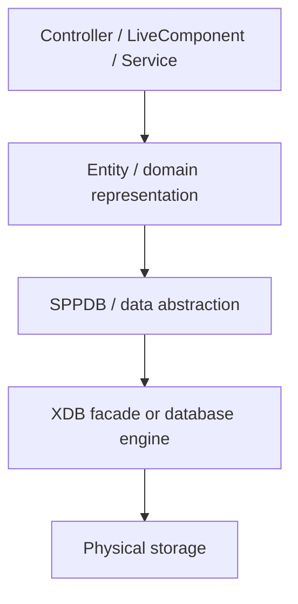
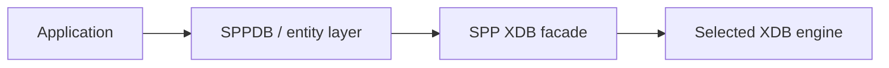
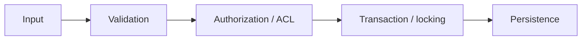
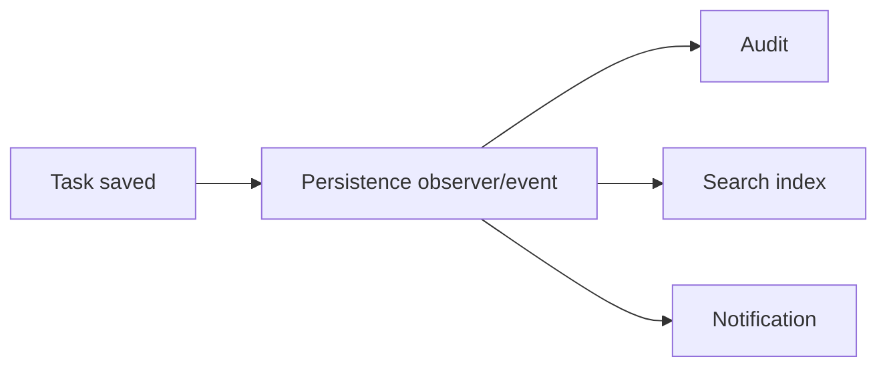
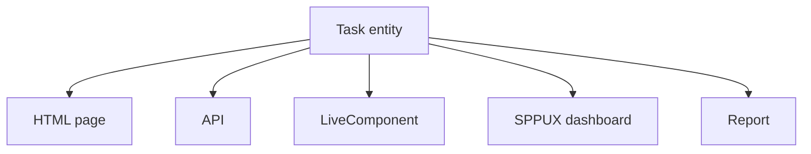
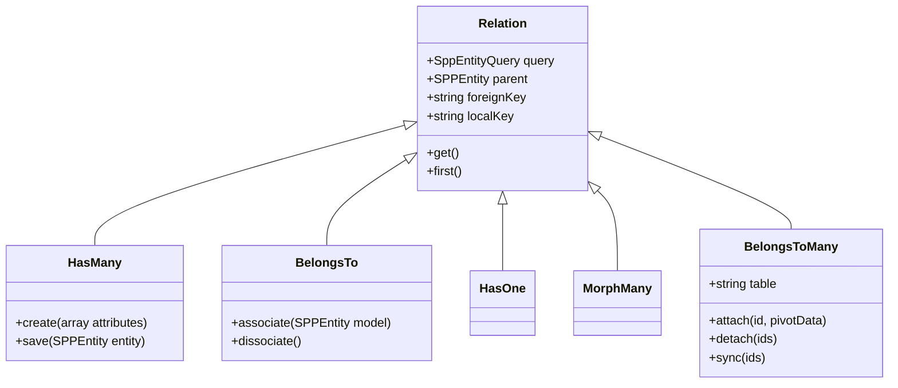
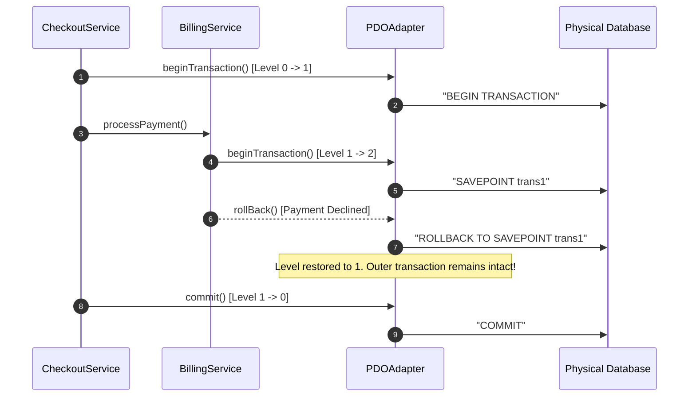
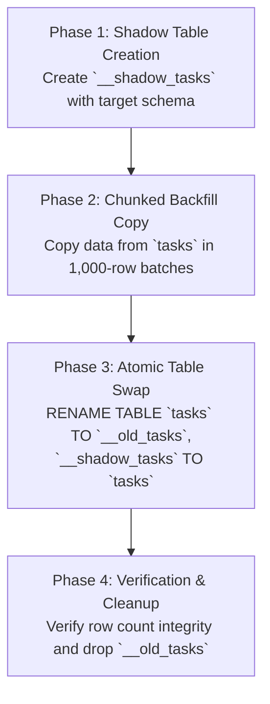

# 40. Data and Persistence: Entities, SPPDB, and SPP XDB

A web application becomes interesting when it has data that survives the request.

A beginner may start with:

```php
$tasks = [
    ['title' => 'Buy milk'],
    ['title' => 'Prepare report'],
];
```

But that array disappears when the PHP request ends.

Persistence means the application can store information and retrieve it later.

SPP has more than one layer for this problem. The handbook therefore teaches them separately instead of calling everything "the database".

## 40.1 The persistence stack

Think in layers:



The important lesson is:

> **Your controller should not need to know how bytes are stored on disk.**

## 40.2 Why have an abstraction?

Suppose application code embeds SQL or storage-specific code everywhere. Changing storage then becomes expensive.

An abstraction gives a cleaner boundary:

```text
application code
      ↓
SPPDB / entity APIs
      ↓
storage implementation
```

The application depends on a framework data contract instead of every low-level storage detail.

# Part I — Entities

## 40.3 What is an entity?

An entity represents something meaningful to the application.

Examples:

```text
Task
User
Organisation
Report
Approval
Document
```

A beginner should think:

> An entity is an application concept that has data and identity.

It is not necessarily identical to a physical database row, although it may map to one.

## 40.4 The SPP entity layer

The repository contains an SPP database-entity abstraction and entity-query infrastructure. This gives the application a place to express:

- entity identity;
- fields;
- relationships;
- persistence queries;
- validation/metadata;
- application semantics.

This layer is especially important for the main Task Desk tutorial.

## 40.5 Build a Task entity

Start conceptually with:

```text
Task
----
id
created_by
title
description
status
priority
created_at
updated_at
```

Then decide which fields are:

```text
required
optional
indexed
validated
editable
computed
```

That distinction becomes important later for forms, APIs, LiveComponent, and SPPUX.

# Part II — SPPDB

## 40.6 What SPPDB is solving

SPPDB is the framework's database/data-access abstraction layer. It sits between application logic and concrete storage implementation.

A beginner mental model:


This lets application code concentrate on data operations without hard-coding every storage detail into every service.

## 40.7 Querying data

The repository provides entity-query and query-builder infrastructure.

The exact query API should be taken from the current SPP source, but conceptually a query does this:

```text
choose source
   ↓
select fields
   ↓
filter
   ↓
sort
   ↓
paginate
   ↓
execute
   ↓
map result
```

Do not put query-building logic into templates.

## 40.8 Query builder versus hand-written SQL

A query builder is useful when conditions are dynamic, queries are reused, framework-level composition is valuable, or storage details should remain behind an abstraction.

Hand-written SQL can still be appropriate when the repository/database contract explicitly supports it and the query genuinely benefits from SQL's expressiveness.

The handbook should teach both rather than claiming one is universally superior.

# Part III — XDB

## 40.9 What is SPP XDB?

The repository contains a substantial XDB subsystem in `spp/modules/spp/sppxdb`.

It includes a facade/factory model and supporting components for querying, pagination, migrations, indexing, validation, locking, ACL, observers, and administration.

A beginner should first learn:

> **XDB is a storage/data subsystem behind a framework-level abstraction, not simply a class you call from every controller.**

## 40.10 The XDB facade

Conceptually:



This separation becomes valuable when learning engines and advanced storage features.

## 40.11 Engines

The repository exposes XDB engine namespaces and engine-related classes.

The handbook should teach the engines independently:

```text
engine-neutral application code
          ↓
       XDB facade
          ↓
selected engine
```

The exact engine capabilities must be taken from the current implementation rather than inferred from class names alone.

# Part IV — CRUD

## 40.12 Create

A create operation generally follows:


Never let arbitrary HTTP input go directly to persistence.

The safe application path is:

```text
request
→ validation
→ authorization
→ business rules
→ persistence
```

## 40.13 Read

For the Task Desk list:

```text
request
→ route
→ controller/service
→ query
→ result set
→ pagination
→ view/API/live response
```

The same underlying data can feed several frontends.

## 40.14 Update

An update should identify:

```text
which entity
who is editing it
what fields may change
whether the transition is valid
whether the user is authorized
```

That is why persistence is tied to security and workflow later in the handbook.

## 40.15 Delete

Deletion requires explicit policy.

Questions include:

- Is deletion allowed?
- Is the record soft-deleted or physically removed?
- Do dependent objects exist?
- Must an audit record be created?
- Should an event be fired?

The database operation is only one part of application behavior.

# Part V — Migrations and seeders

## 40.16 Schema changes need history

If the application changes from:

```text
task.title
```

to:

```text
task.title
 task.priority
```

existing installations need a reproducible way to acquire the new structure.

That is what migrations solve.

SPP has dedicated migration infrastructure under the SPPDB/XDB layers and CLI commands for migration generation/execution.

## 40.17 Seed data

Seeders create known initial data, such as:

```text
admin user
initial roles
default settings
demo tasks
reference data
```

The repository provides seeder scaffolding, so the tutorial teaches both manual seed logic and generated seeders.

# Part VI — Transactions, locking, ACL, and validation

These are advanced persistence concerns.

### Transactions

A transaction groups operations so the application can reason about their combined success/failure.

### Locking

Locking coordinates concurrent access to shared data.

### ACL

ACL determines whether an operation is permitted on data.

### Validation

Validation protects the data contract before persistence.

They are distinct concepts:



The repository contains dedicated XDB classes for ACL, locking, and validation. Their precise guarantees should be learned from implementation/tests rather than assumed from the class names.

# Part VII — Pagination and indexing

## 40.18 Pagination

A list of 10,000 tasks should not normally produce 10,000 rows of HTML in one response.

Pagination turns all results into a manageable page:

```text
all results
    ↓
page 1 of N
```

The XDB subsystem contains a paginator component.

A well-structured application can reuse the same pagination concept across:

```text
HTML pages
APIs
LiveComponent
SPPUX dashboards
reports
```

## 40.19 Indexing

Indexes exist to make particular access patterns faster.

The right question is not:

> "Should everything be indexed?"

It is:

> "Which queries must be efficient, and what index supports those queries?"

The XDB subsystem contains indexing support; the exact index model should be learned from the current engine implementation.

# Part VIII — Observers and events

Persistence can participate in events/observers.

For example:



This is a powerful architectural pattern, but do not use it for every simple update. Explicit service calls are often easier to understand when the dependency is mandatory.

# Part IX — XDB administration

The repository contains an XDB shell and XDB-specific command infrastructure.

The administrator/architect branch should teach:

```text
inspect schema
inspect data
run supported queries/operations
run migrations
seed data
inspect indexes
investigate locks
inspect failures
```

Exact commands must be copied from the repository's current command documentation rather than invented.

# Part X — Test data and Parikshak

Persistence must be tested continuously.

A good data test covers:

```text
create
read
update
delete
validation failure
authorization failure
transaction failure
migration behavior
seed behavior
pagination
```

Use Parikshak's database-refresh facilities where appropriate so tests do not contaminate one another.

# Part XI — Practical Task Desk project

Extend the application with:

```text
Task entity
Task migration
Task seeder
Task CRUD service
Task list page
Task detail page
Task form
Task API
Task LiveComponent later
Task SPPUX dashboard later
```

Then prove the same entity can support different interaction styles:



This is the central persistence lesson of SPP:

> **The data model should not be rebuilt separately for every presentation mechanism.**

# Part XII — Coming from Other Frameworks: Comparative Analysis

| Feature | Laravel (Eloquent) | Symfony (Doctrine ORM) | Django ORM | SPP (Modern SPPDB) |
|---|---|---|---|---|
| **Architecture Pattern** | Active Record | Data Mapper / Unit of Work | Active Record | **Hybrid Active Record + Request-Scoped Identity Map** |
| **Object Identity Guarantee** | ❌ Multiple queries for same PK produce separate divergent objects | ✔️ Identity Map built into EntityManager | ❌ Separate in-memory model instances | ✔️ **Automatic Identity Map across all `find()`, queries & hydration** |
| **Relation Return Types** | Relation Query Proxies | Collections / PersistentCollection | RelatedManager | **First-Class Relation Objects (`HasMany`, `BelongsTo`, etc.)** |
| **Relational Filtering** | `whereHas()` / `whereDoesntHave()` | DQL subqueries | `.filter(related__field=val)` | **Fluent `whereHas()` & `whereDoesntHave()` using correlated `EXISTS`** |
| **Relationship Mutations** | `associate()`, `attach()`, `sync()` | Collections add/remove + `flush()` | `.add()`, `.remove()`, `.set()` | **Fluent `associate()`, `create()`, `save()`, `attach()`, `detach()`, `sync()`** |
| **Declarative Attributes** | Docblock / limited attributes | PHP 8 Attributes | Python class attributes | **Full PHP 8.2+ Attributes (`#[Table]`, `#[Id]`, `#[Column]`, `#[HasMany]`, etc.)** |
| **Nested Transactions** | Savepoints via manual naming | Nested transactions simulated | `atomic(savepoint=True)` | **Full ACID Savepoint Nesting auto-managed at DB adapter layer** |
| **Zero-Downtime DDL** | ❌ Manual external tools (`gh-ost`) | ❌ Lock-heavy standard DDL | ❌ Standard table locks | **Built-in `SafeDDLRunner` 4-phase shadow-table swap engine** |
| **AI Vector Search** | ❌ External packages required | ❌ External packages required | ❌ External packages required | **Native multi-dialect compiler (`pgvector`, `sqlite-vec`, MySQL 9.0+)** |
| **Storage Engines** | RDBMS via PDO | RDBMS via DBAL | RDBMS via Drivers | **Hybrid: Multi-RDBMS PDO + High-Performance Embedded XDB SQLite WAL** |

### Transitioning from Laravel Eloquent
Developers familiar with Eloquent will feel right at home with SPP's fluent Active Record methods (`::find()`, `::where()`, `$entity->save()`, `$entity->delete()`). However, SPP solves the critical "split-brain" mutation issue that plagues Eloquent by embedding an automatic, request-scoped **Identity Map**. When you call `User::find(5)` in three different places during a request lifecycle, SPP returns the exact same in-memory instance, ensuring that mutations applied in a domain service are instantly visible to event listeners without re-querying the database.

### Transitioning from Symfony & Doctrine
Doctrine users will appreciate SPP's strong identity guarantees, clean attribute declarations (`#[Table]`, `#[Column]`, `#[HasMany]`), and transactional integrity, but without the verbose ceremony of `EntityManager::persist()`, `EntityManager::flush()`, and detached entity management. SPP models are self-persisting Active Records backed by intelligent lifecycle events.

### Transitioning from Django ORM
Django developers will recognize the declarative schema definition and intuitive relationship navigation. SPP takes this further by supporting seamless client-side reactivity (LiveComponent, SPPUX), built-in workflow state machines, and zero-downtime shadow table schema migrations directly from the core CLI.

---

# Part XIII — First-Class Relation Objects

In enterprise applications, domain models rarely exist in isolation. Students enroll in courses, users author tasks, and organizations maintain departments.

SPP provides a suite of first-class relation classes extending `\SPPMod\SPPDB\Relations\Relation`:



### 1. Defining Relationships on Entities

```php
namespace App\Entities;

use SPPMod\SPPDB\SPPEntity;
use SPPMod\SPPDB\Attributes\Table;
use SPPMod\SPPDB\Attributes\Id;
use SPPMod\SPPDB\Attributes\Column;
use SPPMod\SPPDB\Attributes\HasMany;
use SPPMod\SPPDB\Attributes\BelongsToMany;
use SPPMod\SPPDB\Relations\HasMany as HasManyRelation;
use SPPMod\SPPDB\Relations\BelongsToMany as BelongsToManyRelation;

#[Table('students')]
class Student extends SPPEntity
{
    #[Id]
    public int $id;

    #[Column('name')]
    public string $name;

    #[HasMany(Enrollment::class, 'student_id')]
    public function enrollments(): HasManyRelation
    {
        return $this->hasMany(Enrollment::class, 'student_id');
    }

    #[BelongsToMany(Course::class, 'course_students', 'student_id', 'course_id')]
    public function courses(): BelongsToManyRelation
    {
        return $this->belongsToMany(Course::class, 'course_students', 'student_id', 'course_id');
    }
}
```

### 2. Fluent Relational Queries & Chaining
Relation methods act as query builder proxies. You can filter, order, and paginate related records directly from the parent entity:

```php
$student = Student::find(101);

// Chaining on the relation builder:
$honorsEnrollments = $student->enrollments()
    ->where('grade', '=', 'A')
    ->orderBy('created_at', 'DESC')
    ->get();
```

### 3. Dynamic Property Access with Instance Caching
Accessing the relationship as a dynamic property automatically executes the relation query and caches the resolved collection on the entity instance:

```php
// First access executes the SQL query
$enrollments = $student->enrollments;

// Second access returns from memory without hitting the database:
foreach ($student->enrollments as $enrollment) {
    echo $enrollment->grade;
}
```

### 4. Relational Persistence Helpers
SPP relation objects provide intuitive mutation helpers:

```php
// Create a new child entity directly through the relation:
$newEnrollment = $student->enrollments()->create([
    'course_id' => 45,
    'grade'     => 'Incomplete',
]);

// Associate a BelongsTo relationship:
$enrollment = Enrollment::find(1);
$enrollment->student()->associate($student);
$enrollment->save();

// Many-to-Many pivot table mutations:
$student->courses()->attach(88, ['term' => 'Fall 2026']);
$student->courses()->detach(42);
$student->courses()->sync([10, 12, 15]); // Retains 10, 12, 15 and removes others
```

### 5. Correlated Existence Queries: `whereHas` & `whereDoesntHave`
To filter parent records based on conditions in related entities without creating messy manual joins:

```php
// Find all students who have at least one enrollment with grade 'A':
$topStudents = Student::query()
    ->whereHas('enrollments', function($q) {
        $q->where('grade', '=', 'A');
    })
    ->get();

// Find students who have NEVER enrolled in course 99:
$eligibleStudents = Student::query()
    ->whereDoesntHave('enrollments', function($q) {
        $q->where('course_id', '=', 99);
    })
    ->get();
```

---

# Part XIV — Request-Scoped In-Memory Identity Map

In high-concurrency enterprise applications and complex service layers, multiple classes often request the same database entity within a single request. 

Without an Identity Map, each call executes a redundant SQL query and creates a brand-new object instance. If Service A updates the student's status, Service B (holding a distinct object instance for the same record) remains unaware of the change, resulting in **split-brain state** and accidental data corruption:

```mermaid
flowchart TD
    subgraph Without Identity Map [Without Identity Map (Split-Brain)]
        Q1["Student::find(42)"] --> ObjA["Student Instance A\n(status: 'pending')"]
        Q2["Student::find(42)"] --> ObjB["Student Instance B\n(status: 'pending')"]
        ObjA -->|Mutate & Save| DB1["DB updated to 'active'"]
        ObjB -->|Unaware of A's edit! Overwrites DB| DB2["DB corrupted!"]
    end

    subgraph With Identity Map [With SPP Identity Map (Guaranteed Singularity)]
        Q3["Student::find(42)"] --> Map{"Identity Map Check"}
        Map -->|Cache Miss| DB3["Fetch DB Row"]
        DB3 --> Inst["Student Instance #42\n(Singleton in Request Scope)"]
        Inst --> Map
        Q4["Student::find(42)"] --> Map
        Map -->|Cache Hit!| Inst
        Inst -->|Single In-Memory Reference| SvcA["Service A"]
        Inst -->|Single In-Memory Reference| SvcB["Service B"]
    end
```

### Identity Map Lifecycle:
- **`IdentityMap::get($class, $id)`**: Returns the cached entity if present.
- **`IdentityMap::set($class, $id, $entity)`**: Caches the entity instance. Automatically invoked by `::find()`, `::load()`, `hydrateFromRaw()`, and `$entity->save()`.
- **`IdentityMap::forget($class, $id)`**: Purges an entity upon `$entity->delete()`.
- **`IdentityMap::clear()`**: Resets all stored instances between queue jobs or tests.
- **`IdentityMap::withoutIdentityMap(callable $callback)`**: Temporarily disables caching for massive batch imports to conserve memory.

---

# Part XV — Nested Transactions and Savepoints

ACID transaction boundaries often cross modular boundaries. For example, a financial checkout service begins a transaction, calls an enrollment service which also begins a transaction, and then invokes a logging service.

Standard database drivers crash or silently commit the outer transaction when a nested `BEGIN` is attempted. SPPDB transparently converts nested transaction calls into **SQL Savepoints**:



Application developers write clean, modular, encapsulated services without worrying whether an upstream caller has already opened a transaction.

---

# Part XVI — Modern Declarative PHP 8.2+ Attributes

SPP eliminates bulky XML and YAML mapping files by allowing entities to declare metadata directly in PHP 8.2+ native attributes:

```php
namespace App\Entities;

use SPPMod\SPPDB\SPPEntity;
use SPPMod\SPPDB\Attributes\Table;
use SPPMod\SPPDB\Attributes\Id;
use SPPMod\SPPDB\Attributes\Column;
use SPPMod\SPPDB\Attributes\HasMany;
use SPPMod\SPPDB\Attributes\BelongsTo;
use SPPMod\SPPDB\Attributes\Workflow;

#[Table('courses')]
#[Workflow('course_approval')]
class Course extends SPPEntity
{
    #[Id]
    public int $id;

    #[Column('title')]
    public string $title;

    #[Column('credits')]
    public int $credits = 3;

    #[Column('department_id')]
    public int $departmentId;

    #[BelongsTo(Department::class, 'department_id')]
    public function department()
    {
        return $this->belongsTo(Department::class, 'department_id');
    }

    #[HasMany(Lesson::class, 'course_id')]
    public function lessons()
    {
        return $this->hasMany(Lesson::class, 'course_id');
    }
}
```

Attributes are scanned and cached in memory upon first reference, ensuring maximum performance.

---

# Part XVII — Zero-Downtime Safe DDL Migrations

In high-traffic production environments, running `ALTER TABLE` on tables containing millions of rows acquires exclusive metadata locks (`ACCESS EXCLUSIVE`), blocking reads and writes and bringing the application down.

SPP introduces `SafeDDLRunner`, which executes schema evolutions using the battle-tested **4-Phase Shadow Table Pattern**:



```php
use SPPMod\SPPDB\Migration\SafeDDLRunner;

$runner = new SafeDDLRunner();

// Add a column with zero downtime and zero table lock:
$runner->addColumn('tasks', 'priority', 'INTEGER DEFAULT 1 NOT NULL', function($shadowTable) {
    // Optional data backfill / transformation lambda
});

// Test safely in CI/CD pipeline using dry-run mode:
$runner->dryRun(true);
$runner->addColumn('tasks', 'archived_at', 'DATETIME NULL');
```

---

# Part XVIII — Native AI Vector Similarity Search

Modern intelligent applications need to perform semantic search, question-answering over documents, and recommendation matching directly from database entities.

SPP compiles vector similarity search across all major database engines without third-party dependencies:

```php
use App\Entities\Article;

// Perform semantic search for articles matching an AI query embedding:
$queryVector = [0.12, -0.45, 0.88, /* ... 1536 float dimensions */];

$matchingArticles = Article::query()
    ->where('status', '=', 'published')
    ->whereSemanticSimilarity('embedding', $queryVector, 'cosine', 0.85, 10)
    ->get();

foreach ($matchingArticles as $article) {
    echo "Found relevant article: " . $article->title . "\n";
}
```

The SQL compiler automatically produces:
- **PostgreSQL**: `WHERE ("embedding" <=> ?::vector) < 0.15 ORDER BY "embedding" <=> ?::vector ASC LIMIT 10`
- **SQLite**: `WHERE vec_distance_cosine("embedding", ?) <= 0.15 ORDER BY vec_distance_cosine("embedding", ?) ASC LIMIT 10`
- **MySQL 9.0+**: `WHERE DISTANCE(`embedding`, CAST(? AS VECTOR), 'COSINE') <= 0.15 ORDER BY DISTANCE(...) ASC LIMIT 0, 10`

---

# Part XIX — Type Safety & IDE Helper Generation

Active Record entities often suffer from lack of autocomplete in IDEs like PhpStorm or VS Code. SPP provides an automated type-generator command:

```bash
php spp.php make:entity-types
```

This scans all application entities and produces a comprehensive `_ide_entity_helper.php` file providing:
- Full `@property` and `@property-read` definitions for all entity fields and relationships.
- Fluent static method autocomplete for `::where()`, `::find()`, `::create()`, `::whereHas()`.
- Deep static analysis support for PHPStan and Psalm.

---

# Kernel Hacker Section

Read the persistence implementation from high level to low level:

```text
SPPEntity Domain Models
        ↓
Attributes & Reflection Cache (SPPEntity::loadEntityConfig())
        ↓
Request-Scoped IdentityMap Singleton Cache
        ↓
First-Class Relation Proxies (HasMany, BelongsTo, BelongsToMany)
        ↓
SppEntityQuery AST (Conditions, Correlated Subqueries, Joins)
        ↓
Dialect Compilers (MySQLCompiler, PostgresCompiler, SQLiteCompiler)
        ↓
Driver Adapters (PDOAdapter, XDBAdapter, Savepoint Emulation)
        ↓
Physical Database Storage Engine
```

### Useful Repository Landmarks:
```text
spp/modules/spp/sppdb/
├── Attributes/
│   └── Attributes.php               # PHP 8.2+ declarative attributes
├── Compilers/
│   ├── CompilerInterface.php        # Dialect compiler contract
│   ├── MySQLCompiler.php            # MySQL 8/9 dialect compiler
│   ├── PostgresCompiler.php         # PostgreSQL & pgvector compiler
│   └── SQLiteCompiler.php           # SQLite & sqlite-vec compiler
├── Relations/
│   ├── Relation.php                 # Abstract base relation proxy
│   ├── HasMany.php                  # One-to-Many relation with create/save
│   ├── BelongsTo.php                # Inverse One-to-Many with associate/dissociate
│   ├── HasOne.php                   # One-to-One relation
│   ├── MorphMany.php                # Polymorphic One-to-Many
│   └── BelongsToMany.php            # Many-to-Many pivot table with attach/detach/sync
├── src/Migration/
│   └── SafeDDLRunner.php            # 4-phase zero-downtime shadow table migrations
├── IdentityMap.php                  # In-memory identity map singleton
├── SppEntityQuery.php               # AST query builder & whereHas compiler
├── class.sppdbentity.php            # Active Record base class (SPPEntity)
├── class.pdoadapter.php             # PDO driver adapter with Savepoint emulation
└── class.xdbadapter.php             # XDB driver adapter with Savepoint emulation
```

## Practical Assignment

Build the complete Task Desk persistence layer twice:

1. **Step 1: Entity Definition**:
   Define a `Task` entity with `#[Table('tasks')]`, typed properties, and a `#[BelongsTo(User::class)]` relationship.
2. **Step 2: Relational Filtering**:
   Query tasks using `$user->tasks()->where('status', 'pending')->get()` and verify that repeated calls return the cached collection.
3. **Step 3: Identity Verification**:
   Execute `Task::find(1)` in two distinct services and assert using `assertSame()` that both references point to the identical in-memory instance.
4. **Step 4: Nested Transaction Test**:
   Open a transaction, trigger an inner service that begins and rolls back a savepoint, and verify that the outer transaction successfully commits.
5. **Step 5: Parikshak Suite**:
   Execute the framework regression tests:
   ```bash
   php spp.php test tests/core/test.sppdb_enterprise_modernization.php
   ```

Your goal is to experience an enterprise persistence architecture designed from first principles for performance, correctness, and developer happiness.
