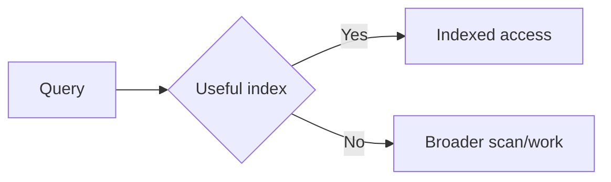
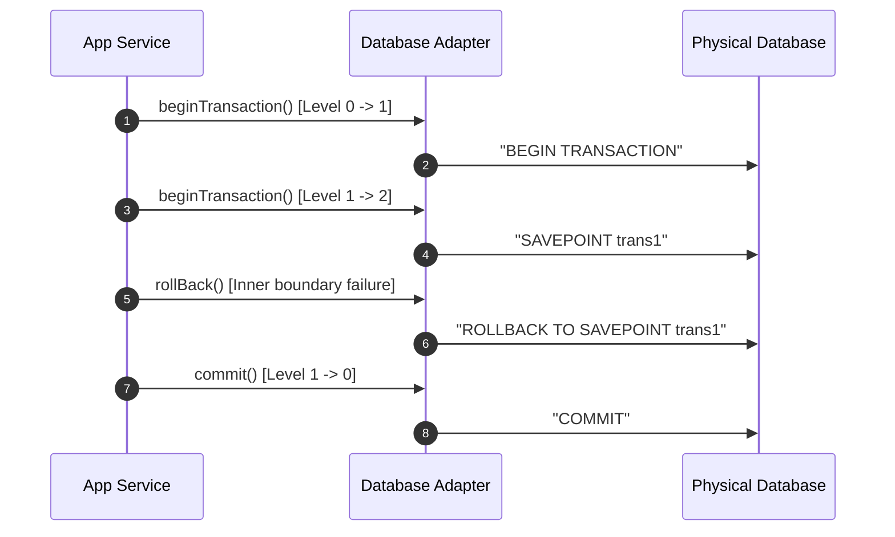
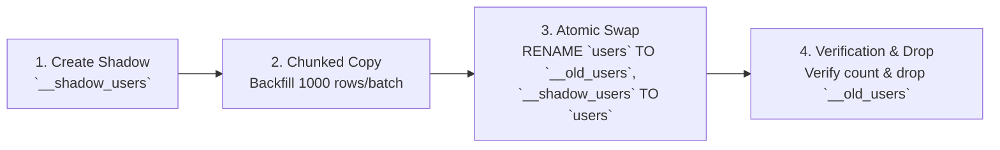

# Tutorial Branch — SPP XDB, Part 2: Advanced Database Architecture

Part 1 taught persistence and the SPPDB/XDB execution path.

Part 2 treats XDB as a serious subsystem and explores the advanced facilities visible in the repository.

## 40.1 Indexing

An index is an additional data structure that can make repeated lookups faster.

The tutorial exercise is to create a large Task dataset and compare a filtered query before and after an appropriate index where the engine supports it.



Do not promise a particular performance improvement without measurement.

## 40.2 Views

XDB contains view-related implementation.

A database view can expose a reusable query as a logical data source.

Exercise: create a reporting-oriented view and compare querying the view with repeating the query manually.

Then trace how the XDB engine represents and executes the view.

## 40.3 Validation

XDB contains validation-related implementation.

The tutorial should distinguish:

- form validation;
- service/business validation;
- database/storage validation.

The same rule may appear at more than one boundary when protecting a critical invariant, but each layer has a different responsibility.

## 40.4 ACL

The XDB subsystem contains ACL-related implementation.

This is different from application authentication.

Authentication asks:

> Who is the user?

Application authorization asks:

> May this user perform this operation?

A storage ACL may additionally ask:

> Is this data operation allowed at the storage boundary?

The tutorial must build a concrete example and inspect the implementation before describing the precise enforcement semantics.

## 40.5 Locking

The repository contains XDB locking implementation.

Build a concurrency exercise where two operations attempt to modify the same logical record.

Observe:

- how a lock is requested;
- how contention is represented;
- what happens on failure;
- when the lock is released.

Do not assume database-engine semantics that are not established by the current source.

## 40.6 Transactions and Nested Savepoint Emulation

The database adapter layer (`PDOAdapter`, `XDBAdapter`) provides full ACID transaction boundaries.

Modern enterprise workflows frequently compose multiple transactional services together. For instance, an order placement service opens a transaction, which calls an inventory reservation service, which also opens a transaction. If the inventory reservation fails and rolls back, standard database engines either error out or commit the outer transaction prematurely.

SPPDB solves this by automatically emulating nested transactions via **SQL Savepoints**:



### Savepoint API:
- `$db->beginTransaction()` / `$db->commit()` / `$db->rollBack()`: Automatically increments/decrements the transaction depth level and creates/releases savepoints (`trans1`, `trans2`, etc.) when `$level > 1`.
- `$db->createSavepoint(string $name)`: Directly issues `SAVEPOINT <name>` with strict identifier sanitization.
- `$db->releaseSavepoint(string $name)`: Releases the named savepoint.
- `$db->rollbackToSavepoint(string $name)`: Rolls back modifications to the savepoint boundary without discarding the entire transaction.
- `$db->getTransactionLevel()`: Returns the active transaction nesting depth.

## 40.7 Encryption

The XDB implementation contains encryption-related functionality.

The tutorial should teach:

- what data is protected;
- where keys/configuration come from;
- when encryption is applied;
- how failures are handled;
- what remains in plaintext.

Security claims must be tied to source/tests.

## 40.8 Observers

The XDB subsystem contains observer-related implementation.

Build an observer that records a data mutation.

Then compare observer behavior with SPP events.

This is a valuable architectural lesson:

> **Not every callback mechanism is an application-wide event system.**

The source should establish the precise boundary of XDB observers.

## 40.9 XDB shell

The repository contains an XDB shell.

Use it to:

- inspect data;
- inspect schema;
- run administrative operations supported by the current shell;
- troubleshoot a failing application independently of the web layer.

The CLI is an important debugging boundary because it lets the developer isolate storage behavior from routing, middleware, and rendering.

## 40.10 Query builder deep dive

Take one Task report query and construct it with the XDB query-builder API.

Then inspect:

1. internal expression construction;
2. parameter binding;
3. final SQL generation;
4. execution path;
5. returned representation.

The tutorial should not assume the builder is a full ORM.

## 40.11 Paginator deep dive

Trace the paginator implementation to understand:

- how count is obtained;
- how pages are calculated;
- how limits/offsets are represented;
- whether any cursor-style path exists;
- how metadata reaches SPPAPI or SPPView.

## 40.12 Migration Manager and Zero-Downtime SafeDDLRunner

Traditional migrations execute `ALTER TABLE` directly against production databases. In tables containing millions of records, `ALTER TABLE` acquires an exclusive metadata table lock (`ACCESS EXCLUSIVE`), blocking all concurrent reads and writes, and resulting in 504 gateway timeouts.

SPP includes `\SPPMod\SPPDB\Migration\SafeDDLRunner`, which implements the **4-Phase Shadow Table Pattern**:



### Hands-on Lab: Zero-Downtime Column Addition
```php
use SPPMod\SPPDB\Migration\SafeDDLRunner;

$runner = new SafeDDLRunner();

// Add a column with zero table lock:
$runner->addColumn('tasks', 'assigned_team_id', 'INTEGER NULL', function($shadowTable) {
    // Backfill transformation callback
});

// Dry-run mode for CI/CD linting:
$runner->dryRun(true);
$runner->addColumn('tasks', 'priority_score', 'FLOAT DEFAULT 0.0');
```

---

## 40.12.1 Native AI Vector Similarity Search

Modern applications require semantic vector search for AI agents and RAG systems. SPPDB compiles vector queries into native database-specific distance operators:

```php
use App\Entities\KnowledgeDocument;

$results = KnowledgeDocument::query()
    ->whereSemanticSimilarity('embedding', $queryVector, 'cosine', 0.85, 5)
    ->get();
```

Compiled dialects:
- **PostgreSQL (`pgvector`)**: `WHERE ("embedding" <=> ?::vector) < 0.15 ORDER BY "embedding" <=> ?::vector ASC LIMIT 5`
- **SQLite (`sqlite-vec`)**: `WHERE vec_distance_cosine("embedding", ?) <= 0.15 ORDER BY vec_distance_cosine("embedding", ?) ASC LIMIT 5`
- **MySQL 9.0+**: `WHERE DISTANCE(`embedding`, CAST(? AS VECTOR), 'COSINE') <= 0.15 ORDER BY DISTANCE(...) ASC LIMIT 0, 5`

---

## 40.13 Distributed and Raft-related implementation

The repository contains Raft-related XDB implementation artifacts.

This area receives a **research-grade treatment**.

The tutorial should inspect:

- node identity;
- log/state representation;
- leader/follower behavior where implemented;
- replication messages;
- commit semantics;
- failure handling;
- persistence;
- cluster configuration.

Only behavior demonstrated by the source/tests is presented as a current guarantee.

A class named `Raft` is not sufficient evidence of a production-ready distributed database guarantee.

---

## 40.14 The 4 Apex Pillars: Advanced Storage Labs

The Apex upgrade introduces four high-performance database paradigms accessible directly from the `SPP_XDB` facade:

### Lab 1: Zero-Copy Binary Flat Buffer (`.xbam`) & Universal Inverted Index
```php
use SPPMod\SPPXDB\SPP_XDB;

$xdb = new SPP_XDB('catalog_db', 'items');

// 1. Pack XML into .xbam binary format (32-byte fixed node records)
$xbam = $xdb->xbam();
$stats = $xbam->packFromXml($xmlCatalog);

// 2. Read node #10 in O(1) time
$node = $xbam->readNode(10);

// 3. Universal Index: multi-field composite query
$uIndex = $xdb->universalIndex();
$uIndex->indexXml('items', $xmlCatalog);

$results = $uIndex->queryComposite('items', [
    'value:category' => 'Electronics',
    'range:price'    => [50.0, 200.0],
    'words'          => 'Wireless Bluetooth'
]);
```

### Lab 2: Tree-Aware AI RAG & Semantic Chunking
```php
$rag = $xdb->rag();
$rag->indexXml('knowledge_base', $manualXml);

// Hybrid search (Cosine Vector + BM25 Lexical)
$results = $rag->searchHybrid('How to configure SSL certificates', topK: 3);

// Format grounded context block for LLM prompt injection
$promptContext = $rag->formatPromptContext($results);

// Export OpenAI/Claude/Gemini compliant tool-calling schema
$toolSchema = $rag->getToolCallingSchema('search_knowledge_base');
```

### Lab 3: Dual-Timeline Bi-Temporal Time Travel
```php
$temporal = $xdb->temporal();

// Record fact with business validity period
$temporal->recordFact(
    'contracts', 
    'cnt_42', 
    ['rate' => 120, 'status' => 'active'], 
    '2025-01-01T00:00:00Z', 
    '2025-06-30T23:59:59Z'
);

// Query point-in-time "As-Of" business valid time
$asOfState = $temporal->queryAsOf('contracts', asOfSystemTime: null, asOfValidTime: '2025-03-15T00:00:00Z');
```

### Lab 4: Cryptographic Merkle DAG Ledger & Tamper Proofing
```php
$merkle = $xdb->merkle();

// Verify cryptographic hash chain & Merkle root
$audit = $merkle->verifyLedger();
assert($audit['valid'] === true);

// Generate inclusion proof for transaction block #2
$proof = $merkle->generateProof(2);

// Verify inclusion proof
assert(\SPPMod\SPPXDB\Temporal\MerkleLedger::verifyProof($proof['leaf_hash'], $proof['proof'], $audit['merkle_root']));
```

### Lab 5: Reactive Live Queries & Hotwire Turbo Streams (CDC)
```php
$live = $xdb->live();

// Subscribe to pending orders
$sub = $xdb->subscribeLive(
    ['status' => 'pending'], 
    'pending_orders_stream', 
    'prepend'
);

// Mutate table
$xdb->insert(['id' => 99, 'status' => 'pending', 'total' => 49.99]);

// Stream delta to client via Server-Sent Events (SSE)
$delta = end($live->getBufferedDeltas('items'));
echo \SPPMod\SPPXDB\Reactive\LiveQueryManager::formatSse($delta);
```

---

## 40.15 Failure exercise

Construct a controlled environment and interrupt an operation at several stages:

```text
before write
while write is active
after write but before invalidation
after cache invalidation
```

Observe what the current implementation actually leaves behind.

This is the beginning of serious reliability engineering.

## 40.15 Parikshak checkpoint

Advanced XDB tests should cover:

- indexes and query behavior;
- view behavior;
- validation;
- ACL decisions;
- lock contention;
- transaction behavior as actually supported;
- encryption paths;
- observer invocation;
- migration state;
- administrative operations where a test boundary exists.

## 40.16 Coming from other frameworks

### Laravel

The conceptual references are migrations, database query builder, Eloquent, cache, transactions, and policies. XDB is not a Laravel clone.

### Symfony/Doctrine

Entity/repository/query abstractions are useful comparisons, but XDB's engine/facade architecture is distinct.

### Django

Think ORM/backend abstraction, then deliberately descend to SPP XDB when you need to understand the actual storage engine.

## 40.17 Kernel Hacker completion

You are finished when you can trace one operation through the full stack and answer:

> Which code is responsible for the application contract, which for the adapter, which for the XDB facade, and which for the concrete engine?

You should also be able to identify where caching, validation, locking, encryption, observation, and migration policy are introduced.
