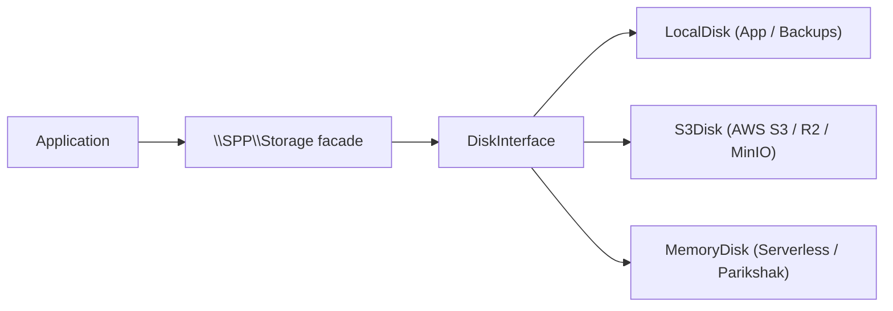
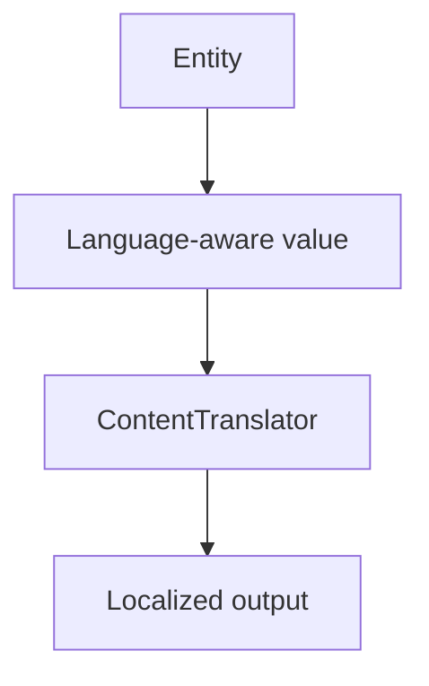
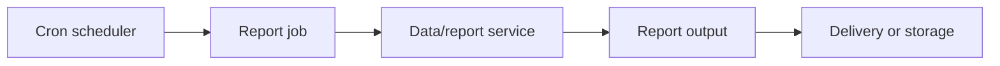

# Tutorial Branch — Storage, Internationalization, and Reporting

This branch covers three framework capabilities that are easy to miss when learning only the MVC/request path:

- storage abstraction;
- localization/content translation;
- reporting and scheduled reports.

## Part A — SPP Sovereign File Services & Storage

### A.1 Why a storage abstraction exists

A file is not necessarily a local file forever, and raw PHP filesystem calls (`file_put_contents`, `unlink`, `scandir`) cause fatal locking collisions (`STATUS_SHARING_VIOLATION` / `EINVAL`) in Windows and WSL environments.

The framework provides a dual-tier filesystem subsystem:
- **`\SPP\File` (`\SPP\Core\File`)**: Sovereign static primitives for atomic staged writes (`putAtomic`), lazy generator line streaming (`lines()`), native YAML/JSON serialization, and path containment guards.
- **`\SPP\Storage` (`\SPP\Core\Storage`)**: Multi-disk abstraction covering `LocalDisk`, pure-PHP `S3Disk` (AWS SigV4 for S3, Cloudflare R2, MinIO), virtual in-memory `MemoryDisk`, and cluster shared storage.



### A.2 First storage exercise: Atomic file persistence

Never use raw `file_put_contents()` for configuration or user assets. Write atomically using staged swaps:

```php
use SPP\File;
use SPP\Core\Storage;

// 1. Atomic write with DrvFs/Windows lock resilience
File::putAtomic('/var/app/data.txt', 'Resilient content');

// 2. Atomic YAML persistence
Storage::writeYaml('/etc/apps/myapp/app.yml', ['name' => 'MyApp', 'version' => '1.0'], 10, 2);
```

### A.3 Second storage exercise: Memory-efficient streaming & query builder

Process large files without breaching PHP's `memory_limit` and search directories with the fluent generator:

```php
use SPP\File;

// 1. Stream line-by-line using a generator
foreach (File::lines('/var/logs/access.log') as $num => $line) {
    if (str_contains($line, '404')) {
        // Handle error line
    }
}

// 2. Fluent directory scanner
$oldBackups = File::find('/var/backups')
    ->extension('zip')
    ->size('> 50MB')
    ->modifiedBefore('-30 days')
    ->get();
```

### A.4 Third storage exercise: Cloud object storage & expiring URLs

```php
use SPP\Core\Storage;

// 1. Store directly on S3 / Cloudflare R2 / MinIO without AWS SDK
$s3 = Storage::disk('s3');
$s3->put('documents/report.pdf', $pdfBytes);

// 2. Issue a 15-minute temporary signed download URL
$url = Storage::temporaryUrl('documents/report.pdf', '+15 minutes');
```

### A.5 Parikshak checkpoint

Test storage operations with Parikshak:
- Verify `putAtomic()` cleans staging files.
- Test `MemoryDisk` virtual storage for isolated, zero-I/O test execution.
- Validate that `LocalDisk::path()` throws an exception on path traversal attempts (`../../etc/passwd`).

---

## Part B — Internationalization

### B.1 Why i18n exists

An application can contain language-dependent text in:

- interface labels;
- validation messages;
- content;
- emails;
- reports.

Hard-coding one language into templates makes localization expensive.

The repository contains `SPPLang`, `ContentTranslator`, and translatable-entity support.

### B.2 UI translation

Create the Task Desk interface in two languages.

Start with a simple translation key:

```text
Task Desk
```

Then move to validation messages and navigation labels.

### B.3 Translatable entities

Create a Task category whose display name can vary by language.

Use the current translatable-entity implementation rather than inventing a JSON column or generic Laravel-style translation package.



### B.4 Parikshak checkpoint

Test that:

- default language works;
- alternate language works;
- missing translation follows the actual fallback behavior;
- translated entity values do not corrupt the underlying data.

## Part C — Reporting

### C.1 A report is an application product

A report may combine:

- data queries;
- filters;
- pagination;
- calculations;
- rendering/export;
- scheduling.

The repository contains an SPPReport subsystem, report API/viewer components, and scheduled report commands.

### C.2 Build a Task report

Create a report showing:

```text
Tasks by status
Tasks by priority
Overdue tasks
Completion rate
```

Build the report from services/data boundaries rather than embedding all SQL in a view.

### C.3 Report API

Expose the report through its supported API/report service path where appropriate.

Then add a browser view.

This demonstrates reuse between presentation and machine-consumable representations.

### C.4 Scheduled reports

Use the report cron facilities to generate a scheduled report where supported.



### C.5 Reporting and observability

Reports answer questions about business data.

Observability answers questions about runtime behavior.

Do not confuse the two.

### C.6 OpenTelemetry branch

The repository also contains an OpenTelemetry collector/exporter tutorial.

Treat this as an observability extension branch, not as part of the ordinary report renderer.

### C.7 Parikshak checkpoint

Test:

- deterministic report calculations;
- empty datasets;
- filters;
- pagination;
- scheduled generation behavior where testable;
- API output.

## Coming from other frameworks

Storage can be compared conceptually with filesystem abstractions in Laravel/Symfony.

i18n maps to translation systems in Laravel, Symfony, Django, or Spring.

Reporting is usually application/domain code plus rendering/export tooling rather than one universal framework concept.

## Kernel Hacker completion

Trace the abstraction boundaries for storage, translation, report services, report rendering/API, and cron-driven execution.
