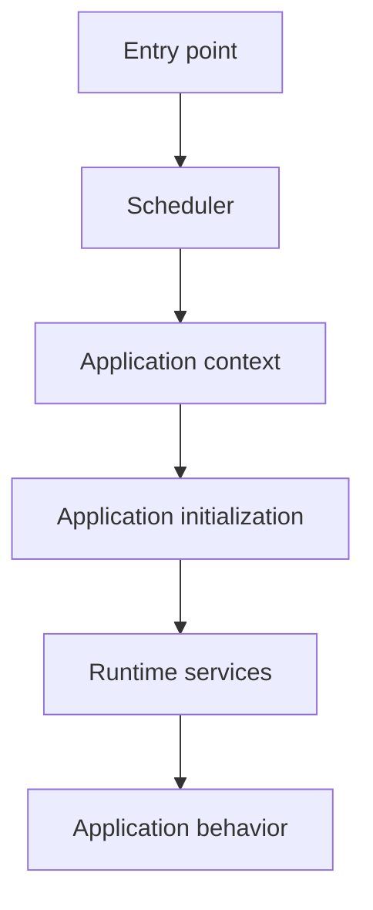
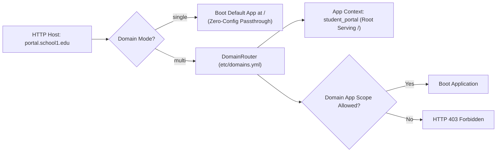

# Book 2 Chapter 1 — Scheduler and Application Contexts

## 1. From the general concept to SPP

Book 1 introduced the idea that a framework must decide which application is running. In SPP, this responsibility is represented through the Scheduler/application-context architecture.

The repository contains a Scheduler implementation and a separate Cron scheduler. These are implementation facts; stronger claims about isolation or distributed execution require additional evidence.

## 2. Runtime mental model



## 3. Why a Scheduler exists

A framework can be installed once while serving different execution modes:

- web request;
- CLI command;
- scheduled job;
- worker/background process.

The Scheduler provides a framework-level place to establish which application/context is active.

## 4. Application context

An application context answers questions such as:

- which application configuration applies;
- which resources are available;
- which modules participate;
- which application services are resolved;
- which paths and runtime values are in effect.

## 5. Hands-on lab

Use the repository's current application-definition conventions to identify the context of a Task Desk request.

Record:

```text
entry point
→ scheduler/context selection
→ application initialization
→ configuration
→ module/service activation
```

## 6. Domain Context Selection & Operational Modes (Single vs. Multi-Domain)

SPP supports two foundational domain architecture modes:

### 1. Single Domain Mode (`mode: single` — Zero-Config Copy-Paste Ready)
In single domain mode, domain routing is **neither required nor enforced**:
* **Immediate Portability**: Simply copy and paste the framework files into any web root (Apache, Nginx, IIS, cPanel `public_html`, or local testing environment).
* **Zero Host Header Inspection**: Any incoming host header, domain, or IP address (`192.168.1.100`, `localhost`, `custom-domain.org`) serves immediately without error.
* **No Unmapped 404 Rejection**: Domain validation is completely bypassed; requests directly resolve to the configured default application (`base_app`) at root (`/`), while all secondary applications remain accessible at their respective URL prefixes (`/appName`).
* **Automatic Fallback**: If `etc/domains.yml` does not exist or contains no domain records, SPP automatically boots into Single Domain Mode out of the box.

### 2. Multi-Domain Mode (`mode: multi` — Virtual Host Multi-Tenancy)
In multi-domain architectures, the application context is resolved dynamically from the incoming HTTP Host header via `DomainRouter`:



Applications can be physically isolated in `domains/<domain>/src/<app>` or logically scoped to approved domains using `php spp.php domain:app:scope <app> --domain-only --allow=...`.

Toggling between architecture modes is performed via CLI:
```bash
# Switch to Single Domain Mode (Zero-config copy-paste ready)
php spp.php domain:mode single

# Switch to Multi-Domain Mode with strict virtual host policy
php spp.php domain:mode multi strict
```

## 7. Application Lifecycle: Decommissioning & Safety Backups

Managing applications across environments requires safe uninstallation and restoration capabilities:
- **`AppUninstaller::uninstall($root, $app, ['config_only' => true])`**: Unbinds domain virtual hosts and routes while preserving source code in `src/`.
- **`AppUninstaller::uninstall($root, $app, ['mode' => 'full', 'backup' => true])`**: Bundles code, database, and configurations into a portable standalone `.zip` archive in `var/backups/apps/` before purging.
- **`AppUninstaller::restore($root, $archive)`**: Reconstructs the application, SQLite database, and domain bindings from an archive.

## 8. Universal OS & Infrastructure Abstraction (`\SPP\Infra`)

`\SPP\Core\Infra` provides cross-platform environment discovery and execution normalization:
- Detects OS family (Windows, Linux, macOS Darwin, BSD, WSL).
- Detects Linux distribution family (`debian_like`, `rhel_like`, `alpine` musl, `arch`, `suse`).
- Detects hosting topology (FHS, user home cPanel-style, Windows paths, Docker, Kubernetes, Serverless).
- Provides cross-platform permission management (`Infra::fixPermissions()`) and read-only root rerouting (`Infra::writablePath()`).

## 9. Failure lab

Break application discovery or context configuration and identify the earliest failing stage.

The objective is to stop debugging application code when the application has not actually been initialized.

## 10. Kernel Hacker

Trace from the public Scheduler API to the context-selection implementation, then inspect the tests/configuration that prove the observed behavior.

## Checkpoint

> **Scheduler/context selection is runtime infrastructure; the business application should not have to rediscover which application is running on every request.**
