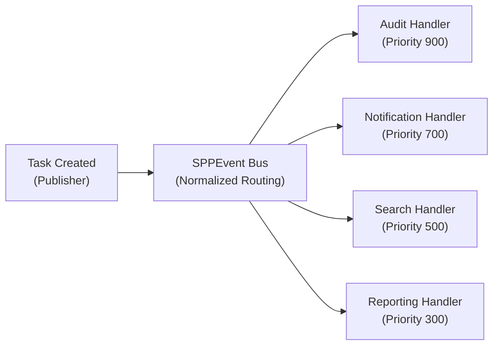

# Book 2 Chapter 4 — Events, Handlers, and Sovereign Enterprise Triggers

## 1. The Coupling Problem

Suppose creating a task should:
- write an audit entry;
- notify a user;
- update a search index;
- refresh a report.

A direct implementation calls all four systems from `TaskService`. That creates hard, brittle coupling: if the search indexer times out, the entire task creation fails.

## 2. The Event Mental Model



The publisher announces an occurrence. Handlers react to it independently.

## 3. SPP Unified Event System Architecture

In SPP, all event operations route through `\SPP\SPPEvent` (aliased to `\SPP\Core\EventManager`):

1. **Normalized Notation**: `task:created` and `task.created` are treated identically.
2. **Wildcard Listeners**: Listen to `task.*` or `entity.*`.
3. **Listener Error Isolation**: A failing listener will not crash subsequent listeners; failures are isolated and traced.
4. **Subscriber Auto-Wiring**: Classes implementing `\SPP\Event\SubscriberInterface` and `getSubscribedEvents()` are auto-wired.

## 4. Sovereign Enterprise Trigger Innovations

SPP incorporates the industry's most acclaimed enterprise trigger patterns directly into its event container:

### `:OLD` and `:NEW` Pseudorecords
Every `SPPEntity` event exposes original and modified data:
```php
SPPEvent::on('entity:updating')->handle(function($params) {
    // Access original pristine data (:OLD)
    $oldStatus = $params->old->status; // or $params->old('status')

    // Access modified pending data (:NEW)
    $newStatus = $params->new->status; // or $params->new('status')

    // Clean change detection
    if ($params->isDirty('status')) {
        echo "Status transitioned!";
    }
});
```

### Declarative `WHEN` Clauses
Execute handlers only when explicit domain conditions are met:
```php
SPPEvent::on('order.status_update')
    ->when(fn($p) => $p->isDirty('status') && $p->new->status === 'approved')
    ->handle(fn($p) => NotificationService::alertApproved($p->entity));
```

### Compound Triggers (`CompoundTrigger`)
Unify `before()`, `instead()`, `after()`, and `onError()` in a single cohesive trigger class:
```php
class TaskCompoundTrigger extends \SPP\Event\CompoundTrigger
{
    public static function targetEvent(): string { return 'entity:task'; }
    public function before(EventParams $p): void { /* Pre-save validation */ }
    public function after(EventParams $p): void { /* Post-save notifications */ }
}
TaskCompoundTrigger::register();
```

### Application Error Abort (`abort()`)
Halt the chain with an explicit business error code:
```php
$params->abort('Task budget ceiling exceeded', 422);
```

### Autonomous Transactions (`autonomous()`)
Run telemetry, audit logging, or metrics in an isolated sandbox that will never crash the calling flow:
```php
SPPEvent::autonomous(function() use ($task) {
    AuditLedger::record($task);
});
```

## 5. Modern Framework Capabilities

- **Fluent Registration**: `SPPEvent::on('event.name')->priority(800)->when($cond)->once()->handle($cb);`
- **Single-Use Listeners**: `SPPEvent::once('worker.start', $cb);` executes once then unbinds.
- **Short-Circuiting**: `SPPEvent::until('policy.evaluate', $params);` returns the first non-null response.
- **Transaction Lifecycle Hooks**:
  ```php
  SPPEvent::afterCommit(fn() => EmailService::send($order)); // Runs ONLY after DB commit!
  SPPEvent::onRollback(fn() => PaymentGateway::void($order));
  ```
- **Asynchronous Queue**: `SPPEvent::queue('report.generate', $payload);` offloads to background daemons.

## 6. CLI Developer Tooling

- List all active listeners and priorities:
  ```bash
  php spp.php event:list-listeners
  ```
- Fire an event from the command line:
  ```bash
  php spp.php event:fire --event=task.created --payload='{"task_id":101}'
  ```

## Checkpoint

> **An event communicates that something happened; an event handler contains a reaction to that event; a sovereign enterprise trigger enforces lifecycle invariants and transactional integrity.**
