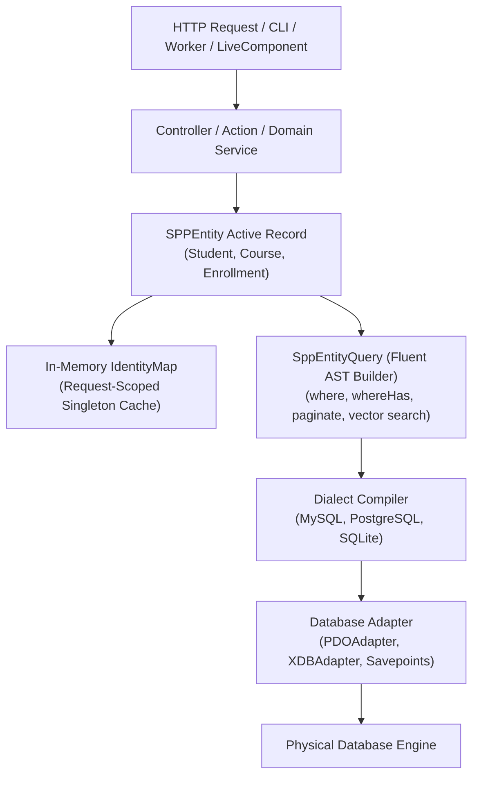

# Book 3 Chapter 1 — SPPDB from the Application Developer's View

## 1. Start with the Problem

Every non-trivial enterprise application needs persistent information: student registrations, financial ledger entries, access permissions, academic courses, and diagnostic telemetry.

From the application developer's viewpoint, business logic should express intentions directly in the domain language:
```text
Find student #42
Verify enrollment in Course 'CS101'
Assign Grade 'A'
Save changes within a transactional boundary
```

Application developers should not have to manually format raw SQL strings, worry about reserved identifier escaping across database brands, debug subtle object mutation discrepancies caused by split-brain in-memory instances, or manage connection strings inside controllers.

SPPDB solves this by providing a unified, multi-layered data platform.

---

## 2. The Application Persistence Boundary



---

## 3. The Developer's Toolbox: Core Features at a Glance

When developing applications with SPPDB, developers have access to six modern persistence pillars:

### 1. Active Record Entities with PHP 8.2+ Declarative Attributes
Declare entities using native PHP 8.2+ attributes without bulky external XML or YAML files:

```php
namespace App\Entities;

use SPPMod\SPPDB\SPPEntity;
use SPPMod\SPPDB\Attributes\Table;
use SPPMod\SPPDB\Attributes\Id;
use SPPMod\SPPDB\Attributes\Column;
use SPPMod\SPPDB\Attributes\HasMany;
use SPPMod\SPPDB\Attributes\Workflow;

#[Table('students')]
#[Workflow('student_lifecycle')]
class Student extends SPPEntity
{
    #[Id]
    public int $id;

    #[Column('name')]
    public string $name;

    #[Column('gpa')]
    public float $gpa = 0.0;

    #[HasMany(Enrollment::class, 'student_id')]
    public function enrollments()
    {
        return $this->hasMany(Enrollment::class, 'student_id');
    }
}
```

### 2. Request-Scoped Identity Map (`IdentityMap`)
Eliminates duplicate queries and split-brain state divergence. Calling `Student::find(42)` anywhere in a request lifecycle returns the exact same in-memory object instance reference:

```php
$student1 = Student::find(42);
$student2 = Student::find(42);

assert($student1 === $student2); // Exactly identical object reference!
```

### 3. First-Class Relationship Objects
Chain queries on relationships, eager-load collections, and filter with correlated subqueries:

```php
// Query chaining on relation:
$honorsEnrollments = $student->enrollments()->where('grade', 'A')->get();

// Correlated existence queries (EXISTS subquery compiled automatically):
$deanList = Student::query()
    ->whereHas('enrollments', fn($q) => $q->where('grade', 'A'))
    ->get();
```

### 4. Transparent Nested Transaction Savepoints
Execute nested transactions across independent modular services without crashing or prematurely committing:

```php
\SPPMod\SPPDB\SPPDB::beginTransaction();
try {
    $student->save();
    
    // An inner service opens its own transaction (auto-converts to SAVEPOINT)
    $billingService->chargeTuition($student);
    
    \SPPMod\SPPDB\SPPDB::commit();
} catch (\Throwable $e) {
    \SPPMod\SPPDB\SPPDB::rollBack();
    throw $e;
}
```

### 5. Zero-Downtime Safe DDL Migrations
Evolve schemas on multi-million row production tables using `SafeDDLRunner` with zero locks and zero downtime via the 4-phase shadow-table swap.

### 6. Native AI Vector Similarity Search
Search vector embeddings using native database distance operators (`pgvector`, `sqlite-vec`, MySQL 9.0+):

```php
$similarCourses = Course::query()
    ->whereSemanticSimilarity('embedding', $userProfileVector, 'cosine', 0.85, 5)
    ->get();
```

---

## 4. Good Application Boundary Practices

1. **Keep Persistence below Controllers**:
   Controllers and LiveComponents should invoke entity active record methods or domain services. Never assemble raw SQL statements in controllers or views.
2. **Never Bypass the Identity Map in Web Requests**:
   Always retrieve entities through `::find()`, `::load()`, or queries so that the `IdentityMap` coordinates object singularity across listeners and services.
3. **Use Savepoint Boundaries for Nested Logic**:
   When orchestrating complex domain workflows involving multiple steps, wrap execution in transactions; inner operations will safely create savepoints.

---

## 5. Hands-on Lab: Student Enrollment Workflow

In this lab, you will create a student, query their enrollments, and verify that the identity map returns the exact same reference.

```php
use App\Entities\Student;

// 1. Create a student
$student = new Student();
$student->name = 'Jane Doe';
$student->gpa = 3.9;
$student->save();

$studentId = $student->id;

// 2. Fetch via primary key in another service context
$retrieved = Student::find($studentId);

// 3. Verify in-memory reference equality
if ($student === $retrieved) {
    echo "PASS: Identity Map returned the identical in-memory instance!\n";
} else {
    echo "FAIL: Separate instances created!\n";
}
```

---

## Checkpoint

> **SPPDB empowers application developers with intuitive Active Record ergonomics and declarative PHP 8.2+ attributes, backed by enterprise-grade guarantees including an In-Memory Identity Map, first-class relations, nested savepoints, and native AI vector search.**
