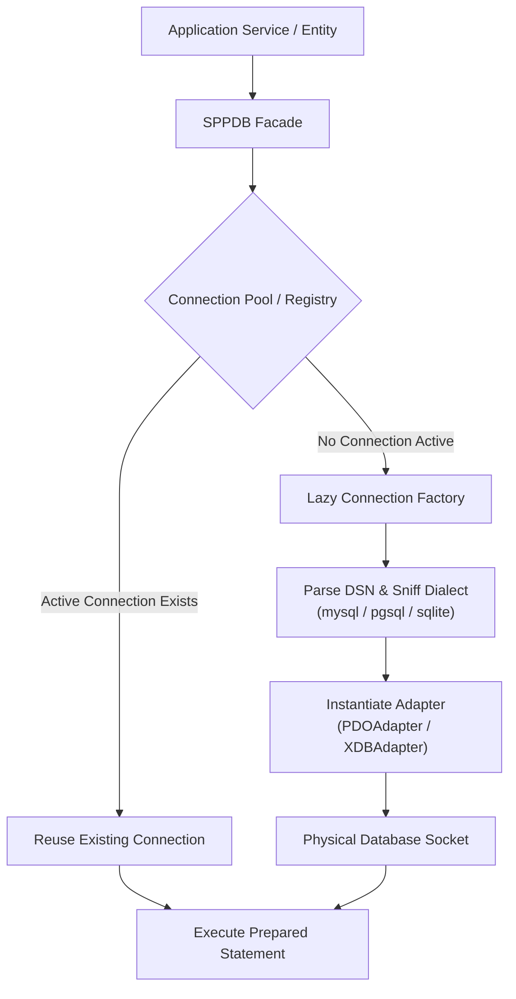

# Book 3 Chapter 2 — Connections, Drivers, and Connection Reuse

## 1. Why a Connection Layer Exists

A database connection is a heavy, stateful operating system resource. Opening a physical TCP socket, performing TLS handshakes, authenticating credentials, and negotiating session parameters can take anywhere from 5ms to over 100ms. In high-throughput applications handling thousands of requests per second, establishing a new connection on every database query quickly exhausts database connection limits and degrades response latency.

SPPDB manages database connections through a dedicated **Connection & Adapter Subsystem**:



---

## 2. The Four Distinct Architectural Layers

Beginners often confuse the database engine, driver, compiler, and connection. In SPP, each has a distinct responsibility:

```text
┌────────────────────────────────────────────────────────┐
│ 1. Database Engine: Physical RDBMS process             │
│    (e.g., PostgreSQL 16, MySQL 9.0, SQLite WAL file)  │
├────────────────────────────────────────────────────────┤
│ 2. Driver / Extension: Low-level PHP C-extension       │
│    (e.g., pdo_mysql, pdo_pgsql, pdo_sqlite)           │
├────────────────────────────────────────────────────────┤
│ 3. Driver Adapter: SPP Database Abstraction Boundary   │
│    (PDOAdapter, XDBAdapter, Savepoint Emulation)       │
├────────────────────────────────────────────────────────┤
│ 4. Dialect Compiler: AST-to-SQL Grammar Translator     │
│    (PostgresCompiler, MySQLCompiler, SQLiteCompiler)   │
└────────────────────────────────────────────────────────┘
```

---

## 3. Lazy Connection Establishment

SPP does not eagerly open database connections during the initial framework boot. If an incoming request serves a static asset, cached page, or non-database API endpoint, zero database sockets are opened:

```php
// In PDOAdapter.php:
public function connect(): void
{
    if ($this->connection !== null) {
        return; // Connection already active; reuse immediately
    }

    $dsn = $this->buildDsn();
    $this->connection = new \PDO($dsn, $this->username, $this->password, [
        \PDO::ATTR_ERRMODE            => \PDO::ERRMODE_EXCEPTION,
        \PDO::ATTR_DEFAULT_FETCH_MODE => \PDO::FETCH_ASSOC,
        \PDO::ATTR_EMULATE_PREPARES   => false, // Enforce true server-side prepared statements
    ]);
}
```

Connection creation is deferred until the very moment an entity calls `->find()`, `->get()`, or `->save()`.

---

## 4. Connection Reuse & Request Scoping

Within a single HTTP request lifecycle:
1. **Singleton Connection per Tenant/DSN**: Repeated queries share the exact same PDO socket.
2. **Transaction Scope Binding**: Transactions are tied to the connection instance. Because all queries in the request share the adapter instance, beginning a transaction with `SPPDB::beginTransaction()` guarantees that subsequent queries and entity saves execute within that identical transaction context.
3. **Automatic Cleanup on Request Termination**: At the conclusion of the request lifecycle, the PHP process or worker pool closes or pools the connection cleanly.

### Long-Running CLI Daemons & Queue Workers
In long-running CLI processes (such as `spp queue:work` or `spp workflow:process-timeouts`), connections can become stale if the database restarts or firewall drops idle sockets. SPPDB handles this via automated reconnection probes:
- Before executing a statement after idle periods, the adapter performs a lightweight ping query (`SELECT 1`).
- If a socket timeout or `2006 MySQL server has gone away` error occurs, the adapter re-establishes the connection and rebinds the prepared statement.

---

## 5. Hands-on Lab: Tracing Connection Reuse

In this lab, you will verify that multiple entity queries reuse the exact same database connection.

Create a scratch test script:

```php
use SPPMod\SPPDB\SPPDB;
use App\Entities\User;

$adapter = SPPDB::getAdapter();

// Query 1
$user = User::find(1);

// Query 2
$users = User::where('status', '=', 'active')->limit(5)->get();

echo "Adapter Hash: " . spl_object_hash($adapter) . "\n";
echo "Transaction Level: " . $adapter->getTransactionLevel() . "\n";
```

**Observation**: Both queries execute through the same adapter instance, preserving socket efficiency.

---

## Checkpoint

> **The connection layer manages access to expensive database sockets lazily and transparently, ensuring that application code can execute queries without manual socket management while maintaining strict transactional boundaries.**
