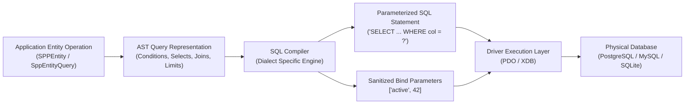
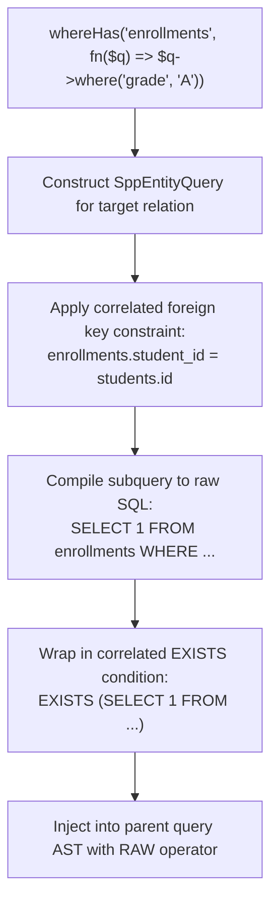

# Book 3 Chapter 3 — SQL Compiler Architecture

## 1. Why Compile SQL?

A modern database abstraction layer allows an enterprise application to express data operations using expressive domain models, without coupling business code to the low-level dialect or SQL quirks of a specific database engine.

To accomplish this without sacrificing speed or expressiveness, the framework employs a dedicated **SQL Compilation Pipeline**:



Without a compilation layer, database-specific SQL strings leak throughout controllers, services, and view models. When an organization decides to migrate from SQLite (in local development) to PostgreSQL or MySQL in production, raw SQL queries break. With SPP's compiler architecture, application code interacts with high-level query specifications while dialect translation happens deterministically underneath.

---

## 2. Compiler vs. Driver Responsibilities

A common misconception among beginner developers is that the database driver (such as PDO) handles SQL translation. It does not: PDO is merely a transport connection and statement execution abstraction.

| Architectural Layer | Core Responsibility | SPP Landmark Component |
|---|---|---|
| **Query Representation (AST)** | Maintains the declarative structure of what data is needed (columns, conditions, joins, limits). | `\SPPMod\SPPDB\SppEntityQuery` |
| **Compiler Layer** | Translates the abstract query specification into valid, optimized, dialect-specific SQL with placeholders. | `\SPPMod\SPPDB\Compilers\CompilerInterface`<br>`\SPPMod\SPPDB\Compilers\MySQLCompiler`<br>`\SPPMod\SPPDB\Compilers\PostgresCompiler`<br>`\SPPMod\SPPDB\Compilers\SQLiteCompiler` |
| **Driver Adapter** | Manages physical PDO/XDB database connections, prepared statement execution, savepoints, and transactions. | `\SPPMod\SPPDB\PDOAdapter`<br>`\SPPMod\SPPDB\XDBAdapter` |

---

## 3. Inside the Query AST (Abstract Syntax Tree)

When a developer builds a query fluently:

```php
$students = Student::where('status', '=', 'active')
    ->where('gpa', '>=', 3.5)
    ->whereHas('enrollments', function($q) {
        $q->where('grade', '=', 'A');
    })
    ->orderBy('created_at', 'DESC')
    ->limit(10)
    ->get();
```

`SppEntityQuery` does not concatenate strings immediately. Instead, it constructs an internal **Abstract Syntax Tree (AST)** composed of discrete arrays and objects:

1. **`columns`**: List of requested columns (`['*']` or specific fields).
2. **`from`**: Primary table name (`students`).
3. **`conditions`**: Nested arrays containing column identifiers, comparison operators (`=`, `>=`, `LIKE`, `IN`, `RAW`), and parameter values.
4. **`joins`**: Join specifications with join types (INNER, LEFT, RIGHT), target tables, and ON clauses.
5. **`orders`**: Sort criteria with directions.
6. **`limit` and `offset`**: Integer pagination boundaries.
7. **`vectorCondition`**: AI vector similarity parameters (embedding column, target float vector, metric, similarity threshold).

---

## 4. Correlated Subqueries & the RAW Condition Operator

A critical capability of the compiler is supporting correlated subqueries—such as relational existence checks (`whereHas` and `whereDoesntHave`):



The compiler evaluates conditions using the `RAW` operator by appending the compiled subquery directly into the SQL string while merging the subquery's bound parameters into the parent query's parameter vector in exact chronological order:

```sql
SELECT * FROM "students" 
WHERE "status" = ? 
  AND "gpa" >= ? 
  AND EXISTS (
      SELECT 1 FROM "enrollments" 
      WHERE "enrollments"."grade" = ? 
        AND "enrollments"."student_id" = "students"."id"
  )
ORDER BY "created_at" DESC 
LIMIT 10
```

This guarantees optimal database query engine index utilization through semi-joins without polluting application code.

---

## 5. Vector Similarity Search Compilation Stage

When AI semantic search is invoked via `whereSemanticSimilarity()`, the compiler undergoes a specialized translation phase:

```php
$articles = Article::query()
    ->whereSemanticSimilarity('embedding', [0.12, 0.85, -0.44], 'cosine', 0.82, 5)
    ->get();
```

1. **Vector Normalization**: The float array is verified for dimension consistency and serialized into the target database's expected format (e.g. JSON string `'[0.12,0.85,-0.44]'`).
2. **Dialect Distance Resolution**:
   - In **PostgreSQL**: Translated to the `pgvector` cosine operator:
     `("embedding" <=> ?::vector) < ?`
   - In **SQLite**: Translated to the `sqlite-vec` extension function:
     `vec_distance_cosine("embedding", ?) <= ?`
   - In **MySQL 9.0+**: Translated to native distance expressions:
     `DISTANCE(`embedding`, CAST(? AS VECTOR), 'COSINE') <= ?`
3. **Ordering by Distance**: The compiler automatically adds distance ordering so the most semantically relevant records return first.

---

## 6. Hands-On Lab: Tracing Query AST to SQL

In this lab, you will inspect how the compiler turns an `SppEntityQuery` into SQL and bound parameters.

Create a test script or tinker snippet:

```php
use SPPMod\SPPDB\SppEntityQuery;

$query = new SppEntityQuery('tasks');
$query->condition('status', '=', 'pending')
      ->condition('priority', '>=', 3)
      ->order('created_at', 'DESC')
      ->limit(5);

$compiler = \SPPMod\SPPDB\SppEntityQuery::getCompiler();
$sql = $compiler->compileSelect($query);
$params = $query->getBindings();

echo "Compiled SQL:\n" . $sql . "\n\n";
echo "Bound Parameters:\n";
print_r($params);
```

**Expected Output (SQLite/PostgreSQL):**
```sql
SELECT * FROM "tasks" WHERE "status" = ? AND "priority" >= ? ORDER BY "created_at" DESC LIMIT 5
```

---

## 7. Failure Lab: SQL Injection Prevention

Attempt to pass raw SQL expressions with injection attempts into `condition()`:

```php
// An attacker tries SQL injection via input
$maliciousInput = "pending' OR '1'='1";
$query = new SppEntityQuery('tasks');
$query->condition('status', '=', $maliciousInput);

$compiler = \SPPMod\SPPDB\SppEntityQuery::getCompiler();
$sql = $compiler->compileSelect($query);
```

**Observation**:
The compiler produces:
`SELECT * FROM "tasks" WHERE "status" = ?`
The parameter `pending' OR '1'='1` is kept in `$query->getBindings()` as a literal scalar value and sent through PDO parameter binding. The injection attempt fails completely because user input never touches the SQL grammar parser.

---

## 8. Kernel Hacker

1. Inspect `spp/modules/spp/sppdb/Compilers/CompilerInterface.php` to review all contract methods (`compileSelect`, `compileInsert`, `compileUpdate`, `compileDelete`, `compileVectorSimilarity`, `quoteIdentifier`).
2. Notice how each compiler escapes identifiers (`"` for PostgreSQL and SQLite, `` ` `` for MySQL) to prevent reserved word collisions.
3. Review `SppEntityQuery::whereHas()` in `spp/modules/spp/sppdb/SppEntityQuery.php` to observe how correlated relation constraints are resolved via lambda closures.

---

## Checkpoint

> **A SQL Compiler preserves developer productivity by turning high-level declarative query abstractions into parameterized, dialect-optimized SQL without exposing application code to vendor-specific database quirks or SQL injection vulnerabilities.**
