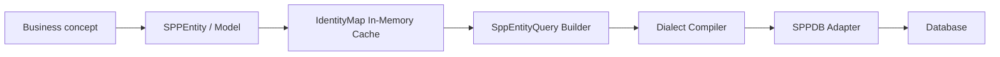

# Book 3 Chapter 5 — Entities, Queries, and Repositories

## 1. Data concepts before SQL

An application deals with concepts such as `Task`, `Student`, or `Purchase`.

A database deals with tables, rows, columns, and SQL.

A framework data layer helps keep those representations connected without requiring every application class to speak raw SQL.

## 2. Entity mental model & Active Record (`SPPEntity`)



In SPP, domain entities extend `\SPPMod\SPPDB\SPPEntity`. An entity unifies:
1. **Active Record Persistence**: Direct persistence via `$entity->save()`, `$entity->delete()`, and `$entity->refresh()`.
2. **Request-Scoped Identity Map**: Single in-memory object instance per physical database row (`IdentityMap::get()`), eliminating redundant queries and state overwrites.
3. **Declarative Schemas & Attributes**: Defining columns via YAML schemas (`etc/apps/<app>/entities/`) or native PHP 8.2+ attributes (`#[Table]`, `#[Column]`, `#[Id]`).
4. **First-Class Relation Objects**: Chainable relation objects (`HasMany`, `BelongsTo`, `HasOne`, `BelongsToMany`, `MorphMany`) that support query builder operations (`->where()`, `->paginate()`, `->count()`) and relationship existence checks (`->whereHas('courses')`).

```php
// Fluent relation queries
$activeEnrollments = $course->enrollments()->where('status', 'active')->get();

// Many-to-Many pivot operations
$course->students()->attach($studentId);
$course->students()->sync([1, 2, 5]);

// IDE autocomplete support
// php spp.php make:entity-types generates typed stubs in _ide_entity_helper.php
```

## 3. Repositories

A repository should represent meaningful application data operations rather than becoming a dumping ground for unrelated business rules.

Good:

```text
findTask(id)
findOpenTasksForUser(user)
```

Less useful:

```text
repositoryContainsEveryBusinessOperationInTheSystem()
```

## 4. Hands-on lab

Build TaskRepository operations and expose them through TaskService.

Then add one query that supports the task list and one query for a detail page.

## 5. Failure lab

Put permission logic into the repository, then move it to the appropriate authorization/service boundary and explain the difference.

## 6. Kernel Hacker

Trace an entity/query operation into SPPDB and identify where query compilation begins.

## Checkpoint

> **Entities represent application concepts; repositories coordinate data access; business rules should remain in the appropriate application/domain boundary.**
