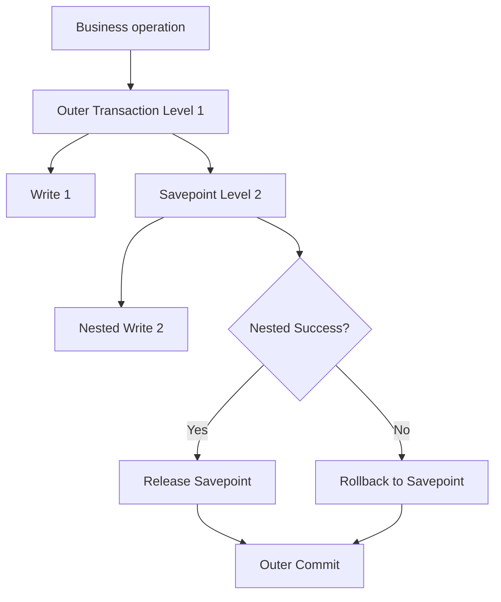

# Book 3 Chapter 6 — Transactions and Error Boundaries

## 1. Why transaction boundaries matter

Some application operations contain several persistence changes that should succeed or fail together.

The application question is:

> Which set of changes must have one consistency boundary?

Do not begin with the database API. Begin with the business operation.

## 2. Conceptual model



## 3. Nested Transactions & SQL Savepoints

In modular enterprise applications, independent domain services often initiate transactions. In standard PDO, opening a nested transaction throws a fatal error.

SPP implements SQL-92 **Savepoints** natively across MySQL, PostgreSQL, and SQLite:

1. **Automatic Nested Savepoints**:
   - The first `beginTransaction()` issues native SQL `BEGIN`.
   - Subsequent nested calls increment `$transactions` and issue `SAVEPOINT transN`.
   - Nested `commit()` issues `RELEASE SAVEPOINT transN`.
   - Nested `rollBack()` issues `ROLLBACK TO SAVEPOINT transN` without killing the parent transaction!

2. **Explicit Named Savepoints**:
   ```php
   $db = new \SPPMod\SPPDB\SPPDB();
   $db->beginTransaction();
   
   $db->createSavepoint('order_placement');
   try {
       $db->exec_query("UPDATE inventory SET stock = stock - 1 WHERE id = ?", [$item]);
       $db->releaseSavepoint('order_placement');
   } catch (\Throwable $e) {
       $db->rollbackToSavepoint('order_placement');
   }
   
   $db->commit();
   ```

3. **Closure-based Retry Engine**:
   `SPPDB::transaction(callable $callback, int $attempts = 1)` automatically re-attempts operations if transient database deadlocks or lock-wait timeouts are encountered.

## 4. Important caution

Do not infer transaction guarantees from the existence of a database wrapper. The actual SPPDB implementation and selected driver determine the available semantics.

## 4. Hands-on lab

Choose a Task Desk operation that modifies more than one persistent record.

Document whether the operation requires a shared transaction and where that boundary should live.

## 5. Failure lab

Inject an error after the first write and observe the actual behavior of the configured database layer.

## Checkpoint

> **A transaction is a consistency boundary chosen for a business operation; the framework and database implementation determine the exact guarantees available.**
