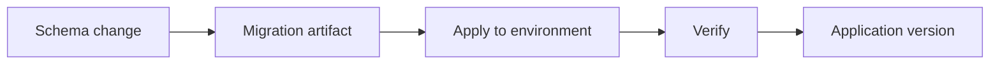
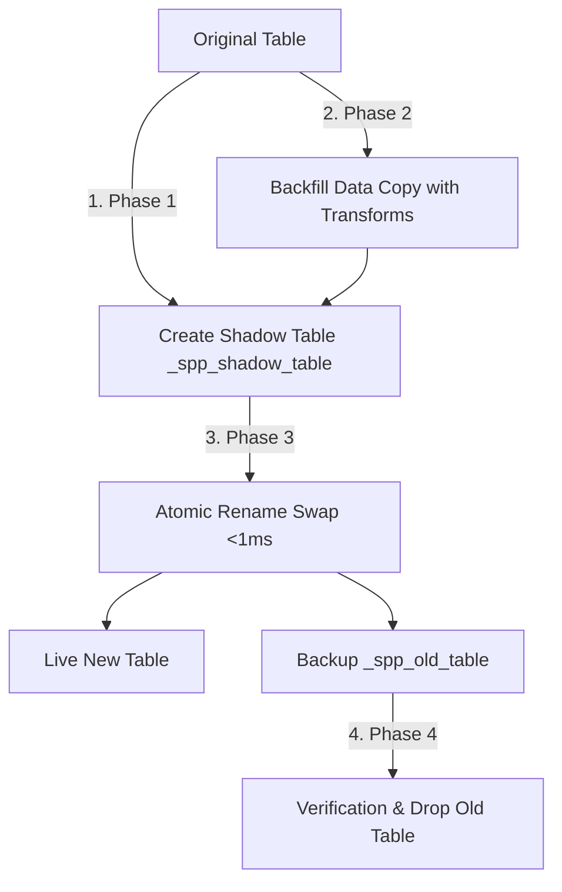

# Book 3 Chapter 7 — Schema Evolution and Migrations

## 1. Why schema changes need discipline

A database schema is part of an application's runtime contract. Changing a table manually on one machine creates drift.

A migration turns a schema change into a repeatable artifact.

## 2. Conceptual lifecycle



## 3. Zero-Downtime Two-Phase DDL (`SafeDDLRunner`)

Applying direct `ALTER TABLE` DDL statements to large tables locks reads and writes, resulting in downtime and request timeouts.

SPP solves this via `\SPPMod\SPPDB\Migration\SafeDDLRunner`, which implements the **shadow-table migration pattern**:



```php
use SPPMod\SPPDB\Migration\SafeDDLRunner;

$runner = new SafeDDLRunner('students');

// 1. Add column with backfilled default without locking live table
$runner->addColumn('grade_level', 'INT NOT NULL DEFAULT 9', 9);

// 2. Drop column safely
$runner->dropColumn('obsolete_field');

// 3. Dry run mode for preflight verification
$runner->dryRun(true)->addColumn('phone', 'VARCHAR(20)');
```

## 4. Migration is not content promotion

A schema migration changes structural data definitions.

The separate SPP transfer/promotion architecture concerns moving application/content state between environments.

They can participate in one deployment process but should not be conceptually collapsed.

## 4. Hands-on lab

Add a field to the Task Desk data model using the current repository migration mechanism. Apply it to a development database and verify the resulting schema.

## 5. Failure lab

Break the migration order or create an invalid change and observe where SPP/database tooling detects the problem.

## Checkpoint

> **Migration is a versioned description of schema evolution; transfer/promotion is a broader environment/content lifecycle.**
