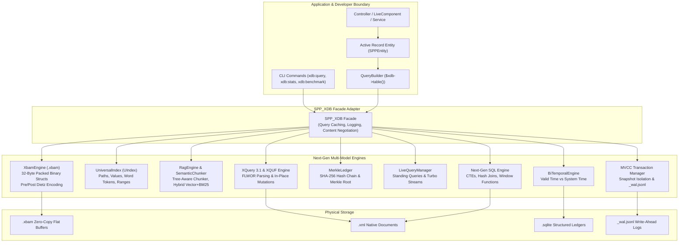

# Book 3 Chapter 8 — Next-Gen XDB Architecture: From XML Serializer to Multi-Model Apex Database

## 1. Why XDB is a Separate Architectural Concept

In the SPP Framework, **SPPDB** provides the common application-facing data abstraction (connections, query builders, entity repositories, and driver adapters), while **SPP XDB** (`SPPMod\SPPXDB`) represents a multi-model database subsystem.

Historically, XDB operated as an XML-serialized relational table engine where tabular rows were stored inside `<database table="..."> <data> <row id="..."> <col>val</col> </row> </data> </database>`. Queries were transpiled from SQL to XPath 1.0 using regular expressions, and the entire document was loaded into memory as a PHP `DOMDocument` on every operation.

The **Next-Gen Apex Architecture** elevates SPP XDB into a high-performance **Native Multi-Model Database** combining:
1. **Zero-Copy Binary Flat Buffer Storage (`.xbam`)** with Dietz Pre/Post/Level interval encoding;
2. **MarkLogic-Style Universal Inverted Indexing (`UniversalIndex`)** with composite bitset/array intersection;
3. **Native AI Retrieval-Augmented Generation (RAG)** with tree-aware semantic XML chunking and LLM tool calling;
4. **SQL:2011 / XTDB Dual-Timeline Bi-Temporal Modeling** (`BiTemporalEngine`);
5. **Cryptographic Merkle DAG Mutation Ledger** with zero-trust tamper resistance (`MerkleLedger`);
6. **Reactive Live Queries & Change Data Capture (CDC)** generating Hotwire Turbo Streams (`<turbo-stream>`) and Server-Sent Events (SSE);
7. **ANSI SQL Dialect Engine** supporting Common Table Expressions (CTEs), $O(N+M)$ Hash Joins, Outer Joins, Correlated `EXISTS` subqueries, `UPSERT`, Transaction Savepoints, SQL/JSON and SQL/XML duality functions, and ANSI Window Functions;
8. **W3C XQuery 3.1 FLWOR & XQuery Update Facility (XQUF)** in-place tree mutations;
9. **ACID Snapshot Isolation** via Multi-Version Concurrency Control (MVCC) and Write-Ahead Logging (`_wal.jsonl`).

---

## 2. Layered Architecture & Subsystem Blueprint



---

## 3. The 4 Apex Pillars

### 3.1 Pillar 1: Zero-Copy Binary Flat Buffer (`.xbam`) & Universal Index (`UIndex`)

#### The Problem with In-Memory DOM Parsing
In standard PHP XML processing, parsing a 50MB XML file into `DOMDocument` allocates hundreds of thousands of PHP objects (`DOMElement`, `DOMAttr`, `DOMText`). This causes:
- $O(N)$ memory bloat (often 8x–10x the raw file size);
- Severe garbage collection pauses;
- CPU cache thrashing during pointer chasing.

#### The `.xbam` Binary Layout
SPPXDB introduces **XBAM** (`.xbam`), a fixed-stride binary flat buffer format. Every node record occupies exactly **32 bytes**, regardless of content length:

```
[64-Byte Header]
  ├── Magic Bytes (8B): "XBAM\x01\x00\x00\x00"
  ├── Node Count (uint32, 4B)
  ├── String Pool Offset & Length (uint32 x 2, 8B)
  ├── Value Pool Offset & Length (uint32 x 2, 8B)
  ├── Creation Timestamp (uint64, 8B)
  └── Reserved Alignment Padding (28B)

[Contiguous Node Records Table (node_count * 32 Bytes)]
  ├── pre (int32, 4B): Pre-order traversal index
  ├── post (int32, 4B): Post-order traversal index
  ├── level (int16, 2B): Depth in tree hierarchy (root = 0)
  ├── type (uint8, 1B): 1=Element, 2=Attribute, 3=Text, 4=Document
  ├── flags (uint8, 1B): Node flags
  ├── tagOffset (uint32, 4B) & tagLen (uint16, 2B): Pointer to String Pool
  ├── valOffset (uint32, 4B) & valLen (uint16, 2B): Pointer to Value Pool
  ├── parentPre (int32, 4B): Pre-order index of direct parent (-1 for root)
  └── Reserved Padding (4B)

[String Pool]: Contiguous UTF-8 tag and attribute names
[Value Pool]: Contiguous UTF-8 attribute values and text node literals
```

#### Dietz Pre/Post Interval Indexing
Using Dietz's interval labeling, any structural relationship between two nodes $A$ and $B$ is answered in $O(1)$ constant time without tree recursion:

$$\text{isDescendant}(A, D) \iff \text{pre}(A) < \text{pre}(D) \land \text{post}(A) > \text{post}(D)$$

$$\text{isChild}(P, C) \iff \text{isDescendant}(P, C) \land \text{level}(C) = \text{level}(P) + 1$$

$$\text{isPreceding}(A, B) \iff \text{post}(A) < \text{pre}(B)$$

```php
use SPPMod\SPPXDB\Storage\XbamEngine;

// Pack an XML document into a binary .xbam flat buffer
$xbam = new XbamEngine('data/catalog.xbam');
$stats = $xbam->packFromXml($catalogXml);

// Seek and read node #42 in O(1) time without loading the rest of the document
$node = $xbam->readNode(42);

// O(k) range scan to find all descendants
$descendants = $xbam->findDescendants(42);
```

#### MarkLogic-Style Universal Inverted Index (`UniversalIndex`)
Rather than creating separate index files for each table column, `UniversalIndex` indexes all document paths, exact values, text word tokens, and numeric ranges into unified posting lists:

```php
$uIndex = $xdb->universalIndex();
$uIndex->indexXml('books', $xmlData);

// 1. Exact path lookup
$titles = $uIndex->lookupPath('books', '/catalog/book/title');

// 2. Full-text word token search
$results = $uIndex->lookupWord('books', 'galaxy');

// 3. Numeric range query
$affordable = $uIndex->lookupRange('books', 'price', 10.0, 25.0);

// 4. Composite intersection query
$matches = $uIndex->queryComposite('books', [
    'value:author' => 'Douglas Adams',
    'value:genre'  => 'scifi',
    'range:price'  => [10.0, 20.0]
]);
```

---

### 3.2 Pillar 2: Native AI RAG Subsystem & Semantic Tree Chunking

#### Tree-Aware Hierarchical Chunking (`SemanticChunker`)
Standard character-based chunkers (e.g., splitting every 500 characters) sever XML tags mid-attribute and lose document context. `SemanticChunker` splits strictly along natural XML domain boundaries (`<section>`, `<course>`, `<article>`, `<row>`) while preserving the full ancestral breadcrumb trail:

```
<university name="Apex Institute">
    <department name="Computer Science">
        <course id="CS101">
            <title>Introduction to Distributed Systems</title>
```
Produces chunks annotated with:
```xml
<!-- Context: university (Apex Institute) > department (Computer Science) > course [#CS101] -->
<title>Introduction to Distributed Systems</title>
```

#### Hybrid Vector + Lexical Search (`RagEngine`)
Combines dense vector cosine similarity with BM25 keyword rankings:

$$\text{CombinedScore} = (w_v \cdot \text{VectorScore}) + ((1 - w_v) \cdot \text{BM25Score})$$

```php
$rag = $xdb->rag();
$rag->indexXml('curriculum', $xmlCurriculum);

// Hybrid search (60% Dense Vector + 40% BM25 Lexical)
$results = $rag->searchHybrid('distributed consensus and Raft', topK: 3, vectorWeight: 0.6, bm25Weight: 0.4);

// Format grounded context block for LLM prompt injection
$contextBlock = $rag->formatPromptContext($results);

// Export OpenAI / Claude / Gemini function-calling JSON schema
$toolSchema = $rag->getToolCallingSchema('search_university_curriculum');
```

---

### 3.3 Pillar 3: Enterprise Bi-Temporal Time Travel & Cryptographic Merkle DAG

#### SQL:2011 / XTDB Dual-Timeline Engine (`BiTemporalEngine`)
Traditional databases only store the current snapshot of a record. SPPXDB models two orthogonal timelines:
1. **Valid Time (Business Time)**: The interval $[ \text{valid\_from}, \text{valid\_to} )$ when the fact was true in reality.
2. **System Time (Transaction Time)**: The interval $[ \text{system\_from}, \text{system\_to} )$ when the database asserted the fact.

```php
$temporal = $xdb->temporal();

// Alice was Sales Rep from Jan 1, 2025 to June 30, 2025
$temporal->recordFact(
    'employees', 
    'emp_alice', 
    ['role' => 'Sales Rep', 'salary' => 60000], 
    '2025-01-01T00:00:00Z', 
    '2025-07-01T00:00:00Z'
);

// Alice promoted to Lead starting July 1, 2025
$temporal->recordFact(
    'employees', 
    'emp_alice', 
    ['role' => 'Engineering Lead', 'salary' => 95000], 
    '2025-07-01T00:00:00Z', 
    BiTemporalEngine::INFINITY
);

// Point-in-time "As-Of" query: "What was Alice's role on March 15, 2025?"
$state = $temporal->queryAsOf('employees', asOfSystemTime: null, asOfValidTime: '2025-03-15T00:00:00Z');
// Returns: ['role' => 'Sales Rep', 'salary' => 60000]
```

#### Cryptographic Merkle DAG Mutation Ledger (`MerkleLedger`)
Every database mutation is appended to an immutable SHA-256 Merkle chain:
- **Genesis Block**: References `0000...0000`.
- **Cryptographic Hash Chain**: Block $i$ references `block_hash` of block $i-1$.
- **Rolling Merkle Root**: Mathematical digest of the entire mutation lineage.
- **Inclusion Proofs**: Mathematically prove a specific transaction was committed without exposing the entire database.
- **Zero-Trust Tamper Detection**: If any block payload on disk is altered, `verifyLedger()` flags the exact block index.

```php
$merkle = $xdb->merkle();

// Append mutation
$merkle->append('INSERT', 'accounts', 'acc_1001', ['balance' => 5000]);

// Audit cryptographic ledger integrity
$audit = $merkle->verifyLedger();
if ($audit['valid']) {
    echo "Ledger verified. Merkle Root: " . $audit['merkle_root'];
}

// Generate cryptographic inclusion proof for block #1
$proof = $merkle->generateProof(1);
$isValid = MerkleLedger::verifyProof($proof['leaf_hash'], $proof['proof'], $audit['merkle_root']);
```

---

### 3.4 Pillar 4: Reactive Live Queries & Hotwire Turbo Streams (CDC)

Whenever an insert, update, or delete occurs, `LiveQueryManager` evaluates active subscriptions and generates real-time Hotwire Turbo Streams (`<turbo-stream>`) and Server-Sent Events (SSE) packets:

```php
$live = $xdb->live();

// Register a standing live subscription
$sub = $xdb->subscribeLive(
    ['status' => 'pending'],     // Filter criteria
    'order_feed',               // Target client DOM ID
    'prepend'                   // Turbo action (replace, append, prepend, update, remove)
);

// Mutation occurs
$xdb->insert(['id' => 501, 'status' => 'pending', 'total' => 129.99]);

// Formats Hotwire Turbo Stream frame
$deltas = $live->getBufferedDeltas('orders');
echo $deltas[0]['turbo_stream'];
// <turbo-stream action="prepend" target="order_feed">
//   <template>{"id":501,"status":"pending","total":129.99}</template>
// </turbo-stream>

// Formats Server-Sent Event (SSE) packet
echo LiveQueryManager::formatSse($deltas[0]);
// event: message
// id: sub_9a8b1c
// data: <turbo-stream action="prepend" target="order_feed">...
```

---

## 4. Next-Gen SQL Dialect Capabilities

The SQL parsing engine (`XDB_Sqlparser`) supports enterprise relational query constructs:

### 4.1 Common Table Expressions (CTEs)
Recursive and non-recursive `WITH cte AS (...) SELECT ...`:
```sql
WITH top_departments AS (
    SELECT dept, AVG(salary) AS avg_sal
    FROM employees
    GROUP BY dept
    HAVING avg_sal > 75000
)
SELECT employees.name, employees.salary, top_departments.avg_sal
FROM employees
INNER JOIN top_departments ON employees.dept = top_departments.dept;
```

### 4.2 $O(N + M)$ Hash Joins
Replaces legacy $O(N \times M)$ nested-loop joins. The smaller table is loaded into an in-memory hash table ($O(M)$), then probed sequentially with rows from the outer table ($O(N)$). Full support for `INNER JOIN`, `LEFT JOIN`, `RIGHT JOIN`, `FULL OUTER JOIN`, and `CROSS JOIN`.

### 4.3 Correlated Subqueries (`WHERE EXISTS`)
```sql
SELECT id, username
FROM users
WHERE EXISTS (
    SELECT 1 FROM orders WHERE orders.user_id = users.id AND orders.status = 'paid'
);
```

### 4.4 Enterprise UPSERT
```sql
-- MySQL-compatible ON DUPLICATE KEY UPDATE with VALUES() reference
INSERT INTO accounts (id, name, balance)
VALUES (1, 'Savings', 2500)
ON DUPLICATE KEY UPDATE balance = VALUES(balance);

-- SQLite-compatible REPLACE & IGNORE
INSERT OR REPLACE INTO stats (id, hits) VALUES (42, 100);
INSERT OR IGNORE INTO stats (id, hits) VALUES (42, 100);
```

### 4.5 Transaction Savepoints
```sql
START TRANSACTION;
INSERT INTO ledger (id, amount) VALUES (1, 100);
SAVEPOINT sp1;
INSERT INTO ledger (id, amount) VALUES (2, 999); -- Erroneous write
ROLLBACK TO SAVEPOINT sp1;                       -- Reverts entry 2 only
INSERT INTO ledger (id, amount) VALUES (2, 200); -- Correct write
COMMIT;
```

### 4.6 SQL/JSON, SQL/XML Duality & ANSI Window Functions
- `JSON_EXTRACT(col, '$.path')`, `JSON_VALUE(col, '$.path')`, `JSON_UNQUOTE(col)`
- `XMLELEMENT('tag', val)`, `XMLQUERY('//xpath', col)`
- `ROW_NUMBER() OVER (PARTITION BY dept ORDER BY salary DESC)`
- `RANK()`, `DENSE_RANK()`, `SUM(salary) OVER (...)`, `LAG(salary, 1, 0)`, `LEAD(...)`

---

## 5. Automated Verification Checklist

All capabilities are verified through Parikshak test suites:

| Test Suite | Purpose | Tests | Status |
|---|---|:---:|:---:|
| `tests/core/test.xdb_apex.php` | Zero-Copy `.xbam`, Universal Index, AI RAG, Bi-Temporal, Merkle Ledger, Turbo Streams | 7 | **100% PASS** |
| `tests/core/test.xdb_sql_nextgen.php` | CTEs, Hash Joins, Outer Joins, Correlated EXISTS, UPSERT, Savepoints, Window Functions | 10 | **100% PASS** |
| `tests/core/test.xdb_nextgen.php` | Dietz Tree Engine, MVCC WAL, XQuery FLWOR, XQUF, TwigStack, JSON/XML Duality | 10 | **100% PASS** |
| **Total** | **Comprehensive XDB Engine Coverage** | **27** | **100% PASS** |

---

## 6. Hands-On Lab: Querying XDB from the CLI

Run queries across the multi-model database using the unified CLI tool:

```bash
# 1. Execute SQL with Window Functions
php spp.php xdb:query "SELECT id, dept, salary, RANK() OVER (PARTITION BY dept ORDER BY salary DESC) as rnk FROM employees"

# 2. Execute W3C XQuery 3.1 (FLWOR)
php spp.php xdb:query "for \$b in //book where \$b/price < 30 order by \$b/price return \$b/title" --type=xquery

# 3. Execute In-Place XQUF Tree Mutation
php spp.php xdb:query "replace value of node //book[@id='b1']/price with 39.99" --type=xquf

# 4. Inspect Storage Metrics & Index Status
php spp.php xdb:stats employees --json
```

---

## Checkpoint

> **SPP XDB is an enterprise-grade Native Multi-Model Database. Application code accesses it transparently via `SPP_XDB` or `SPPEntity`, while the engine delivers zero-copy binary performance, universal indexing, AI hybrid RAG, bi-temporal auditability, and real-time reactive streaming.**
