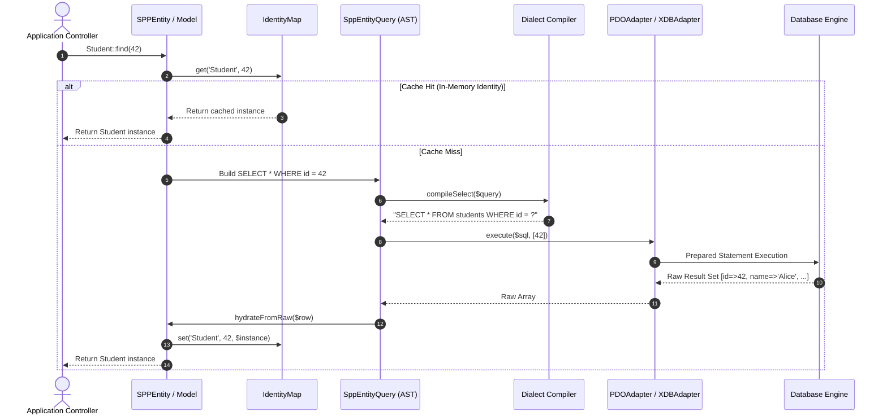
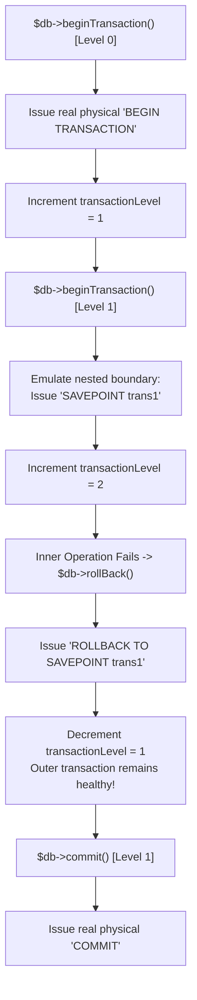

# Book 6 Chapter 8 — SPPDB Driver and Compiler Internals

For kernel developers, system architects, and framework contributors, understanding how SPP routes a persistence call from an active record model to physical disk blocks is critical.

This chapter traces the complete anatomy of an SPPDB operation through every architectural layer.



---

## 1. Architectural Layers & Separation of Concerns

SPPDB strictly segregates concerns into five decoupled components:

```text
┌────────────────────────────────────────────────────────┐
│                   Domain Entity Layer                  │
│   SPPEntity, Attribute Reflection, Relation Proxies    │
├────────────────────────────────────────────────────────┤
│                 Identity Map Subsystem                 │
│      Request-Scoped IdentityMap Singleton Cache        │
├────────────────────────────────────────────────────────┤
│                 Query Abstraction (AST)                │
│    SppEntityQuery, Conditions, Joins, Aggregates       │
├────────────────────────────────────────────────────────┤
│                     Compiler Layer                     │
│ MySQLCompiler, PostgresCompiler, SQLiteCompiler        │
├────────────────────────────────────────────────────────┤
│                Driver & Connection Layer               │
│  PDOAdapter, XDBAdapter, Savepoints, Retry Engine      │
└────────────────────────────────────────────────────────┘
```

---

## 2. Deep Dive: Entity Hydration & Attribute Reflection

When an entity class is first referenced:

```php
#[Table('students')]
class Student extends SPPEntity
{
    #[Id]
    public int $id;

    #[Column('full_name')]
    public string $name;

    #[HasMany(Enrollment::class, 'student_id')]
    public function enrollments(): HasMany
    {
        return $this->hasMany(Enrollment::class, 'student_id');
    }
}
```

The kernel executes the following sequence:

1. **`loadEntityConfig()` Reflection Scanning**:
   - Uses `\ReflectionClass` to inspect class and property attributes.
   - Extracts `#[Table]` for the table name, `#[Id]` for primary key identifiers, and `#[Column]` mappings.
   - Discovers relationship attributes (`#[HasMany]`, `#[BelongsTo]`, `#[HasOne]`, `#[MorphMany]`, `#[BelongsToMany]`).
   - Caches the reflected schema statically per entity class to ensure zero reflection penalty on subsequent calls.

2. **Uninitialized Property Safety**:
   - In PHP 7.4+, uninitialized typed class properties (`public string $name;`) throw fatal errors if accessed before assignment, and are omitted from `get_object_vars()`.
   - SPPDB intercepts property access in `get()`, `set()`, `__get()`, and `__set()` using `property_exists($this, $attr)` and safe `isset()` checks, ensuring clean hydration without uninitialized property exceptions.

3. **Dynamic Relation Invocation & Local Proxy Caching**:
   - When `$student->enrollments` is accessed as a property, `SPPEntity::__get()` checks if an `enrollments()` method exists.
   - If found, it executes the method to obtain the `HasMany` relation instance, resolves the results, and caches them in `$this->relations['enrollments']`.
   - If accessed as a method call `$student->enrollments()`, it returns the live `HasMany` relation object, allowing chained query building (`$student->enrollments()->where('status', 'active')->get()`).

---

## 3. Deep Dive: Identity Map Internals

The Identity Map ensures that within a single request, CLI task, or queue job, multiple queries requesting the same entity identity return the exact same in-memory object instance.

### Hash Key Resolution:
```php
protected static function makeKey(string $entityClass, string|int $id): string
{
    $normalizedClass = ltrim($entityClass, '\\');
    return $normalizedClass . ':' . (string)$id;
}
```

### Save and Delete Coordination:
- **During Insert**: When a new entity is saved via `$entity->save()`, the newly generated auto-increment ID is written to the entity, and `IdentityMap::set()` immediately registers the entity.
- **During Update**: The existing instance in the map is updated in-place.
- **During Delete**: When `$entity->delete()` succeeds, `IdentityMap::forget($class, $id)` purges the key, preventing stale reads.
- **Bulk Batch Processing**: To prevent memory leaks during long-running queue workers or imports processing millions of records, developers invoke `IdentityMap::withoutIdentityMap(fn() => processBatch())` or periodically call `IdentityMap::clear()`.

---

## 4. Deep Dive: Nested Savepoint Emulation

Database drivers generally support transactions, but standard SQL engines do not allow nested `BEGIN TRANSACTION` statements. If a transaction is already active, issuing another `BEGIN TRANSACTION` either causes an error or commits the active transaction.

SPPDB solves this transparently across all database adapters via **Savepoint Emulation**:



### Driver Adapter Code Flow:
```php
public function beginTransaction(): bool
{
    $this->connect();
    if ($this->transactionLevel === 0) {
        $result = $this->connection->beginTransaction();
        $this->transactionLevel = 1;
        return $result;
    }

    $savepointName = 'trans' . $this->transactionLevel;
    $this->createSavepoint($savepointName);
    $this->transactionLevel++;
    return true;
}

public function commit(): bool
{
    if ($this->transactionLevel <= 0) {
        return false;
    }

    if ($this->transactionLevel === 1) {
        $result = $this->connection->commit();
        $this->transactionLevel = 0;
        return $result;
    }

    $this->transactionLevel--;
    $savepointName = 'trans' . $this->transactionLevel;
    return $this->releaseSavepoint($savepointName);
}
```

Every savepoint name is validated using strict regex (`^[a-zA-Z0-9_]+$`) to guarantee zero possibility of SQL injection in DDL commands.

---

## 5. Kernel Hacker Lab: Tracing Dialect AST Compilation

In this lab, you will step inside the compiler dispatch mechanics.

Create a scratch test file:

```php
use SPPMod\SPPDB\SppEntityQuery;
use SPPMod\SPPDB\Compilers\PostgresCompiler;

$query = new SppEntityQuery('enrollments');
$query->condition('grade', '=', 'A')
      ->condition('student_id', '=', 'RAW:students.id');

$compiler = new PostgresCompiler();
$sql = $compiler->compileSelect($query);

echo "Compiled Subquery SQL:\n" . $sql . "\n";
```

Notice how `RAW:` prefixes are handled without parameter escaping, enabling correlated subqueries to compile inline.

---

## Checkpoint

> **By understanding the strict separation between Entity Reflection, Identity Mapping, AST Query Representation, Dialect Compilers, and Driver Savepoints, kernel developers can safely extend SPPDB to support new database backends, custom attributes, and specialized enterprise storage engines.**
